# 3장. Grover와 BBHT algorithm

> [← 2장 개발 환경과 toolchain](02_development_environment_and_toolchain.md) · [index](index.md) · [4장 software reference model과 test vector →](04_software_reference_model_and_test_vectors.md)

---

이 장에서는 accelerator가 구현하는 Grover 및 BBHT algorithm을 설명합니다. 구체적인 hardware
implementation은 [9장](09_iteration_datapath_and_number_of_pes.md)과 [10장](10_measurement_unit_and_microarchitecture.md)에서 다룹니다.
quantum computing 기초부터 살펴보려면 학습용 해설서
[`documents/study_references/`](../study_references/index.md)의 index를
참고할 수 있습니다.

---

## 3.1 state vector emulation

이 system은 실제 quantum computer가 아니라 state vector emulator입니다. 14 qubits가 만드는
16,384 states의 amplitude를 모두 memory에 저장하고 고전 산술로 갱신합니다. 각 amplitude는
23-bit fixed-point 값입니다([6장](06_data_representation_and_memory_map.md)).

따라서 고전적인 선형 search보다 빠른 장치는 아닙니다. data 16,384개를 한 번 확인하는
대신 같은 수의 amplitude를 여러 차례 갱신해야 합니다. 이 implementation의 목적은 속도 우위가 아니라,
quantum algorithm의 실행 과정을 FPGA에서 cycle 단위로 관찰하고 검증하는 데 있습니다.

---

## 3.2 Grover iteration의 구성

uniform superposition에서 시작합니다. 16,384 amplitudes가 전부 같은 값(raw 32768)입니다.

iteration 한 번은 두 단계입니다.

① oracle: sign 뒤집기. dataset의 각 칸에 predicate를 걸어, predicate를 만족하는 칸의 amplitude
sign만 뒤집습니다.

```
for i in 0..16383:
    if predicate(data[i], A, B):
        amp[i] = -amp[i]
```

oracle에는 solution index가 주어지지 않습니다.
oracle이 받는 것은 data 값과 threshold뿐입니다. "solution이 8685번이니 8685번 amplitude를 뒤집어라"
가 아니라 "값이 12345인 칸을 뒤집어라" 이고, 그 결과로 8685번이 뒤집히는 것입니다.

② diffusion operator: inversion about the mean. 전체 amplitude의 mean을 구하고, 각 amplitude를 mean을 기준으로
뒤집습니다.

```
mean = sum(amp) / number of states
for i in 0..16383:
    amp[i] = 2*mean - amp[i]
```

oracle이 solution amplitude를 음수로 만들어 두었으므로 mean이 살짝 내려가고, inversion about the mean이
solution amplitude를 크게 키웁니다. 나머지는 조금씩 줄어듭니다. 이것을 반복하면 solution amplitude가
자랍니다.

number of iterations에는 최적값이 있습니다. 너무 적게 돌리면 solution amplitude가 덜 자라고, 너무 많이
돌리면 지나쳐서 다시 줄어듭니다. 최적 number of iterations는 대략 `(π/4)·sqrt(number of states / number of solutions)`
입니다. 문제는 solution이 몇 개인지 모른다는 것입니다.

---

## 3.3 solution이 몇 개인지 모를 때: BBHT

BBHT(Boyer–Brassard–Høyer–Tapp)는 solution이 몇 개인지 모른 채로 search하는 방법입니다. 요지는 "number of
iterations를 무작위로 뽑아 던져 보고, 틀리면 sampling range를 키운다" 입니다.

이렇게 한 번 뽑아 돌려 보는 것을 shot이라고 부릅니다.

| 단계 | 무엇 |
|:-:|---|
| 1 | number of iterations를 0 이상 현재 sampling range 미만에서 균등하게 뽑음 |
| 2 | uniform superposition에서 Grover iteration을 뽑은 횟수만큼 |
| 3 | Born-rule sampling으로 index 하나를 뽑음 |
| 4 | 그 index의 data 값을 predicate로 다시 검사 (solution check) |
| 5 | 맞으면 성공 종료. 틀리면 sampling range를 키워 1로 되돌아감 |

4단계에서는 measurement 결과가 predicate를 만족하는지 고전 비교로 즉시 확인합니다. predicate를 만족하지
않으면 다음 shot이 uniform superposition에서 다시 시작되므로 지금까지 계산한 iteration state는 모두
버려집니다. 이 재시작 비용이 전체 연산에서 큰 비중을 차지하며, 확정 설계의 최적화 네 개
가운데 세 개가 이 부분을 줄입니다
([11장](11_checkpoint_and_policy_engine.md)).

### sampling range가 커지는 방법

software reference model의 갱신식 `sampling range ← min((6/5)·sampling range, sqrt(number of states))`을
14 qubits 기준으로 미리 풀어 28 entries ROM에 저장했습니다. 6/5가 growth factor입니다.

```
1, 2, 2, 2, 3, 3, 3, 4, 5, 6, 7, 8, 9, 11, 13, 16, 19, 23, 27, 32, 39, 47, 56, 67, 80, 96, 115, 128
```

마지막 entry(sampling range 128 = sqrt(16384))에서 ROM index(`round_idx`)가 고정됩니다. 즉 그 뒤로는 계속
`[0, 128)`에서 뽑습니다.

### 종료 조건

두 가지 상한이 있습니다.

| 상한 | 값 | 언제 |
|---|---|---|
| BBHT budget (`REQUESTED_ITERATIONS`) | requested iterations 누적 576 (= 4.5·sqrt(16384)) | 실패한 shot 뒤에 누적 + 1이 576 이상이면 |
| shot cap | runtime 입력, 기본 100 | 돌린 shot의 개수가 shot cap에 닿으면 |

`REQUESTED_ITERATIONS`는 requested iterations 누적입니다: 실제로 hardware가 돌린 executed iterations가 아니라, 뽑힌
number of iterations를 그대로 더한 값입니다. checkpoint가 있으면 executed iterations는 이보다 훨씬 적습니다.
두 값의 차이는 [15장](15_operation_sequence_and_cycle_breakdown.md)에서 자세히 설명합니다.

---

## 3.4 Born-rule sampling 방식

measurement는 amplitude square에 비례하는 probability로 index 하나를 뽑습니다.

```
probability(i) = amp[i]^2 / sum(amp[k]^2)
```

amplitude가 가장 큰 칸을 그냥 고르는 방식은 쓰지 않았습니다. 그렇게 하면 뽑은 number of iterations가 최적값이
아닐 때도 항상 같은 답이 나와서, "틀리면 다시 뽑는다" 는 BBHT의 전제 자체가 무너집니다.
실패 probability의 분포가 algorithm의 일부입니다.

implementation은 integer prefix sum 방식입니다. 512 rows 각각에서 32 lanes amplitude의 square를 더해 row weight를 만들고
그 prefix sum을 쌓은 뒤, Measurement PRNG 출력을 total weight로 맞춰 만든 random number가 어느 row에 떨어지는지 찾고
그 row 안에서 lane 하나를 고릅니다. truncation도 round-half-to-even도 normalization도 없어서 probability가 이론값에서 벗어나지 않습니다. 자세한 것은
[10장](10_measurement_unit_and_microarchitecture.md).

random number stream은 두 개이고 서로 독립입니다.

| stream | 쓰임 | implementation |
|---|---|---|
| Iteration-Count LFSR | number of iterations 선택 | 32-bit LFSR, 뽑을 때마다 7-step jump |
| Measurement PRNG | Born-rule sampling의 random number | xorshift64 계열 adapter |

두 seed는 CSR로 따로 줍니다. 같은 seed 쌍이면 BBHT trajectory가 완전히 재현되고, 이것이 software
reference model과 bit-exact로 대조할 수 있는 근거입니다([4장](04_software_reference_model_and_test_vectors.md)).

---

## 3.5 enumeration: solution을 전부 찾기

predicate를 만족하는 칸이 여러 개일 때 전부 찾는 mode입니다.



결과 하나를 찾을 때마다 oracle의 solution 집합이 바뀝니다. 따라서 다음 enumeration round는 새로운
search 문제이고, 이전 enumeration round의 amplitude checkpoint를 이어 쓰면 안 됩니다. checkpoint
재사용은 solution 집합이 변하지 않은 같은 enumeration round 안에서 실패한 shot 사이에만 허용됩니다.

enumeration round 규칙은 이렇습니다.

| 규칙 | 값 |
|---|---|
| 초기 sampling range | 1 |
| sampling range 증가 | single search와 같은 28 entries ROM (3.3절) |
| number of iterations 선택 | 0 이상 sampling range 미만의 균등 integer, rejection sampling |
| measurement | 독립 Measurement PRNG stream의 integer prefix sum Born-rule sampling |
| 상한 | sampling range 최대 128, BBHT budget 576, 기본 shot cap 100 |
| 새 solution 발견 후 | 그 solution을 제외하고, checkpoint 무효화, sampling range 1에서 재시작 |

### 발견한 것을 빼는 두 방식

| 방식 | 제외 방법 | dataset 전송 | 채택 |
|---|---|---|---|
| `SOFTWARE_RELOAD` | 발견 원소를 predicate에 걸리지 않는 값으로 바꿈 | 전체 재전송 또는 부분 갱신 경로 필요 | 아니오. regression의 대조군 |
| `PROJECTED_MASK_MEM` | oracle을 `predicate(i) && !found_mask[i]`로 계산 | 변경 없음 | 예: 실물이 이 방식 |

같은 dataset과 같은 random number stream이면 두 방식의 발견 index가 같아야 합니다. 차이는 search
결과가 아니라 제어 비용과 data 이동 비용입니다. 두 방식을 reference model로 나란히 돌려 모든
쌍이 같다는 것을 확인한 뒤 mask 방식을 골랐습니다([실험 04](../reports/04_enumeration_method_comparison.md)).

그 결과 enumeration에 필요한 것이 전부 Accelerator Core 안에 들어갔습니다.

| 통합 전의 미결 | 결정 |
|---|---|
| `found_mask` · enumeration FSM · 결과 queue를 어디에 둘지 | 셋 다 Accelerator Core 안. Result FIFO 256 entries |
| 최대 결과 수 | Result FIFO 256 entries가 상한. 넘으면 full stall 이므로 실행 중에도 계속 뽑음 |
| mask set/clear와 결과 읽기용 CSR | Found Mask는 Accelerator Core가 스스로 관리. 바깥은 `FIFO_DATA` 읽기(= pop)와 `ENUM_CFG` 뿐 |
| dataset 한 data word 갱신 경로 | 필요 없어짐. mask 방식은 dataset을 건드리지 않음 |
| Accelerator Core 호출 사이 random number seed 전달 | `SEED_J` · `SEED_MEAS` 두 CSR. accepted start에서 reload |

Manual mode(`auto_shot = 0`)에서는 firmware가 shot마다 독립적이고 재현 가능한 `SEED_MEAS` 를 만들어
넣습니다. Accelerator Core 안의 rejection sampling이 random number를 몇 번 소비했는지 바깥에서 알 수 없으므로,
Measurement PRNG state를 shot 사이에 이어 받는다고 가정하지 않습니다.

### 언제 멈추는가

남은 solution이 없을 때가 문제입니다. BBHT는 solution이 몇 개인지 모르므로 solution이 하나도 없다는 것을
스스로 증명하지 못합니다. policy가 둘 있습니다.

| policy | 동작 | 용도 |
|---|---|---|
| `GROUND_TRUTH` | 비어 있는 마지막 enumeration round를 실행하기 전에 종료 | regression verification과 expected result 생성 |
| `BBHT_LIMIT` | solution 없는 마지막 enumeration round를 상한까지 실행 | 실제 firmware 종료 비용 분석 |

`GROUND_TRUTH`는 verification용 solution 정보입니다. 실제 hardware·firmware에서는 사전 scan,
미리 알려진 number of solutions, 또는 명시적 상한 policy 가운데 하나가 필요합니다. board의 `ENUM` 명령은
shot cap · BBHT budget에 닿을 때까지 돌리고, 연속 실패 한계(`fail_repeat_limit`, 기본 3)에 닿으면
끝냅니다.

---

## 3.6 채택하지 않은 방식

| 무엇 | 왜 |
|---|---|
| amplitude maximum 선택 measurement | Born rule을 깨뜨려 BBHT 통계가 무너집니다 |
| oracle에 solution index 주입 | oracle은 data와 threshold만 봅니다 |
| BBHT scheduler에 실제 number of solutions 전달 | solution이 몇 개인지 모르는 것이 문제 설정 자체입니다 |
| enumeration round를 넘는 checkpoint 재사용 | solution 집합이 바뀌면 다른 search 문제입니다 |

reference model은 verification을 위해 실제 solution mask를 계산하지만, 그 값을 search 쪽으로 넘기지
않습니다.
