# 5장. hardware architecture 개요

> [← 4장 software reference model과 test vector](04_software_reference_model_and_test_vectors.md) · [index](index.md) · [6장 data 표현과 memory map →](06_data_representation_and_memory_map.md)

---

## 5.1 한 장으로 보는 system



```
 ┌──────────────────────────────── host ──────────────────────────────┐
 │  serial terminal · bbht_cli.py   ASCII line 명령 / 결과            │
 └───────────────────────────────┬────────────────────────────────────┘
                                 │ USB-UART (FT2232) 115200 8N1
                                 │ printf_tx = D10 / printf_rx = A9
 ════════════════════════════════╪══════════════════════════ SoC 경계 ═
                                 │
 ┌───────────── gclk_noc / gclk_system clock domain (50 MHz) ──────────┐
 │                               │                                     │
 │   ┌────────────────┐    ┌─────▼──────┐    ┌──────────────────────┐  │
 │   │ i_main_core    │    │   UART0    │    │ i_system_sram 128KiB │  │
 │   │ rvc_orca RV32  │◄──►│  16550     │    │ 0xE0000000~0xE001FFFF│  │
 │   │                │    └────────────┘    └──────────┬───────────┘  │
 │   │ app/bbht_console                                 │              │
 │   │ user/api/bbht_grover_driver.c                    │              │
 │   └───┬────────────────────────────────────────┬─────┘              │
 │       │ APB (sp*)                              │ AHB (rh*)          │
 │  ┌────▼─────────────────┐              ┌───────▼──────────────┐     │
 │  │ sni_apb_asynch       │              │ mni_ahbm_asynch      │     │
 │  │ RVX 생성 CDC         │              │ RVX 생성 CDC         │     │
 │  └────┬─────────────────┘              └───────┬──────────────┘     │
 └───────┼────────────────────────────────────────┼────────────────────┘
         │ rp* (APB slave)                        │ sh* (AHB master)
 ┌───────┼────────────────────────────────────────┼────────────────────┐
 │       │      gclk_accel clock domain           │                    │
 │       │      (100 MHz, PLL0)                   │                    │
 │  ╔════▼════════════════════════════════════════▼══════════════════╗ │
 │  ║              bbht_rvx_wrapper                                  ║ │
 │  ║                                                                ║ │
 │  ║  ┌──────────────────────┐        ┌───────────────────────────┐ ║ │
 │  ║  │ bbht_grover_mmio     │        │ bbht_ahb_loader           │ ║ │
 │  ║  │ CSR 0x000~0x094      │ cfg_*  │ 32b SINGLE read           │ ║ │
 │  ║  │ W1P pulse            ├───────►│ single outstanding        │ ║ │
 │  ║  │ done_sticky latch    │ dma_   │ 정렬/범위/개수/busy 검사  │ ║ │
 │  ║  │ FIFO read-to-pop     │◄status─┤ word[k]→data[2k],[2k+1]   │ ║ │
 │  ║  └──┬────────────────┬──┘        └──────────┬────────────────┘ ║ │
 │  ║     │ cfg_* / cmd_*  │ st_* / res_*         │ load_start       ║ │
 │  ║     │                │                      │ data_wr_*        ║ │
 │  ║     │  ┌─────────────┴──────────────────────┴───────────────┐  ║ │
 │  ║     └─►│          bbht_grover_core → bbht_grover_main_ip    │  ║ │
 │  ║        │                                                    │  ║ │
 │  ║        │  BBHT shot loop · checkpoint policy                │  ║ │
 │  ║        │  (a Checkpoint-Capacity of 3, 3-shot Lookahead)    │  ║ │
 │  ║        │  oracle(LT/GT/EQ/RANGE)                            │  ║ │
 │  ║        │  Born-rule sampling · solution check               │  ║ │
 │  ║        │  amp/data mem · Result FIFO 14b x 256              │  ║ │
 │  ║        └────────────────────────────────────────────────────┘  ║ │
 │  ╚════════════════════════════════════════════════════════════════╝ │
 └─────────────────────────────────────────────────────────────────────┘
```

system은 네 layer입니다.

1. host: [`software/host_fpga_develop/bbht_cli.py`](../../software/host_fpga_develop/bbht_cli.py) 또는 serial terminal.
   ASCII 한 줄을 보내고 한 줄씩 받습니다([14장](14_host_interface_and_uart_protocol.md)).
2. RVX SoC (50 MHz): ORCA RV32 core가 명령을 parse하고
   [`bbht_grover_driver.c`](../../hardware_bram/firmware/bbht_grover_driver.c)로 CSR을
   씁니다. dataset은 core가 system SRAM에 두고, accelerator가 AHB master로 직접 끌어갑니다.
3. Bus Interface (100 MHz): APB slave `bbht_grover_mmio`, AHB master `bbht_ahb_loader`, 계약
   이름과 실물 module 이름을 잇는 adapter([7장](07_bus_interface.md)).
4. Accelerator Core (100 MHz): amplitude와 dataset을 BRAM에 들고 Grover iteration · Born-rule sampling · solution check ·
   BBHT 제어를 전부 합니다([8장](08_accelerator_core_top_and_bbht_control.md)~[11장](11_checkpoint_and_policy_engine.md)).

single search와 enumeration, Result FIFO, checkpoint policy가 전부 Accelerator Core 안에 있습니다. 바깥에 둔 것은
APB CSR · AHB load · UART 뿐입니다.

---

## 5.2 module layer와 file 지도

```
RVX SoC (bbht_grover_final)
├── ORCA RV32 core + micro NoC          RVX 생성 (50 MHz)
├── APB NI (sni_apb_asynch)             RVX 생성 · CDC 담당
├── AHB NI (mni_ahbm_asynch)            RVX 생성 · CDC 담당
├── system SRAM 128 KiB                 RVX 생성
└── user region                         project implementation (100 MHz)
    └── bbht_rvx_wrapper                최상위. 계약 이름 bbht_grover_core 에 연결
        ├── bbht_grover_mmio            APB slave · CSR 38개
        ├── bbht_ahb_loader             AHB master · dataset DMA
        └── bbht_grover_core_adapter    계약 이름과 reset 차이를 변환
            └── bbht_grover_main_ip     Accelerator Core (8장~11장)
```

공용 RTL source 18개는 [`hardware_bram/src/`](../../hardware_bram/src/)에 있고, configuration마다 다른
adapter 하나는 configuration directory에 있습니다(아래 "hardware directory tree와 BRAM configuration"). 아래 표의 adapter와 platform
정의는 final configuration(`final`)의 것입니다. Bus Interface는 SJS, Accelerator Core는 PJK가 맡았습니다.

| file | 담당 | 역할 |
|---|:-:|---|
| [`bbht_rvx_wrapper.v`](../../hardware_bram/src/bbht_rvx_wrapper.v) | SJS | RVX user region 최상위. adapter를 거쳐 Accelerator Core에 연결 |
| [`bbht_grover_mmio.v`](../../hardware_bram/src/bbht_grover_mmio.v) | SJS | APB CSR. 생성 header `bbht_grover_csr.vh` 를 include |
| [`bbht_ahb_loader.v`](../../hardware_bram/src/bbht_ahb_loader.v) | SJS | AHB master DMA |
| [`bbht_grover_core_adapter.v`](../../hardware_bram/configurations/final/src/bbht_grover_core_adapter.v) | SJS | 계약 이름·reset(`rstnn` ↔ `rstn`) 차이 흡수. Checkpoint-Capacity · Lookahead-Shots · number of PEs · Measurement Microarchitecture 기본값이 여기 |
| [`bbht_bram_top.v`](../../hardware_bram/src/bbht_bram_top.v) | SJS | 두 번째 최상위. adapter 없이 Accelerator Core에 직접 연결 |
| [`bbht_grover_user_region.vh`](../../hardware_bram/src/bbht_grover_user_region.vh) | SJS | RVX에 넘기는 wiring. clock assign 두 줄이 여기 |
| Accelerator Core 10개 + `grover_param.vh` | PJK | [8장 8.1절](08_accelerator_core_top_and_bbht_control.md#81-module-지도) |
| `grover_policy_ooc_top.v` · `grover_policy_impl_wrapper.v` | PJK | Policy Engine OOC synthesis 전용. 전체 synthesis source에서 제외 |
| `spec/generated/bbht_grover_csr.vh` · `bbht_grover_regs.h` | 생성물 | [13장](13_csr_registers_and_execution_modes.md) |
| [`firmware/bbht_grover_driver.{c,h}`](../../hardware_bram/firmware/) · `bbht_console/` | SJS | firmware driver와 UART 명령 shell |
| [`rvx/bbht_grover_final.xml`](../../hardware_bram/configurations/final/rvx/bbht_grover_final.xml) | SJS | platform 정의. `clk_accel` 100 MHz, SRAM 128 KiB |

### 두 최상위의 용도

`bbht_rvx_wrapper` 와 `bbht_bram_top` 은 port가 같고 둘 중 하나만 synthesis합니다.

| 최상위 | 쓰임 |
|---|---|
| `bbht_rvx_wrapper` | RVX platform에 들어가는 것. adapter를 거칩니다 |
| `bbht_bram_top` | 저장소 regression용. mmio · loader를 Accelerator Core에 직접 연결합니다 (board에 구운 Board-Verified Build wrapper도 이렇게 물었습니다) |

`bbht_bram_top` 은 DRAM Variant의 [`bbht_dram_top.v`](../../hardware_dram/src/bbht_dram_top.v)와
짝입니다. 같은 testbench 틀로 두 variant를 비교하려는 구조입니다.

### hardware directory tree와 BRAM configuration

shot 실패 뒤 amplitude를 어떻게 재활용하느냐로 variant가 둘이고, hardware directory tree도 둘입니다. 이 문서의
본문(5~19장)은 BRAM Variant의 final configuration(`final`)을 기준으로 하고, No-Checkpoint
Baseline과 DRAM Variant는 따로 장을 두었습니다.

| directory tree | 무엇 | 장 |
|---|---|:-:|
| [`hardware_bram/`](../../hardware_bram/) | checkpoint · PE 조합별 configuration 열 개. 같은 RTL을 parameter만 달리 compile. 여기에 RTL을 따로 가진 200 MHz revision 하나 | 5~21 |
| [`hardware_dram/`](../../hardware_dram/) | 모든 iteration의 amplitude를 DDR3에 저장. RVX platform `bbht_grover_dram` | [21](21_dram_variant.md) |

Accelerator Core의 Checkpoint-Capacity · Lookahead-Shots · number of PEs · Measurement Microarchitecture는 전부 compile parameter라([8장 8.2절](08_accelerator_core_top_and_bbht_control.md#82-compile-parameter-8개)),
BRAM Variant의 configuration 사이에 다른 것은 그 기본값을 정하는 adapter 하나와 그 configuration의 산출물뿐입니다.
그래서 `hardware_bram/` 은 공용 source를 바로 아래에 한 벌만 두고, configuration마다 다른 것을
`configurations/<configuration>/` 에 둡니다. 2026-10-06에 옛 `hardware_bram_checkpoint/` ·
`no_checkpoint_baseline/` 을 이렇게 합쳤습니다.

```
hardware_bram/
  src/ testbench/ sim/ synth/ firmware/   모든 configuration 공용. sim 은 CONFIGURATION=<configuration> 로 adapter를 고름
  rvx/                  공용 설치기 install_model.sh · user region template
  results/              configuration 사이 비교 근거 (Six-Stage Ablation · 5 configurations의 resource · Checkpoint-Capacity · Lookahead-Shots 단독)
  configurations/<configuration>/
    src/                bbht_grover_core_adapter.v 하나 (Checkpoint-Capacity · Lookahead-Shots · number of PEs · Measurement Microarchitecture 기본값)
    rvx/                platform 정의 <platform>.xml · install_to_platform.sh (공용 설치기를 부름)
    results/ vivado/ bitstream/   그 configuration의 simulation 근거 · implementation report와 board benchmark · 굽기 묶음
    sim/                그 configuration에만 있는 regression (no_checkpoint_baseline · final_200mhz)
```

configuration은 지금까지 실험한 조합 열 개와 200 MHz revision 하나입니다. 표의 순서는 Six-Stage Ablation 순서에 Checkpoint-Capacity · Lookahead-Shots 단독
실험과 No-Checkpoint Baseline을 끼우고, 마지막에 200 MHz revision을 둔 것입니다.

| configuration | checkpoint | Checkpoint-Capacity | Lookahead-Shots | number of PEs | Measurement Microarchitecture | RVX platform | 어디서 나왔나 | 산출물 |
|---|:-:|:-:|:-:|:-:|:-:|---|---|---|
| `capacity0_pes1_singlerow_linear` | 0 | - | - | 1 | Single-Row Build · Linear Select | `bbht_grover_capacity0_pes1_singlerow_linear` | Stage 1과 같은 구성 | 100T implementation (2026-10-08, 굽지 않음) · bench500 (2026-10-08) |
| `capacity4_lookahead8_pes1_singlerow_linear` | 1 | 4 | 8 | 1 | Single-Row Build · Linear Select | `bbht_grover_capacity4_lookahead8_pes1_singlerow_linear` | 첫 checkpoint board benchmark | 옛 RTL board benchmark (2026-09-01) |
| `capacity4_lookahead4_pes1_singlerow_linear` | 1 | 4 | 4 | 1 | Single-Row Build · Linear Select | `bbht_grover_capacity4_lookahead4_pes1_singlerow_linear` | Stage 2, Checkpoint-Capacity · Lookahead-Shots 단독 실험의 대조군 | 옛 RTL board benchmark (2026-09-04). 현행 RTL로 100T implementation · 200T(100T 예산) bitstream · bench500 (2026-10-07) · 200T board 500 runs · 네 predicate (2026-10-08) |
| `capacity3_lookahead4_pes1_singlerow_linear` | 1 | 3 | 4 | 1 | Single-Row Build · Linear Select | `bbht_grover_capacity3_lookahead4_pes1_singlerow_linear` | Checkpoint-Capacity · Lookahead-Shots 단독 실험 | 없음 |
| `capacity3_lookahead3_pes1_singlerow_linear` | 1 | 3 | 3 | 1 | Single-Row Build · Linear Select | `bbht_grover_capacity3_lookahead3_pes1_singlerow_linear` | Checkpoint-Capacity · Lookahead-Shots 단독 실험 | 100T implementation · 200T(100T 예산) bitstream · bench500 (2026-10-07) · 200T board 500 runs · 네 predicate (2026-10-08) |
| `capacity4_lookahead4_pes4_singlerow_linear` | 1 | 4 | 4 | 4 | Single-Row Build · Linear Select | `bbht_grover_capacity4_lookahead4_pes4_singlerow_linear` | Stage 3 | 100T implementation · 200T(100T 예산) bitstream · bench500 (2026-10-07) · 200T board 500 runs · 네 predicate (2026-10-08) |
| `capacity3_lookahead3_pes4_singlerow_linear` | 1 | 3 | 3 | 4 | Single-Row Build · Linear Select | `bbht_grover_capacity3_lookahead3_pes4_singlerow_linear` | Stage 4. No-Checkpoint Baseline cycle 대조의 기준 | 100T implementation · 200T(100T 예산) bitstream · bench500 (2026-10-07) · 200T board 500 runs · 네 predicate (2026-10-08) |
| `capacity3_lookahead3_pes4_dualrow_linear` | 1 | 3 | 3 | 4 | Dual-Row Build · Linear Select | `bbht_grover_capacity3_lookahead3_pes4_dualrow_linear` | Stage 5 | 100T implementation · 200T(100T 예산) bitstream · bench500 (2026-10-07) · 200T board 500 runs · 네 predicate (2026-10-08) |
| `final` | 1 | 3 | 3 | 4 | Dual-Row Build · Two-Level Select | `bbht_grover_final` | **final configuration**. Six-Stage Ablation의 여섯째 단계 | Board-Verified Build · bitstream · simulation 근거 전부. 200T(100T 예산) bitstream · bench500 (2026-10-07) · 200T board 500 runs · 네 predicate (2026-10-08) |
| `no_checkpoint_baseline` | 0 | - | - | 4 | Single-Row Build · Linear Select | `bbht_grover_no_checkpoint_baseline` | No-Checkpoint Baseline ([20장](20_no_checkpoint_baseline.md)) | bitstream · board benchmark (2026-10-04) |
| `final_200mhz` | 1 | 3 | 3 | 4 | Dual-Row Build · Two-Level Select | `bbht_grover_final_200mhz` | final configuration을 `clk_accel` 200 MHz로. **RTL이 다름** (아래, [실험 20](../reports/20_200mhz_implementation.md)) | RTL Predicate500 · 200T(100T 예산) bitstream · 200T board 네 predicate (2026-10-12) · 200T board 500 runs (2026-10-13) |

`CHECKPOINT_MANUAL_ENABLE=0` · `SPECULATIVE_PLANNING_ENABLE=1` 은 모든 configuration이 같습니다. checkpoint를 끈 두 configuration은
`burst_enable` 을 Accelerator Core에 0으로 넘깁니다(이유는 [20장 20.2절](20_no_checkpoint_baseline.md#202-source를-어떻게-나눴나)).

읽을 때 지킬 것이 셋 있습니다.

- Six-Stage Ablation과 Checkpoint-Capacity · Lookahead-Shots 단독 실험의 수치는 tag `board-verified-build-2026-09-07` 안의 standalone top으로
  잰 것입니다. configuration adapter는 그 top 들이 넘기던 parameter를 옮긴 것이고, 그 수치를 configuration directory에서
  다시 재지는 않았습니다. Six-Stage Ablation의 Stage 1은 `capacity4_lookahead4_pes1_singlerow_linear` build를 runtime Restart mode로 잰 값이라,
  checkpoint hardware를 뺀 1 PE build는 `capacity0_pes1_singlerow_linear` configuration이 처음입니다.
- `capacity4_lookahead8_pes1_singlerow_linear` · `capacity4_lookahead4_pes1_singlerow_linear` 의 board bitstream은 단일 PE 시절의 옛 RTL로 만든 것이라, 현행 Accelerator Core
  에 그 configuration adapter를 문 것과 byte가 같지 않습니다. 두 묶음은 250쌍(seed 50)이라 500 workloads
  campaign과 총합을 맞댈 수도 없습니다.
- 열 configuration 모두 port 계약 · lint · 실물 core 통신 계약 T1~T9를 통과합니다(2026-10-06,
  [16장](16_verification_framework.md)). Six-Stage Ablation 여섯 configuration은 2026-10-07에 현행 RTL로 Arty 100T implementation(굽지 않음)과 원격 board
  AX7A200B 용 100T 예산 bitstream을 냈고, board app과 같은 순서의 RTL bench500을 돌렸습니다
  ([implementation 비교](../../hardware_bram/results/2026-10-07_impl_6models/evidence.md) · [bench500](../../hardware_bram/results/2026-10-07_bench500_6models/evidence.md)).
  2026-10-08에 원격 200T board에서 여섯 configuration을 쟀습니다([실험 18](../reports/18_six_stage_ablation_comparison.md)).
  Arty 100T 로 구운 것은 여전히 `final` 과 `no_checkpoint_baseline` 둘입니다.

새 configuration은 이미 있는 configuration directory의 `src/` 와 `rvx/` 를 복사해 adapter 기본값과 xml의 첫 `<name>` 만
바꾸면 됩니다. Accelerator Core를 configuration directory로 복사하지 마십시오. 같은 RTL을 parameter만 달리 compile해야
configuration 사이 비교가 공정합니다. 한 configuration에만 해당하는 결과 묶음은 그 configuration의 `results/`, 여러 configuration을
맞대는 결과는 `hardware_bram/results/` 에 둡니다.

`final_200mhz` 만 이 규칙의 예외입니다. 200 MHz에 맞추려고 pipeline register를 더한 Accelerator Core RTL 10개를
configuration `src/` 에 따로 두고, configuration `sim/Makefile` 과 `rvx/install_to_platform.sh` 가 공용 source 위에 덮어씁니다.
값과 BBHT trajectory는 `final` 과 같고 cycle만 다르므로, 다른 configuration과 cycle을 맞댈 때는 RTL이 다르다는 것을
같이 밝히십시오. 공용 `make -C hardware_bram/sim ports-configurations lint-configurations` 는 이 configuration에도 공용 source를 쓰므로,
이 revision의 RTL 검사는 configuration `sim/` 에서 합니다([실험 20](../reports/20_200mhz_implementation.md)).

### tag와 옛 directory 이름

tag 안에서는 BRAM Variant directory 이름이 그 시점 이름인 `hardware_bram/` 이고, 내용도 그 시점의
배치입니다. 지금의 공용 `hardware_bram/src/` 와 이름이 같아도 같은 file이 아닙니다. tag 안 경로를
말하는 곳은 옛 배치를 그대로 씁니다. directory 이름은 2026-09-25에 `hardware_bram_checkpoint/` 로
바뀌었다가 2026-10-06에 위의 배치로 돌아왔습니다.

| tag | 그 시점의 `hardware_bram/` |
|---|---|
| `board-verified-build-2026-09-07` (옛 이름 `board-k3h3-e4-m2`) | `src/` = board bitstream과 byte 동일한 17개. `src_comm/` · `src_ablation/`(Six-Stage Ablation · Checkpoint-Capacity · Lookahead-Shots 단독 standalone top) 이 따로 있고 `make final` · `anchor` · `publication` · `kh` · `synth/run_resource.sh` 가 돎 |
| `backup-src_comm` | `src_comm` 을 `src/` 로 합친 직후. Accelerator Core는 Board-Verified Build 그대로 |
| `backup-src_ablation` | ablation study core까지 합친 revision. 2026-09-13 정리를 마친 main과 같은 code |

---

## 5.3 clock과 reset 소유권

| 경계 | network 쪽 | user 쪽 | CDC | 소유 |
|---|---|---|---|---|
| APB CSR | `gclk_noc` | `i_grover_csr_clk = gclk_accel` | `sni_apb_asynch` | RVX 생성 |
| AHB DMA | `gclk_noc` | `i_grover_dma_clk = gclk_accel` | `mni_ahbm_asynch` | RVX 생성 |
| accelerator 내부 | — | `gclk_accel` 하나 | 없음 | project implementation |

`user_slaveif_apb_clkout` 과 `user_masterif_ahb_clkout` 을 쓰므로 clock은 user region에서
넣어 줍니다. 다음 두 줄이 그것입니다.

```verilog
assign i_grover_csr_clk = gclk_accel;
assign i_grover_dma_clk = gclk_accel;
```

reset은 두 interface가 같은 reset group(3)에서 나오므로 함께 풀립니다. wrapper는
`i_grover_csr_rstnn` 하나를 받아 전체에 씁니다. asynchronous assert, active-low입니다.

wrapper 나 Accelerator Core 안에는 CDC를 추가하지 않습니다. RVX가 만든 CDC가 실제 board에서 검증된
구조이고, 중복 삽입하면 그 verification을 적용할 수 없습니다. 2026-09-16 implementation report의 Inter Clock
Table이 비어 있어 clock domain 간 경로가 없음을 확인했습니다([19장](19_synthesis_implementation_bitstream.md)).

### `gclk_accel` 과 `clk_accel`

Board-Verified Build(2026-09-07)의 user region은 accelerator clock에 `clk_accel` 을, 현재 main은
`gclk_accel` 을 연결합니다. RVX 생성 RTL이 `assign gclk_accel = clk_accel;` 이라 두 signal 사이에
gating도 BUFG도 없는 순수 alias입니다. 2026-09-16 implementation 묶음의 `build_info.txt` 와 2026-09-17
board session에서 확인했습니다.

---

## 5.4 data가 들어오는 길

dataset은 CSR로 넣지 않습니다.

```
  host가 만든 array                 board에서 GEN
        │                                │
        ▼                                ▼
  ┌───────────────────────────────────────────────┐
  │  System SRAM  0xE0000000 ~ 0xE001FFFF (128KiB)│
  │  static unsigned int dataset[8192]            │  32 KiB, 4B 정렬
  └───────────────┬───────────────────────────────┘
                  │ DATA_ADDR / DATA_COUNT / DMA_COMMAND
                  ▼
  ┌───────────────────────────────────────────────┐
  │  bbht_ahb_loader                              │
  │   검사: 정렬 / 개수 / 범위 / main busy        │
  │   32b AHB SINGLE read, single outstanding     │
  │   data word당 3 cycles                        │
  │   (address 1 + data 1 + 쓰기 1)               │
  └───────────────┬───────────────────────────────┘
                  │ data_wr_en / data_wr_addr[13:0] / data_wr_data[15:0]
                  ▼
  ┌───────────────────────────────────────────────┐
  │  Accelerator Core generic loader → data mem   │
  └───────────────────────────────────────────────┘
```

AHB는 SINGLE 전송, single outstanding입니다. 14 qubits 전체 load가 약 246 µs 이고 search 한 번이
그보다 훨씬 길어서 burst를 쓰지 않았습니다. packing과 홀수 개수 처리는
[6장 6.8절](06_data_representation_and_memory_map.md#68-system-sram과-load), load 전 검사는
[7장 7.3절](07_bus_interface.md#73-dma-engine의-사전-검사)에 있습니다.

## 5.5 결과가 나오는 길

```
  single search                      enumeration
  ─────────────                      ───────────
  result_valid + result_index        Result FIFO 14b x 256
        │                                  │ res_dout / res_empty / res_count
        ▼                                  ▼
  CSR RESULT_INDEX (0x028)           CSR FIFO_DATA (0x040)
        │                                  │  읽기 완료 → res_pop 1 cycle
        ▼                                  ▼
  STATUS.result_valid 확인 후 읽기    FIFO_COUNT / STATUS.fifo_empty 로 확인
```

`FIFO_DATA` 는 읽는 것 자체가 pop입니다. mmio가 APB access phase에 `res_pop` 을 한 cycle
내고, `pready` 가 constant 1이라 읽기 한 번에 pop 한 번입니다. 비어 있으면 pop 하지 않습니다.
index 0이 정상 결과일 수 있으므로 값 0을 empty로 해석하면 안 됩니다.

enumeration에서는 `done` 만 기다리면 안 됩니다. Result FIFO가 256 entries라 그보다 많은 solution이 나오면
hardware가 full stall에 걸려 진행이 멈춥니다. `busy` 인 동안에도 계속 뽑아야 하고, driver의
`bbht_search_enum()` 이 그렇게 되어 있습니다.

---

## 5.6 시작 명령 수락 조건

wrapper가 실제로 판단하는 것은 셋뿐이고 나머지는 signal 연결입니다. start 수락 조건, checkpoint
자동 경로 유도(`checkpoint_auto_enable = burst_enable && auto_shot`), manual checkpoint 입력의
0 tie-off 입니다([7장 7.1절](07_bus_interface.md#71-wrapper의-제어-logic)).

```
start_accept = cmd_search_start     COMMAND 쓰기가 만든 1-cycle pulse
             && !search_busy        실행 중이 아닐 것
             && !load_busy          load 중이 아닐 것
             && res_empty           직전 enumeration 결과가 남지 않았을 것
             && !done_pending       직전 완료가 아직 안 읽혔지 않을 것
```

start queue는 두지 않습니다. 조건이 안 맞는 pulse는 조용히 버려지므로 firmware는 `COMMAND` 를 쓰기
전에 `STATUS` 를 확인해야 합니다. queue가 있으면 실제 시작 시점이 software에서 보이지 않고,
그런 채로 counter를 읽으면 서로 다른 실행의 값이 섞입니다.

`done_pending` 은 mmio의 `done_sticky` 입니다. `COMMAND` 쓰기가 그것을 지우고 한 cycle 뒤에
`cmd_search_start` 가 나오므로 정상 순서(설정 → `COMMAND` → polling)는 항상 통과합니다. 걸리는
것은 앞 실행을 읽지 않고 곧바로 다음 start를 밀어 넣는 경우뿐입니다.

`search_busy` 는 core가 따로 내보내지 않습니다. 계약이 `busy = search_busy | load_busy` 로
정의하므로 `busy & ~load_busy` 로 유도합니다.
