# 8장. Accelerator Core 최상위와 BBHT 제어

> [← 7장 Bus Interface](07_bus_interface.md) · [index](index.md) · [9장 Iteration Datapath와 4 PEs →](09_iteration_datapath_and_number_of_pes.md)

---

8장부터 11장까지는 accelerator IP 내부를 다룹니다. 외부 port의 이름, 폭, 방향과 transaction
순서는 [12장 Accelerator Core port 계약](12_accelerator_core_port_contract.md)을 기준으로 하며,
여기서는 해당 계약을 구현하는 내부 module과 제어 흐름을 설명합니다.

---

## 8.1 module 지도

Accelerator Core는 최상위 file 하나와 기능별 file 아홉, header 하나입니다. 한 file 안에 여러
module이 들어 있는 것은 v0.6에서 file을 합칠 때 module 경계를 보존한 채 묶었기 때문이고,
module hierarchy는 합치기 전과 같습니다.

| file | 담은 module (요약) | 역할 | 다루는 장 |
|---|---|---|:-:|
| [`bbht_grover_main_ip.v`](../../hardware_bram/src/bbht_grover_main_ip.v) | `bbht_grover_main_ip` | 최상위. parameter 분기와 signal 연결 전부 | 8 |
| [`grover_param.vh`](../../hardware_bram/src/grover_param.vh) | (header) | number of qubits · number of lanes · fixed-point · predicate encoding · BBHT constant의 단일 출처 | 6 |
| [`grover_bbht.v`](../../hardware_bram/src/grover_bbht.v) | `grover_bbht_shot_fsm` `grover_lfsr32_jump7` `grover_j_reject` `grover_iter_rom` `grover_cache_ctrl` `grover_meas_prng64_adapter` | 바깥 BBHT shot 제어와 random number | 8 |
| [`grover_iteration.v`](../../hardware_bram/src/grover_iteration.v) | `grover_iter_datapath_e4` `grover_ctrl_fsm_ckpt_e4` `grover_e4_oracle_align_quad` 외 | Grover iteration 한 번의 실행 | 9 |
| [`grover_arithmetic.v`](../../hardware_bram/src/grover_arithmetic.v) | `grover_predicate` `grover_oracle_flip` `grover_adder_tree` `grover_sum_accum` `grover_two_mean_calc` `grover_diffusion_sat` | iteration 안의 산술 조각 | 9 |
| [`grover_measurement.v`](../../hardware_bram/src/grover_measurement.v) | `grover_measure_verify` `grover_born_square32` `grover_born_sampler` `grover_row_weight_mem_m1_2w` `grover_verify` | Born-rule sampling과 solution check | 10 |
| [`grover_checkpoint.v`](../../hardware_bram/src/grover_checkpoint.v) | `grover_amp_mem_packed` `grover_ckpt_mem_interleaved_e4` `grover_ckpt_meta` `grover_ckpt_planner_pipe` `grover_ckpt_executor` `grover_ckpt_segment_router` | checkpoint 저장·계획·실행 | 11 |
| [`grover_policy.v`](../../hardware_bram/src/grover_policy.v) | `grover_ckpt_policy_rolling` `grover_ckpt_policy_memo` `grover_shadow_j` `grover_ckpt_plan_queue` | 어느 checkpoint를 남길지 정하는 Policy Engine | 11 |
| [`grover_memories.v`](../../hardware_bram/src/grover_memories.v) | `grover_data_mem_e4` `grover_amp_mem` `grover_found_mask_mem_e4` `grover_result_fifo` `grover_row_weight_mem` | dataset·amplitude·Found Mask·Result FIFO | 6 |
| [`grover_loader.v`](../../hardware_bram/src/grover_loader.v) | `grover_loader_ctrl` | dataset load 수신과 중복 address 검출 | 7 |
| [`grover_status.v`](../../hardware_bram/src/grover_status.v) | `grover_status_counters` | sticky status bit와 성능 counter | 12 |



`grover_policy_ooc_top.v`와 `grover_policy_impl_wrapper.v`는 Policy Engine만 따로 OOC
synthesis해 timing을 확인하는 용도입니다. 전체 설계 synthesis source에는 포함하지 않습니다.

---

## 8.2 compile parameter 8개

최상위 parameter 여덟 개가 configuration을 정합니다. 확정 값은 adapter
[`bbht_grover_core_adapter.v`](../../hardware_bram/configurations/final/src/bbht_grover_core_adapter.v)의
기본값으로 들어갑니다.

| parameter | 확정 값 | 뜻 |
|---|:-:|---|
| `CHECKPOINT_ENABLE` | 1 | checkpoint 저장 경로를 켬 |
| `CHECKPOINT_CAPACITY` | 3 | Checkpoint-Capacity (3 또는 4만 허용) |
| `LOOKAHEAD_SHOTS` | 3 | Lookahead-Shots (policy가 지금 shot 뒤로 내다보는 shot의 개수) |
| `CHECKPOINT_MANUAL_ENABLE` | 1 | 외부에서 policy를 주입하는 verification 전용 경로 |
| `SPECULATIVE_PLANNING_ENABLE` | 1 | Iteration-Count Predictor speculative planning과 Plan Queue 겹침 |
| `NUMBER_OF_PES` | 4 | number of PEs (Grover iteration 한 번에 협력하는 PE의 개수) |
| `BUILD_ROWS_PER_CYCLE` | 2 | Dual-Row Build (Build에서 한 cycle에 2 rows). 1~4, 4 PEs가 아니면 1로 동작 |
| `USE_TWO_LEVEL_SELECT` | 1 | Two-Level Select (16 groups × 32 rows를 두 단계로 선택) |

이 표는 Board-Verified Build의 기본 configuration입니다. 최신 Accelerator Core에는 실험용
`POLICY_SEARCH_MODE`가 있고, `BUILD_ROWS_PER_CYCLE`을 3 · 4로 두면 Triple-Row · Quad-Row Build가 됩니다.
policy search mode는 [실험 26](../reports/26_policy_seed_first_rtl.md), 200T용 설정 생성과
Build 1~4 rows 선택은 [실험 27](../reports/27_200t_parameter_automation.md)을 보십시오.

전부 build에 굳는 값입니다. CSR로 바꿀 수 있는 것은 runtime 설정(predicate · threshold · seed ·
shot cap · mode)뿐이고, 위 여덟은 bitstream을 다시 구워야 바뀝니다. 그래서 CSR execution mode
이름에 Checkpoint-Capacity · Lookahead-Shots 값을 박지 않습니다([1장 1.4절](01_project_overview.md)).

`CHECKPOINT_ENABLE=0`이면 checkpoint 저장 · Planner · Executor · Policy Engine이 통째로
빠집니다. number of PEs는 따로 갑니다.

- `NUMBER_OF_PES=1`이면 v0.8.x datapath가 그대로 남습니다.
- `NUMBER_OF_PES=4`이면 4 PEs와 그 amplitude memory가 남고, amplitude memory는 checkpoint slot 0 하나만
  씁니다. Dual-Row Build · Two-Level Select도 4 PEs의 네 bank 읽기 port에 얹혀 있어서 checkpoint 없이 켤 수 있습니다.
  2026-09-25에 4 PEs를 `CHECKPOINT_ENABLE`에서 떼어 냈고, No-Checkpoint Baseline
  (`no_checkpoint_baseline` configuration, 4 PEs만 켜고 Dual-Row Build · Two-Level Select도 끔)이 이 configuration입니다. configuration별 parameter 값은 [5장 5.2절](05_hardware_architecture_overview.md#hardware-directory-tree와-bram-configuration)에 있습니다.
- `NUMBER_OF_PES=2`(2 PEs)는 여전히 `CHECKPOINT_ENABLE=1`일 때만 생깁니다.

checkpoint revision의 Restart mode 실행도 4 PEs amplitude memory의 checkpoint slot 0만 씁니다. 그래서 같은 Measurement Microarchitecture
설정이면 No-Checkpoint Baseline의 Restart mode와 cycle까지 같습니다. 네 predicate × 500 workloads에서
2,000/2,000 확인했습니다
([20장](20_no_checkpoint_baseline.md)).

`BUILD_ROWS_PER_CYCLE` · `USE_TWO_LEVEL_SELECT`는 main의 `src/`에만 있는 parameter입니다. 기본값
(2 · 1)이면 Board-Verified Build와 동작이 같습니다. ablation study를 한 벌의 source로 돌리려고 추가한
것입니다.

---

## 8.3 Shot Controller

`grover_bbht_shot_fsm`은 외부 `start` 입력부터 `done` 출력까지 한 번의 실행을 제어합니다.

```
number of iterations 선택 → 재개 판단 → Grover iteration → measurement·solution check → 성공 / 종료 / 다음 shot
```

"재개 판단" 이 checkpoint 경로입니다. 이미 돌려 둔 state에서 차이만큼만 이어 돌릴 수
있는지를 여기서 봅니다([11장](11_checkpoint_and_policy_engine.md)).

### counter 갱신 시점

```
j_req가 확정되는 순간:  shot_count += 1
                          requested_iterations += j_req
```

이 시점 규약이 어긋나면 software reference model과 BBHT trajectory가 안 맞습니다. 예를 들어 실패가
확정된 뒤에 더하면 마지막 shot 하나가 빠지고, iteration을 시작할 때 더하면 checkpoint로 건너뛴
경우에 값이 달라집니다. BBHT trajectory는 실제 실행과 무관해야 하므로 request가 확정되는
순간으로 고정했습니다.

---

## 8.4 random number: Iteration-Count LFSR과 7-step jump

number of iterations는 `grover_lfsr32_jump7`이 뽑습니다. 32-bit LFSR이고 feedback은
`fb = s[31]^s[21]^s[1]^s[0]`입니다. 한 번 뽑을 때마다 일곱 step을 진행시킵니다.

`grover_j_reject`는 하위 7 bits만 사용합니다(number of iterations는 0..127,
[6장 6.4절](06_data_representation_and_memory_map.md)). 한 step씩 움직이면 연속한 두 뽑기가 같은
bit window를 미끄러지며 재사용해 상관이 생깁니다. 일곱 step jump은 이 상관을 줄입니다.

`rnd`로 나가는 값은 항상 뽑기 직전 state입니다. 이 timing 규약이 software
reference model과 bit-exact 대조의 기준입니다([4장](04_software_reference_model_and_test_vectors.md)).

`grover_j_reject`는 0 이상 sampling range 미만의 균등 integer를 rejection sampling으로 만듭니다. sampling range가
power of 2가 아닐 때 modulo 연산으로 접으면 분포가 치우치기 때문입니다.

Measurement PRNG는 별도 stream입니다(`grover_meas_prng64_adapter`, xorshift64 계열). seed도
CSR로 따로 줍니다.

---

## 8.5 sampling range 증가: 28 entries ROM

sampling range는 `grover_iter_rom`을 따라 커집니다.

```
1, 2, 2, 2, 3, 3, 3, 4, 5, 6, 7, 8, 9, 11, 13, 16, 19, 23, 27, 32, 39, 47, 56, 67, 80, 96, 115, 128
```

software reference model의 `sampling range ← min((6/5)·sampling range, sqrt(number of states))`을 14 qubits 기준으로 미리 풀어 둔 것이고,
마지막 entry에서 ROM index(`round_idx`)가 고정됩니다. runtime에 multiplication과 올림을 하지 않으려고 ROM
으로 굳혔습니다.

---

## 8.6 종료 조건과 우선순위

넷이고 순서가 정해져 있습니다.

```
성공 > zero-weight runtime error > shot_limit > budget_limit > manual miss > 다음 shot
```

| 조건 | 언제 |
|---|---|
| 성공 | measurement index가 solution check를 통과 |
| `zero_weight_error` | total weight가 0 (amplitude가 전부 0) |
| `shot_limit` | 돌린 shot의 개수가 `shot_cap`(기본 100)에 닿음 |
| `budget_limit` | 누적 `REQUESTED_ITERATIONS + 1`이 576 이상일 때, 실패한 shot 뒤에 |
| manual miss | Manual mode에서 지정한 number of iterations로 돌렸는데 실패 |

`budget_limit`의 "실패한 shot 뒤에" 가 중요합니다. BBHT budget을 넘겼다고 진행 중인 shot을 자르지
않습니다: 자르면 그 shot의 measurement가 없어져서 BBHT trajectory가 software reference model과 갈라집니다.

우선순위가 고정된 이유도 같습니다. 여러 조건이 동시에 서는 경우(예: 마지막 shot이 BBHT budget도
shot cap도 채우면서 성공)에 어느 사유로 끝났다고 보고하는지가 달라지면 `STATUS` bit를
읽는 쪽이 매번 다른 결론을 냅니다.
