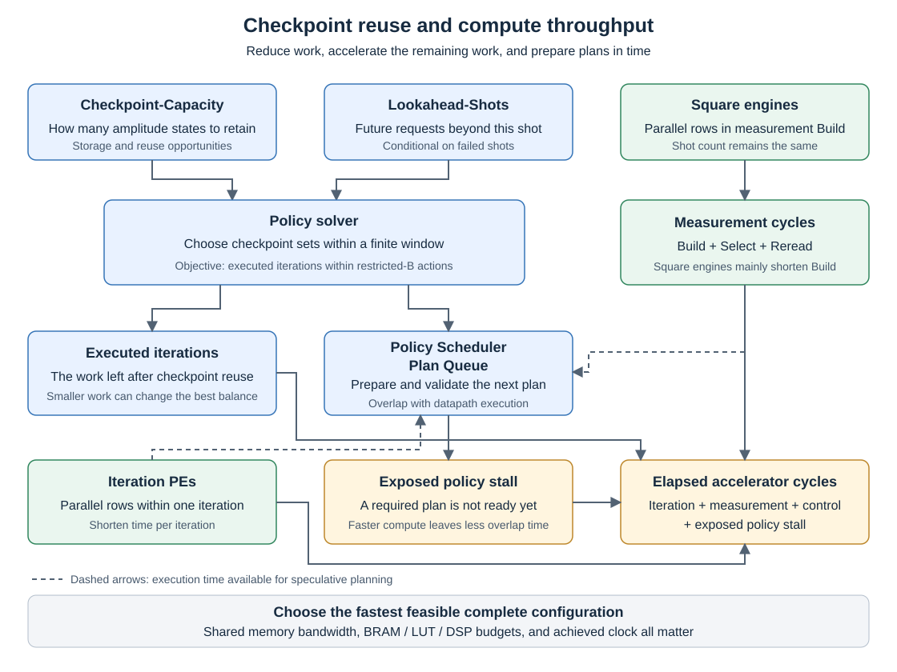

# 11장. checkpoint와 Policy Engine

> [← 10장 Measurement Unit과 Dual-Row Build · Two-Level Select](10_measurement_unit_and_microarchitecture.md) · [index](index.md) · [12장 Accelerator Core port 계약 →](12_accelerator_core_port_contract.md)

---

checkpoint는 Six-Stage Ablation에서 cycle을 56.63% 줄여 가장 큰 개선 효과를 보였습니다.
감소 폭은 나머지 다섯 단계의 효과를 합친 것보다 큽니다.

---

## 11.1 state 재사용 원리

BBHT는 실패하면 sampling range를 키워 다시 뽑습니다([3장 3.3절](03_grover_and_bbht_algorithm.md)).
그런데 새로 뽑은 number of iterations가 직전 것보다 크면, 이미 돌려 둔 state에서 차이만큼만 더 돌리면
됩니다. 처음부터 다시 `S_INIT` 할 이유가 없습니다.

```
shot 1:  5 iterations   →  uniform superposition에서 5 iterations
shot 2:  12 iterations  →  shot 1의 5-iteration state에서 7 iterations만 더   (12 iterations가 아니라)
```

sampling range가 커지는 방향이라 새 number of iterations가 큰 경우가 잦고, 그래서 이득이 큽니다.

enumeration에서는 enumeration round를 넘어 재사용하면 안 됩니다. 결과 하나를 찾을 때마다 oracle의 solution
집합이 바뀌어 다른 search 문제가 되기 때문입니다([3장 3.5절](03_grover_and_bbht_algorithm.md)).

---

## 11.2 checkpoint 저장 구조

`grover_ckpt_meta`가 checkpoint 최대 3개(a Checkpoint-Capacity of 3)의 valid bit와 각 checkpoint가 몇 번째 iteration의 state인지를 들고,
정렬된 checkpoint 집합을 유지합니다.

checkpoint slot은 Checkpoint-Capacity와 무관하게 4벌입니다([6장 6.7절](06_data_representation_and_memory_map.md#67-memory-구조)).
`grover_ckpt_mem_interleaved_e4`가 4 PEs의 4 rows 동시 읽기에 맞춰 bank를 교차 배치합니다.

---

## 11.3 Checkpoint Planner와 Checkpoint Executor

`grover_ckpt_planner_pipe`(Checkpoint Planner)가 논리적인 계획(출발 checkpoint, 정렬된 새 checkpoint 집합)을
checkpoint slot 계획으로 바꿉니다. 규칙은 넷입니다.

- 출발점은 새 number of iterations 이하인 checkpoint 중 가장 가까운 것. 없으면 uniform superposition에서 시작
- 목적지(endpoint)는 반드시 만듭니다
- 중간 checkpoint는 request pool 안에서만 고르고, a Checkpoint-Capacity of 3에서는 최대 2개
- 기존 checkpoint는 Checkpoint-Capacity가 허락하는 한 최대한 남깁니다

`grover_ckpt_executor`(Checkpoint Executor)가 그 계획을 경계 sequence로 풀어 냅니다. metadata를 지우거나
확정하는 것은 안전한 경계에서만 하고, 한 segment의 경계를 넘을 때는 1 iteration짜리 out-of-place
bridge를 씁니다.

`grover_ckpt_segment_router`(Segment Router)의 segment 규약이 이것입니다.

```
Pass 1:  src → dst      (읽는 checkpoint slot과 쓰는 checkpoint slot이 다름)
Pass 2:  dst → dst      (제자리)
```

이 규약에 따라 전체 state memory를 한 벌 더 둘 필요가 없습니다. oracle 결과를 목적지
checkpoint slot에 바로 쓸 수 있는 이유도 여기에 있습니다
([9장 9.4절](09_iteration_datapath_and_number_of_pes.md)).

---

## 11.4 Policy Engine과 3-shot Lookahead

200T 실험의 Policy Scheduler 구상, 설정 기반 실행과 7-shot · 8-shot Lookahead의 Iteration-Count Predictor 전달 수정은
[실험 27](../reports/27_200t_parameter_automation.md)에 있습니다. 여기서는 기본 3-shot Lookahead policy를 설명합니다.
Seed-First Branch and Bound with Single-Action Exit(policy search mode 6)의 단일 후보 조기 반환과 아직 남은 다중 후보 latency는
[실험 28](../reports/28_policy_single_action_exit.md)에 기록했습니다.
같은 relaxed cost를 segment별로 병렬 계산하는 후속 변경과 verification 범위는
[실험 29](../reports/29_policy_per_segment_parallel_lower_bound.md)에 있습니다.
Build 조기 반환, Scan 결과 재사용과 production scheduler의 실행 시작 단축은
[실험 30](../reports/30_policy_parallel_action_check_and_faster_start.md)에 기록했습니다.
최소 lower bound를 달성한 seed의 최적성 증명, 두 request suffix 직접 계산과 Scan 병렬화는
[실험 31](../reports/31_policy_optimality_early_exit_and_parallel_scan.md)에 기록했습니다.

어느 checkpoint를 남길지는 미래에 어떤 number of iterations가 올지에 달려 있습니다. 지금 당장 좋은
선택이 다음 두 번의 request에서 나쁠 수 있습니다.

`grover_ckpt_policy_rolling`이 현재 request와 결정론적으로 예측되는 미래 request 3개(3-shot Lookahead)를
내다보고, 그 범위 안에서 실제로 돌릴 iteration 비용의 sum이 최소가 되는 선택을 DP로
풉니다.

DP 결과가 같은 경우를 처리하는 순서도 다음과 같이 고정합니다.

```
비교 순서:  (DP의 총 executed iterations, number of segments, 정렬된 checkpoint slot 집합)
```

이 규칙이 고정되어야 software reference model이 BBHT trajectory를 재현할 수 있습니다. 동점에서 아무거나
고르면 reference model과 RTL이 갈라지고, 500/500 대조가 성립하지 않습니다.

### Iteration-Count Predictor를 이용한 미래 number of iterations 예측

`grover_shadow_j`가 실제 Iteration-Count LFSR state를 복사본으로 돌려서 "이번 shot이 실패한다면 다음에
무엇이 뽑힐까" 를 미리 계산합니다. 진짜 BBHT random number state는 건드리지 않습니다.

그 예측으로 미리 푼 계획은 `grover_ckpt_plan_queue`(Plan Queue)에 넣어 두었다가, 실제로 실패가 나면
꺼내 씁니다. hit와 miss는 `plan_queue_hit_count` · `plan_queue_miss_count`로
밖에서 셀 수 있습니다([13장](13_csr_registers_and_execution_modes.md)).

예측이 맞지 않으면 계획을 다시 계산하므로 BBHT trajectory에는 영향을 주지 않습니다. 현재 shot이
성공하면 다음 number of iterations를 뽑지 않으므로 이때의 miss도 정상 동작입니다.

---

<a id="115-memo와-3279-사이클"></a>

## 11.5 memo table initialization: 3,279 → 381 cycles

DP의 부분 결과는 `{epoch 8 bits, cost 10 bits}`인 18-bit entry로 memo table에 담습니다.
Board-Verified Build와 2026-10-25까지의 공용 RTL은 a Checkpoint-Capacity of 4 and 4-shot Lookahead와 같은 1,093-entry stride를 a Checkpoint-Capacity of 3 and 3-shot Lookahead에도
사용했습니다.

```
Board-Verified Build:                                        MEM_ENTRIES = 3 × 1,093 = 3,279
최신 main, a Checkpoint-Capacity of 3 and 3-shot Lookahead:  MEM_ENTRIES = 3 ×   127 =   381
```

a Checkpoint-Capacity of 3 and 3-shot Lookahead에서는 내다보는 범위 안의 universe ID가 0..6이고 state 집합 크기가 최대 3입니다. 동결된
`rank_state()` 식에서 도달 가능한 가장 큰 rank는 126이므로 단계당 127 entries면 충분합니다.
최신 main은 세 단계의 address를 `0`, `127`, `254`에서 시작해 최종 address 380까지만 사용하고,
이를 하나의 512×18 `ram_style="block"` array에 둡니다. address 381 이상을 읽거나 쓰면
simulation assertion이 실패합니다. a Checkpoint-Capacity of 3 and 3-shot Lookahead 이외의 parameter 조합은 기존 1,093-entry stride와
bank 구조를 유지합니다.

실제 RAMB 개수는 synthesis 결과로 확정해야 합니다. 2026-10-26 수정 환경에서는 Vivado
license를 얻지 못해 새 array의 OOC resource를 아직 재지 못했습니다
([실험 21](../reports/21_policy_memo_table_compaction.md)).

### memo table initialization 시점

reset 뒤 첫 시작과 8-bit epoch가 한 바퀴 돌 때 Policy Engine은 `ST_CLEAR`에서 memo table을 한 entry씩
지웁니다. 최신 main a Checkpoint-Capacity of 3 and 3-shot Lookahead의 청소 길이는 381 cycles이며, Board-Verified Build보다 2,898 cycles
짧습니다. 공용 100 MHz와 별도 200 MHz overlay에 같은 address 배치를 적용했습니다.

| 대상 | 청소 길이 | 해석 |
|---|---:|---|
| 2026-09-07 Board-Verified Build와 과거 benchmark 묶음 | 3,279 cycles | benchmark 값을 그대로 인용 |
| 최신 main a Checkpoint-Capacity of 3 and 3-shot Lookahead RTL | 381 cycles | 새 RTL simulation·향후 build에 적용 |
| 그 밖의 Checkpoint-Capacity · Lookahead-Shots 조합 | `LOOKAHEAD_SHOTS` × 1,093 | 기존 배치 유지 |

따라서 과거 board 실행과 RTL campaign의 cycle 값은 여전히 직접 맞대면 안 됩니다. 과거
Six-Stage Ablation은 workload마다 새로 시작해 매번 3,279 cycles을 치렀고, board app과
`bench500`은 500개를 연달아 실행해 첫 workload와 epoch 순환 때만 청소했습니다. 이 때문에
final configuration의 과거 비교에서 473/500이 정확히 3,279 cycles 차이났습니다.

원인은 2026-09-16 SoC console simulation에서 확인했습니다. 같은 workload를 reset 직후와 그다음에
연달아 돌려 `cycle` · `policy_cycles` · `policy_stall`이 셋 다 정확히 +3,279이고
`max_latency`가 3,352로 튀는 것을 보았습니다
([soc_rtl_console](../../hardware_bram/configurations/final/results/2026-09-16_soc_rtl_console/evidence.md)).

이 과거 원인은 한 workload에서 확인했으며 473건 전체를 같은 방식으로 재현하지는
않았습니다. 나머지 21건의 차이는 epoch 순환에 따른 initialization 시점과 관련된 것으로 보이지만
아직 검증하지 않았습니다.

---

## 11.6 Checkpoint-Capacity와 Lookahead-Shots의 선택

a Checkpoint-Capacity of 4 and 4-shot Lookahead에서 a Checkpoint-Capacity of 3 and 3-shot Lookahead로 줄였을 때 cycle이 7.66% 감소했고 resource 사용량도 함께 줄었습니다.

| configuration |    LUT |     FF | BRAM tile | DSP |
| -------- | -----: | -----: | --------: | --: |
| Stage 3 | 30,294 | 25,822 |      83.0 |  64 |
| Stage 4 | 29,959 | 25,655 |      83.0 |  64 |

둘을 따로 떼어 본 실험
([kh_isolated_e1](../../hardware_bram/results/2026-09-09_kh_isolated_e1/evidence.md))
은 Checkpoint-Capacity와 Lookahead-Shots의 영향을 분리해 benchmark했습니다.

| 무엇을 줄였나 |    몫 |
| ------------- | ----: |
| Checkpoint-Capacity만 줄임 | 0.21% |
| Lookahead-Shots를 줄임 | 2.58% |

주된 비용은 checkpoint 저장 공간이 아니라 유지할 checkpoint를 결정하는 과정에서
발생합니다. Lookahead-Shots가
크면 DP가 내다보는 범위가 넓어져 풀이가 오래 걸리고, 그동안 datapath가 stall합니다(`policy_stall`).
BRAM이 줄지 않는 것도 checkpoint slot이 Checkpoint-Capacity와 무관하게 4벌이기 때문입니다
([6장 6.7절](06_data_representation_and_memory_map.md#67-memory-구조)).

---

## 11.7 제외한 설계안

| 무엇                            | 왜                                                                         |
| ------------------------------- | -------------------------------------------------------------------------- |
| 5벌 이상의 checkpoint           | 저장 공간보다 checkpoint 선택에 드는 결정 비용이 큽니다                    |
| 전체 state scratch 한 벌 더      | segment 규약이 목적지 checkpoint slot을 그대로 쓰므로 필요 없습니다                      |
| enumeration round를 넘는 checkpoint 재사용 | solution 집합이 바뀌면 다른 search 문제입니다                                    |
| request 순서 분할형 Two-Track Execution        | 분할 비용 +50%, checkpoint slot 소유권 문제로 탈락                                    |
| Pass 2–Build Fusion              | measurement rescan을 없애는 방식. Board-Verified Build는 rescan 비용을 줄이는 방식을 채택했습니다 |

policy algorithm을 고른 과정은 [실험 05](../reports/05_checkpoint_policy_selection.md), Checkpoint-Capacity · Lookahead-Shots를 정한 실험은
[실험 07](../reports/07_lookahead_shots_reduction.md), 마지막 둘의 benchmark는 [실험 10](../reports/10_two_track_execution_and_pass2_build_fusion.md)에 있습니다.

확장 범위의 parameterized RTL 독립 블록 검증은 [실험 34](../reports/34_parameterized_rtl_development.md),
후속 Main IP의 Scheduler · Planner · Executor 연결과 선택한 설정의 integration 검증은
[실험 35](../reports/35_parameterized_main_ip_scheduler_integration.md)에 있습니다.
후속 개발 경로의 고정 병렬도 full Common500 검증은 완료했으며, 전체 SoC · implementation · board 검증은
남아 있습니다. 이 장의 Board-Verified Build 설계와 성능 인용 범위를 바꾸지 않습니다.
후속 full Common500과 고정 병렬도 parameter sweep은
[실험 36](../reports/36_generalized_common500_and_policy_heatmaps.md)에서 별도로 기록합니다.
후속 iteration / square engine 확장, 최종 구성 이후의 확장용 memory 정리와 resource 한도 내
연산부 최적화 순서는 [실험 37](../reports/37_expanded_iteration_and_measurement_engines.md)에 있습니다.

---

## 11.8 checkpoint policy와 연산 병렬도의 관계

이 절은 교수 검토와 algorithm 설명을 위한 개발 경로의 정리입니다. 앞 절의 Board-Verified Build와
후속 parameterized RTL을 구분하며, 용어의 최종 일괄 변경은 수행하지 않습니다.
개발 경로의 지원 범위와 검증 근거는 [실험 37](../reports/37_expanded_iteration_and_measurement_engines.md),
고정 병렬도의 실제 비교는 [실험 36](../reports/36_generalized_common500_and_policy_heatmaps.md)을 따릅니다.

### 11.8.1 설명의 출발점: 연산량과 처리 속도

이 accelerator는 [state vector emulation](03_grover_and_bbht_algorithm.md#31-state-vector-emulation)을
수행합니다. 같은 Oracle에서 BBHT shot이 실패한 뒤에는 이미 계산한 amplitude state를 재사용할 수 있습니다.
Checkpoint-Capacity와 Lookahead-Shots는 **어떤 state를 보존하여 재계산을 얼마나 줄일지**를 결정하고,
iteration PE와 square engine의 개수는 **남은 계산을 얼마나 빠르게 처리할지**를 결정합니다.
여기에 Policy Scheduler가 다음 계획을 미리 준비할 수 있는지가 전체 실행 시간을 좌우합니다.

| 설정 | algorithm에서의 의미 | 직접 바뀌는 양 | 구별할 것 |
|---|---|---|---|
| Checkpoint-Capacity | 동시에 보존할 amplitude checkpoint의 상한 | 재사용 가능한 state 집합과 executed iterations | checkpoint 하나는 전체 amplitude vector입니다. basis state나 qubit 하나를 뜻하지 않습니다 |
| Lookahead-Shots | 현재 shot 뒤에 실패를 가정하여 계획에 넣는 미래 shot 수 | solver가 고려할 request window와 checkpoint 선택 | 현재 shot까지 포함하면 request는 하나 더 있습니다. Plan Queue 깊이와 다릅니다 |
| number of PEs | 한 Grover iteration 안에서 서로 다른 row를 함께 처리하는 PE 수 | iteration당 cycle | 여러 shot을 독립 실행하는 개수가 아닙니다 |
| square engines | Measurement Unit의 Build에서 row weight를 함께 만드는 engine 수 | measurement Build당 cycle | engine 하나에 row 하나를 위한 32-lane square가 있습니다. 과거 Measurement Microarchitecture 번호와 다릅니다 |

후속 경로의 설정은 `CHECKPOINT_CAPACITY`, `LOOKAHEAD_SHOTS`, `NUMBER_OF_PES`,
`BUILD_ROWS_PER_CYCLE`에 대응합니다. 기존 구성 이름과 과거 benchmark의 표기는 그대로 보존합니다.
row와 lane, iteration, measurement의 상세 동작은 [9장](09_iteration_datapath_and_number_of_pes.md)과
[10장](10_measurement_unit_and_microarchitecture.md)에 있습니다.



### 11.8.2 한 shot에서 policy가 하는 일

1. Shot Controller가 이번 shot에서 필요한 number of iterations를 정합니다. Iteration-Count Predictor는
   이번 shot과 뒤따르는 shot들이 실패한다는 조건으로 미래 request를 계산합니다.
2. solver는 현재 checkpoint 집합과 request window를 입력받습니다. 각 request 이하에서 가장 가까운
   checkpoint를 출발점으로 잡고, 없으면 uniform superposition에서 시작합니다.
3. restricted-B action set 안에서 이번 endpoint와 보존할 기존 checkpoint, 실행 중 추가할 중간
   checkpoint의 조합을 비교합니다. 추가할 중간 checkpoint는 request pool에 있는 값이며 실제 실행
   구간 안에 있어야 합니다. endpoint를 포함한 보존 개수는 Checkpoint-Capacity 안에 들어가야 합니다.
4. window 안의 executed iterations 합이 최소인 action을 선택합니다. 동점이면 root의 segment 수,
   정렬된 checkpoint tuple 순서로 결정합니다. memoized DP와 lower bound를 이용한 pruning은
   이 결정을 더 적은 탐색으로 계산하는 수단입니다.
5. Checkpoint Planner가 선택한 논리적 checkpoint 집합을 물리 slot과 segment 경계로 바꿉니다.
   Checkpoint Executor는 iteration PE들을 동작시키고 안전한 완료 경계에서 metadata를 확정합니다.
6. Measurement Unit이 amplitude square, prefix sum, 선택과 solution check를 수행합니다. 실패하면
   다음 shot에 checkpoint를 재사용합니다. enumeration에서 solution을 찾고 Oracle이 바뀌면 이전
   checkpoint와 예측 계획을 무효화합니다.

DP의 부분 문제는 checkpoint 집합과 남은 request 위치로 구분합니다. 같은 부분 문제의 비용을 memo에
보관하여 재계산을 피합니다. generic backend는 DFS stack으로 부분 문제를 처리하며, 여러 후보의
lower bound를 병렬로 계산합니다. lower bound는 보존 용량 등의 제약을 완화한 낙관적 비용입니다.
실제로 끝까지 계산한 후보보다 좋아질 수 없는 후보를 제외하되 root의 동률 규칙도 보존합니다.
이 후보 탐색 병렬도는 `POLICY_SCAN_LANES`이며 iteration PE나 square engine 개수와 별도입니다.

Policy Scheduler는 이 결정이 필요한 시점에 준비되도록 demand와 speculation을 조정하고 Plan Queue를
관리합니다. **solver는 무엇을 남길지 계산하고, scheduler는 언제 계산하고 어느 결과를 쓸지 제어합니다.**
현재 Scheduler는 Accelerator Core의 `AP_*` / `SP_*` 제어이며 별도 module로 분리한 구현은 아닙니다
([실험 35](../reports/35_parameterized_main_ip_scheduler_integration.md)). 미래 request는 조건부 예측이므로
실제 request와 입력 checkpoint 집합, 계획의 유효 세대가 맞을 때만 사용합니다.

현재 solver의 최적성은 **restricted-B action set과 유한 request window 안의 iteration 비용**에 관한
것입니다. 모든 가능한 checkpoint algorithm이나 전체 BBHT 실행 시간의 전역 최적성을 뜻하지 않습니다.
단일 action이면 비교할 선택이 없으므로 mode 6은 나머지 window의 비용 계산을 생략할 수 있습니다.
이 경우 `root_cost`가 immediate cost를 반환하는 계약은
[실험 28](../reports/28_policy_single_action_exit.md)과
[실험 36](../reports/36_generalized_common500_and_policy_heatmaps.md)의 설명을 따릅니다.

### 11.8.3 checkpoint와 Lookahead가 함께 필요한 예

다음은 이해를 위한 algorithm 예이며 RTL 성능 측정값이 아닙니다. 같은 Oracle에서 5 iterations를
계산한 checkpoint가 있고, 이번 request는 12 iterations, 다음 실패 후 request는 8 iterations라고 합니다.
iteration은 순방향으로 실행하며 더 큰 checkpoint에서 역으로 돌아가는 action은 사용하지 않습니다.

| 보존 가능 개수 | 이번 shot의 실행과 보존 | 다음 request의 실행 | 두 shot의 executed iterations |
|---:|---|---|---:|
| 1 | 5에서 12까지 7 iterations 실행하고 endpoint 12만 보존 | checkpoint 12에서 8로 돌아갈 수 없어 처음부터 8 iterations | 15 |
| 2 | 다음 request를 보고 5에서 12로 가는 도중 8을 보존하고 endpoint 12도 보존 | checkpoint 8을 바로 사용 | 7 |

다음 request가 8이라는 정보를 이용하려면 적어도 1-shot Lookahead가 필요합니다. 보존 공간이 하나뿐이면
endpoint 12를 남겨야 하므로 Lookahead를 늘려도 이 예의 선택은 바뀌지 않습니다. 공간만 늘리는 것과
미래 정보를 이용해 그 공간을 채우는 것은 함께 보아야 합니다.

일반적으로 Checkpoint-Capacity가 커지면 재사용 기회가 늘지만, 선택할 집합과 저장 공간도 늘어납니다.
Lookahead-Shots가 커지면 미래의 재사용을 고려할 수 있지만 탐색량도 늘어납니다. 유한 window를 매 shot
다시 푸는 방식에서는 둘 중 하나를 늘릴 때 전체 workload의 iteration 수나 cycle이 항상 줄어든다고
가정할 수 없습니다. 유효한 action이 하나뿐인 구간에서는 window가 커져도 선택 이득이 없습니다.

request 방향의 탐색 깊이는 Lookahead-Shots가 결정합니다. Checkpoint-Capacity를 늘려 커지는 것은
주로 checkpoint 집합의 크기와 가능한 조합 수입니다. amplitude memory의 물리 주소 깊이가 증가하는
현상과 DFS의 탐색 깊이가 증가하는 현상은 구별합니다.

### 11.8.4 전체 cycle에 반영되는 경로

전체 cycle은 실행한 iteration들의 비용, 매 shot의 measurement 비용, initialization과 실행 제어 비용,
그리고 사용 가능한 계획을 기다린 policy stall로 나누어 생각할 수 있습니다. iteration과 measurement는
현재 실행 경로에서 차례로 진행되며, speculative policy 계산은 그 실행과 겹칠 수 있습니다.

| 비교할 값 | 의미 | 해석 |
|---|---|---|
| executed iterations | 실제 amplitude 갱신을 수행한 iteration 수 | checkpoint policy가 줄이려는 연산량 |
| iteration당 cycle | Pass 1 · Mean · Pass 2와 drain의 비용 | PE를 늘려 줄이려는 시간 |
| measurement당 cycle | Build · Select · Reread와 solution check의 비용 | square engine은 주로 Build를 단축 |
| policy cycles | run의 유효한 완료 solver 결과에 누적한 계산 cycle | background에서 겹쳐 수행한 계산도 포함하며, 취소된 job의 원시 총량과는 다를 수 있음 |
| policy stall | 실제 demand가 사용 가능한 계획을 기다린 cycle | solver 계산뿐 아니라 predictor 준비와 demand 제어의 대기도 포함 |
| total cycles | accelerator 실행의 경과 cycle | 겹친 policy cycles를 여기에 다시 더하면 안 됨 |

policy cycles와 policy stall은 서로 다른 counter입니다. solver가 짧아도 초기 demand 제어에 대기가
있을 수 있으며, solver가 오래 계산해도 미리 끝내면 그 계산 전체가 stall로 드러나지는 않습니다.
정확한 counter 조건은 [`bbht_grover_main_ip.v`](../../hardware_bram/src/bbht_grover_main_ip.v)의
`policy_cycles_run` / `policy_stall_run` 갱신을 기준으로 합니다.

이상적인 row 발행 구간에서 PE 수를 두 배로 늘리면 iteration의 두 pass는 각각 약 절반에 발행할 수
있습니다. square engine 수를 두 배로 늘리면 Build의 row 발행 구간이 약 절반으로 줄어듭니다.
Mean, pipeline drain, Select, initialization과 제어는 같은 비율로 줄지 않으며 마지막 부분 row group도
있으므로 전체 cycle을 단순히 병렬도에 반비례시킬 수는 없습니다.

현재 solver의 비용 비교에는 iteration / square engine 수에 따른 cycle이나 예상 stall이 들어가지
않습니다. 따라서 **iteration 수가 최소인 policy 선택과 전체 실행 시간이 최소인 hardware 구성을
구별해야 합니다.** 같은 solver 입력에서 iteration / square engine 개수만 바꾸면 policy의 선택은
같아야 하지만, 완료 시점과 speculative 계산의 overlap은 달라질 수 있습니다.

### 11.8.5 네 설정 사이의 연결

| 함께 볼 설정 | 연결되는 이유 | 성능을 볼 때의 기준 |
|---|---|---|
| Checkpoint-Capacity · Lookahead-Shots | 미래의 재사용 정보를 실제 보존 공간에 반영 | 둘을 늘린다고 항상 이득이 커지는 것은 아님. 선택 이득과 solver 비용을 함께 비교 |
| Checkpoint-Capacity · number of PEs | checkpoint가 executed iterations를 줄이고 PE는 iteration당 시간을 줄임 | iteration이 적어지면 PE 증가로 절약할 총 cycle도 작아질 수 있음 |
| Lookahead-Shots · number of PEs | 긴 window의 solver를 실행 뒤로 숨겨야 함 | iteration이 빨라지면 다음 계획이 필요한 시점도 빨라져 stall이 드러날 수 있음 |
| Checkpoint-Capacity · square engines | checkpoint 재사용은 iteration을 생략해도 shot의 measurement는 수행 | 같은 shot 수에서는 Build 연산량이 유지되어 square engine의 상대적 중요도가 커질 수 있음 |
| Lookahead-Shots · square engines | measurement 시간도 speculative policy의 준비 시간으로 사용 | Build가 빨라져도 계획 준비 시간이 줄어들 수 있음 |
| number of PEs · square engines | iteration과 measurement의 다른 부분을 가속 | 어느 한쪽만 확대하면 남은 쪽과 고정 비용의 비중이 커짐 |

고정 seed와 동일한 bit-exact 계약에서는 checkpoint policy와 병렬도 변경이 BBHT의 requested iterations,
measurement의 PRNG 순서와 결과를 바꾸지 않아야 합니다. checkpoint가 줄이는 것은 물리적으로 다시
계산할 iteration 수이며, shot 수를 줄이는 별도 algorithm으로 해석하지 않습니다.

작은 Checkpoint-Capacity만으로 PE와 square engine의 최종 균형을 고르면, checkpoint를 늘렸을 때와
iteration / measurement의 비중이 다를 수 있습니다. 예를 들어 iteration 수가 절반이 되면 iteration당
같은 시간을 절약해도 전체 절약량은 절반이 되지만, shot 수가 같다면 Build 단축의 절약량은 유지됩니다.
이는 PE 자체의 처리율이 나빠진다는 뜻이 아니라 가속할 작업의 양이 바뀐다는 뜻입니다.

반대로 PE가 많아지면 checkpoint 재사용으로 절약하는 iteration 하나의 시간 가치가 작아지고, 동시에
policy 계산을 숨길 시간도 줄어듭니다. 그래서 더 작은 checkpoint / Lookahead가 유리할 가능성도 있습니다.
서로 반대 방향의 효과가 있으므로 연산 병렬도를 높이면 최적 checkpoint / Lookahead가 어느 쪽으로
이동한다고 미리 단정할 수 없습니다.

### 11.8.6 resource와 최종 선택

Checkpoint-Capacity는 amplitude 저장 용량과 metadata를, Lookahead-Shots는 request window와 solver의
탐색 stack / 후보 cache를 증가시킬 수 있습니다. PE는 iteration 산술과 read / write bandwidth,
현재 구조의 dataset / Found Mask 복제에 영향을 줍니다. square engine은 square 산술, row weight 저장과
amplitude read bandwidth에 영향을 줍니다. iteration과 measurement가 amplitude memory를 공유하므로
전체 BRAM 사용량을 네 설정의 독립적인 증가량만 더해서 예측해서는 안 됩니다.

최종 선택은 **resource 안에 들어가고 timing을 만족하는 구성 중 실제 전체 실행 시간이 짧은 구성**입니다.
동일 clock에서는 total cycles로 비교할 수 있고, 달성 clock이 다르면 그 차이도 반영합니다.
초기 연산부 비교를 같은 기준 checkpoint / Lookahead에서 수행한 뒤, 유망한 PE / square engine 후보마다
checkpoint / Lookahead를 다시 비교합니다. 그 뒤 memory를 정리하고 synthesis / routing과 실제 통합
실행으로 확인하는 순서는 [실험 37](../reports/37_expanded_iteration_and_measurement_engines.md)에 있습니다.
