# 16장. verification 체계

> [← 15장 동작 과정과 cycle 구성](15_operation_sequence_and_cycle_breakdown.md) · [index](index.md) · [17장 board 운용 →](17_board_operation.md)

---

verification 환경은 port 계약 검사부터 실제 board 시험까지 여섯 단계로 구성됩니다. 단계가
높아질수록 실행 시간과 준비 비용이 늘어나지만 실제 system에 더 가까운 조건을 검증합니다.

---

## 16.1 verification 단계



| 층 | 무엇                           | 도구                       | 시간          |
| :-: | ------------------------------ | -------------------------- | ------------- |
| 0 | port 계약 대조                 | `check_ports.py`         | 즉시          |
| 1 | Bus Interface·최상단 regression         | verilator                  | 초~분         |
| 2 | BBHT trajectory testbench 250쌍 / 500 workloads | verilator + 실제 driver  | 분~수십 분    |
| 3 | SoC 전체 RTL simulation              | Questa + 실제 RISC-V core  | 수 분~수 시간 |
| 4 | synthesis·implementation                     | Vivado                     | 수십 분       |
| 5 | board                           | Arty A7-100T + host UART | —            |

여기에 가로지르는 축이 하나 더 있습니다. software reference model([4장](04_software_reference_model_and_test_vectors.md))
은 RTL과 독립적으로 같은 BBHT trajectory를 계산해 2층과 5층의 기준값을 제공합니다.

Bus Interface나 Accelerator Core를 고치면 이 순서로 올라갑니다. 3~5층을 다시 통과하기 전에는
Board-Verified Build(baseline)를 바꾸는 논의를 하지 않습니다(인수인계 §4.2). 0~2층은 저장소 안에서 전부 돌고,
3층부터는 RVX platform과 Vivado 가 필요합니다.

---

## 16.2 0층: port 계약

port routing이 계약과 일치하는지 자동으로 확인합니다.
[`port_contract.tsv`](../../spec/port_contract.tsv)가 기준이고(2026-09-01 인수인계 docx 에서 뽑아
굳힌 것, docx 의 sha256 을 header에 남겼습니다. docx 는 지금 git 기록에만 있습니다),
`check_ports.py`가 wrapper 19 signals + core 61 signals를 네 variant(`stub` · `real` · `dram` · `no_checkpoint_baseline`)로
대조합니다.

이름 오타, 방향 뒤집힘, 폭 한 bit 차이, `signed` 누락, 미연결을 전부 잡습니다.

```bash
make -C hardware_bram/sim ports ports-real
```

---

## 16.3 1층: 계약의 동작

| 묶음   | 대상                                                                      | 무엇을                                                                                 |
| ------ | ------------------------------------------------------------------------- | -------------------------------------------------------------------------------------- |
| T1~T9  | [`tb_bbht_rvx.v`](../../hardware_bram/testbench/tb_bbht_rvx.v)           | CSR 읽기·쓰기, DMA load, Result FIFO, start 거절 조건                                   |
| D1~D11 | [`tb_driver.cpp`](../../hardware_bram/testbench/tb_driver.cpp)           | 실제 driver C code와 RTL을 같이 돌려 둘의 해석이 같은지                             |
| H1~H15 | [`tb_bbht_bram_top.v`](../../hardware_bram/testbench/tb_bbht_bram_top.v) | 최상단에 APB로 host 순서를 흉내 내고 14-qubit dataset 전체 load, Restart mode/Checkpoint mode BBHT trajectory 비교, enumeration까지 |

`CORE=stub`이면 Accelerator Core 자리에 자리 채우개를 넣어 Bus Interface만 보고, `CORE=real`이면
adapter를 거쳐 실제 Accelerator Core에 연결합니다.

두 Bus Interface implementation(Board-Verified Build와 현재 revision)이 같은 testbench에서 T1~T9 · D1~D11을 모두
통과했고, D5의 single search cycle이 63,963으로 같았습니다.

H1~H15 묶음이 predicate 네 개를 전부 씁니다: H5 `LT256`, C4 `GT16128`, H11 `RANGE 1000~1300`,
`CHECKPOINT_ENUMERATION LT4`. board에서는 2026-10-04 에 네 predicate를 500 workloads씩 돌렸습니다
([실험 16](../reports/16_three_revisions_board_predicate500.md)). 이 층은 그보다 먼저, 그리고 enumeration까지 네 predicate를 보는 자리입니다.

verification 범위의 한계: workload 수가 적어 BBHT trajectory의 통계적 정합성이나 Policy Engine의 소유권
결함처럼 특정 조합에서만 발생하는 문제는 확인하기 어렵습니다.

---

## 16.4 2층: BBHT trajectory testbench

같은 workload를 수백 개 연달아 돌려 BBHT trajectory와 cycle을 통째로 비교합니다. 자극은 실제
driver(`bbht_grover_driver.c`)를 그대로 compile해 넣으므로 board app이 하는 순서와
같습니다.

| testbench                                                                              | workload                     | 결과                                              |
| --------------------------------------------------------------------------------- | ---------------------------- | ------------------------------------------------- |
| [bench250](../../hardware_bram/configurations/final/results/2026-09-10_bench250_final_core/evidence.md) | number of solutions 1/4/16/64/256 × 50 seeds | BBHT trajectory 250/250, cycle 230/250                      |
| [bench500](../../hardware_bram/configurations/final/results/2026-09-10_bench500_final_core/evidence.md) | 같은 축 × 100 seeds          | board final configuration과 5축 500/500, cycle sum error 0 |

`bench500`은 500 workloads를 한 process에서 reset 없이 연속 실행합니다. board app이 number of solutions 바깥
loop · seed 안쪽 loop로 도는 순서를 그대로 맞춘 것이고, 이것이 Six-Stage Ablation campaign
(workload마다 새로 시작)과의 유일한 실질 차이입니다. 그 차이가 낳는 것이
[11장 11.5절](11_checkpoint_and_policy_engine.md)의 3,279 cycles입니다.

### 이 층이 지키는 BBHT trajectory invariant

같은 seed에서 Restart mode와 checkpoint가 `shot_count` · `requested_iterations`를 같게 내야 합니다.
checkpoint는 amplitude를 어떻게 계산하느냐만 바꾸지 BBHT trajectory를 바꾸면 안 되기 때문입니다.
500/500 통과했고 `plan_queue_miss_count`는 0입니다.

verification 범위의 한계: testbench가 Bus Interface에 직접 접근하므로 실제 CPU와 NoC는 포함되지
않습니다.

---

## 16.5 3층: SoC 전체 RTL simulation

RVX platform `bbht_grover_final` 전체(ORCA RISC-V core · micro NoC · APB/AHB NI · 우리
Bus Interface · Accelerator Core)를 Questa로 실행합니다. 이 단계부터 실제 CPU가 NoC를 거쳐 accelerator에
접근합니다.

### ① benchmark app

board에 구운 것과 sha256이 같은 `bbht_paper_bench.elf`를 그대로 돌려 261쌍을 냈습니다.
verilator `bench500`과 5축 전부 일치하고, board의 final configuration과도 `cycle_count`까지 261/261
같습니다([soc_rtl_paper_bench](../../hardware_bram/configurations/final/results/2026-09-16_soc_rtl_paper_bench/evidence.md)).

`CYCLE_COUNT`는 Accelerator Core가 accelerator clock으로 세는 값이라, 이것이 같다는 것은 Bus Interface가
search의 시작과 끝을 testbench와 똑같은 시점에 잡는다는 뜻입니다.

### ② console 명령 왕복

`bbht_console` script 21줄을 SoC 위에서 실행하고, 응답을 host CLI의 replay
transport(`bbht_cli.py --port replay:`)에 입력해 parsing한 뒤 기준값과 대조했습니다.
어긋남 0건입니다([soc_rtl_console](../../hardware_bram/configurations/final/results/2026-09-16_soc_rtl_console/evidence.md)).

| 검사                                        | 결과  |
| ------------------------------------------- | ----- |
| 명령 21줄의 echo 순서와 종결자              | 21/21 |
| `ID` 응답 7값 대 CSR source of truth                 | 7/7   |
| `RUN`/`STAT` 3회 대 같은 순서 verilator | 60/60 |
| `ENUM` 순서와 종료 cycle                 | 일치  |

기준값은 [`tb_console_seq.cpp`](../../hardware_bram/testbench/tb_console_seq.cpp)가
같은 순서로 동일한 RTL에 접근해 생성합니다(`make console-seq`). 대조기는
[`soc_console_check.py`](../../hardware_bram/sim/soc_console_check.py)입니다.

이 단계의 주의 사항은 [2장 2.3절](02_development_environment_and_toolchain.md)에 정리했습니다. script mode가
build에 들어갔는지 log로 확인해야 합니다.

verification 범위의 한계: 물리 UART는 포함되지 않습니다. simulation의 printf module이 115200 baud로 받아 해독하므로
framing은 돌았지만 FTDI · baud rate error · pin map은 board에서만 봅니다. 그리고 host → board
방향 byte가 여기서는 한 번도 돌지 않습니다: script mode는 명령을 compile 시점
array에서 읽기 때문입니다.

---

## 16.6 4층: synthesis와 implementation

무엇을 읽을 수 있고 없는지는 [19장](19_synthesis_implementation_bitstream.md)에 있습니다. 요지만
적으면, 이 층에서 읽을 수 있는 것은 "Bus Interface를 바꾸고도 같은 chip에 같은 여유로
들어간다" 까지입니다. 성능 수치를 여기서 인용하면 안 됩니다: 이 묶음에는 실행 결과가
없습니다.

---

## 16.7 5층: board

board benchmark 실험 전체([실험 보고서 index 「board benchmark 묶음」](../reports/index.md#board-benchmark-묶음))가 이 층입니다.

---

## 16.8 자동 정합성 검사

사람이 두 곳을 따로 고치다 어긋나는 것을 막는 장치가 셋 있습니다.

| 검사      | 무엇을                                                                                                             | 명령                                             |
| --------- | ------------------------------------------------------------------------------------------------------------------ | ------------------------------------------------ |
| CSR source of truth  | JSON 하나에서 header 넷을 생성하고, 생성 대상이 아닌 두 곳까지 대조. 반대로 RTL 안에 CSR 값을 다시 박는 것도 막음    | `python3 spec/gen_csr.py --check` |
| port 계약 | wrapper 19 + core 61을 세 variant로 대조                                                                             | `make -C hardware_bram/sim ports ports-real`   |
| 문서      | 죽은 link · 없는 anchor · 없는 그림 · 고아 그림 · render 안 된`.mmd` · 되살아난 폐기 spec · 본문 mermaid fence | `python3 documents/check_docs.py`              |

문서 검사기로 확인할 수 없는 다음 항목은 별도로 검토해야 합니다.

- 인용한 주장이 대상 절에 실제로 있는가
- 뒤 장에서 정의되는 용어를 앞 장이 설명 없이 쓰지 않는가
- 폐기된 주장이 표현만 바꿔 살아 있지 않은가
- benchmark 수치에 조건이 붙어 있는가

---

## 16.9 네 predicate와 다른 두 revision

2026-09-25 까지 board에서 benchmark 규모로 돈 predicate는 `EQ` 하나였습니다. 네 predicate × 500 workloads(Predicate500,
[18장](18_predicate500_automated_test.md))를 세 revision(final configuration · No-Checkpoint Baseline · DRAM Variant)의 RTL 과 SoC RTL simulation에 걸어 software reference model과
맞댔습니다. 비교 축은 `rc` · `result_index` · predicate verification · `trial_count` · `L_BBHT` ·
`actual_iter` 여섯입니다.

| revision · 층 | 결과 | 근거 |
|---|---|---|
| final configuration RTL (Restart mode + Checkpoint mode) | 4,000/4,000. EQ 1,000 실행은 기존 bench500 과 cycle까지 같음 | [predicate500_rtl](../../hardware_bram/configurations/final/results/2026-09-25_predicate500_rtl/evidence.md) |
| final configuration SoC RTL simulation | console 16/16, board가 만든 dataset hash 4/4. cycle 15/16 같고 1건은 reset 뒤 memo table 청소 +3,279 | [soc_rtl_predicate500](../../hardware_bram/configurations/final/results/2026-09-25_soc_rtl_predicate500/evidence.md) |
| No-Checkpoint Baseline RTL | Restart mode 2,000/2,000. final configuration RTL을 Single-Row Build · Linear Select로 돌린 Restart mode와 cycle · STATUS 까지 2,000/2,000 | [20장](20_no_checkpoint_baseline.md) |
| No-Checkpoint Baseline SoC RTL simulation | 16/16, hash 8/8, cycle 16/16 | 같은 장 |
| DRAM Variant RTL + AXI model | 2,000/2,000 (기본 latency · backpressure 두 벌), protocol 위반 0 | [21장](21_dram_variant.md) |
| DRAM Variant SoC RTL simulation (NoC · DDR model) | 16/16, hash 8/8. cycle은 AXI model의 약 1.4× | 같은 장 |
| 세 revision board (2026-10-04) | final configuration 4,000 · No-Checkpoint Baseline 2,000 · DRAM Variant 2,000 이 네 축 전부 일치 | [실험 16](../reports/16_three_revisions_board_predicate500.md) |

firmware의 dataset 생성기를 host gcc 로 compile해 software 생성기와 20 datasets의 hash · number of
solutions를 맞대는 검사도 있습니다(`make -C hardware_bram/sim console-gen`).

---

## 16.10 권장 verification 순서

```bash
# 0~1층 (몇 초)
make -C hardware_bram/sim ports lint regress driver

# 1층 전체: adapter + Accelerator Core까지 (몇 분)
make -C hardware_bram/sim real
make -C hardware_bram/sim top

# 2층 (20분쯤)
make -C hardware_bram/sim bench250

# 3층: RVX platform이 필요합니다
source /opt/rvx/rvx_setup.sh
hardware_bram/configurations/final/rvx/install_to_platform.sh
cd $RVX_MINI_HOME/platform/bbht_grover_final && make syn && make sim_rtl

# 정합성 검사
python3 spec/gen_csr.py --check
python3 documents/check_docs.py
```

Six-Stage Ablation과 Checkpoint-Capacity · Lookahead-Shots 단독 실험은 tag에서 꺼내 돌립니다
([2장 2.2절](02_development_environment_and_toolchain.md)).

---

## 16.11 남은 verification 항목

Bus Interface를 교체한 revision의 wall-clock time, 500 workloads 규모의 board benchmark, board에서의 `LT` · `GT` · `RANGE`, No-Checkpoint
Baseline과 DRAM Variant의 board 실행은 2026-10-04 묶음([실험 16](../reports/16_three_revisions_board_predicate500.md))으로 채웠습니다.

| 무엇 | 왜 남았나 |
|---|---|
| 2026-10-04 checkpoint cycle 중 3,279 가 아닌 차이 | 청소가 다른 stall과 겹친 것으로 보이나 하나씩 확인하지 않았습니다 |
| SoC 경로의 16 solutions 나머지 39 seeds와 64 · 256 solutions | simulation 시간 제한. 같은 configuration의 verilator `bench500` 은 500/500 통과했습니다 |
| 3,279 cycles 차이 473건 전부의 재현 | 한 workload로 원인을 확인했습니다. 나머지 21건이 제각각인 이유도 미확인입니다 |
| 두 build의 bitstream hash 비교 | Vivado version이 달라 원리상 불가능합니다 |
| SPI flash boot | board RESET 이나 port 재열기 뒤에는 app을 다시 load해야 합니다 |
| ORCA ① naive 의 2,000 benchmarks | 끝까지 돌리면 수년이 걸립니다. 단가 추정으로 대신하고 두 workload로 식을 확인했습니다([실험 19 「verification」](../reports/19_orca_server_software_baseline.md#verification)) |

Predicate500 바깥의 조건을 board에서 볼 때는 console 명령만 있으면 됩니다. 예를 들어
`GEN PRED=RANGE TARGETS=16` 뒤에 `LOAD` 와 `RUN` 을 치면 bitstream이나 app을 다시 올리지
않아도 됩니다.
