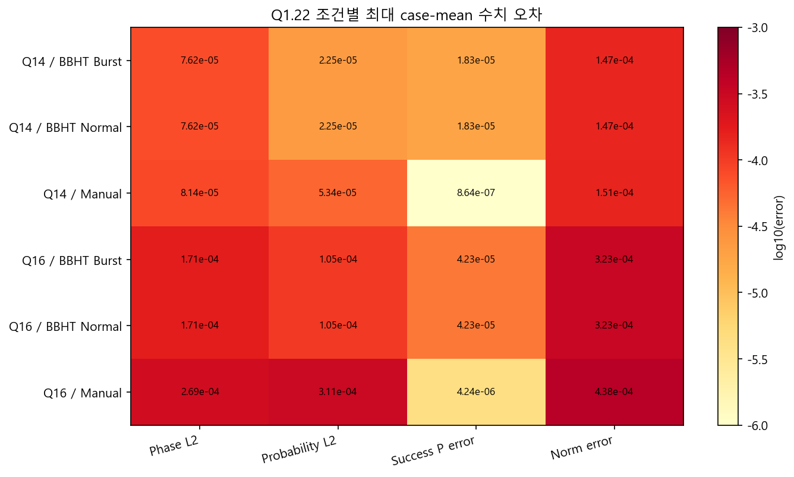
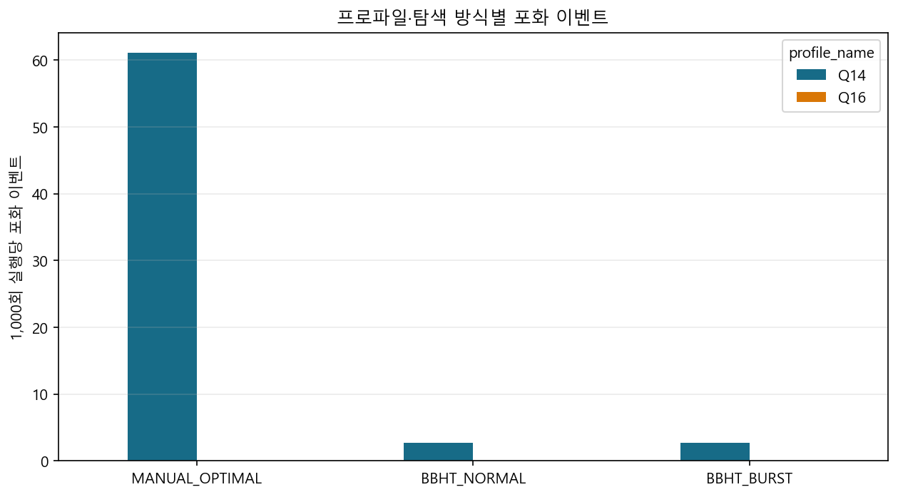

# 실험 02. amplitude precision: 14 qubits와 22 fraction bits

> [← 실험 01 reference model campaign: 기능 정합성](01_reference_model_campaign.md) · [index](index.md) · [실험 03 random number seed coverage →](03_random_seed_coverage.md)

---

| 정한 것 | 근거의 축 |
|---|---|
| 14 qubits · 22 fraction bits · symmetric saturation | reference model precision 분석 |

float64 기준과 같은 mask · 같은 number of iterations로 fraction bits만 바꿔 돌린 precision 분석입니다(1 · 4 · 64 solutions와
states의 절반이 solution인 경우). 표의 값은 probability distribution L2 error가 기준을 넘지 않는 가장 작은 fraction bits입니다.

| number of qubits | probability L2 ≤ 10⁻³ | probability L2 ≤ 10⁻⁵ |
|---:|---:|---:|
| 14 | 20 fraction bits | 22 fraction bits |
| 15 | 20 fraction bits | 24 fraction bits까지 미충족 |
| 16 | 20 fraction bits | 24 fraction bits까지 미충족 |

14 qubits는 22 fraction bits에서 두 기준을 모두 만족했고, qubit가 더 많으면 24 fraction bits까지 늘려도 10⁻⁵에 닿지
못했습니다. 14 qubits · 22 fraction bits로 굳힌 근거 중 하나가 이것입니다.

[실험 01](01_reference_model_campaign.md) campaign의 Q1.22 실행 전체에서 잰 error의 maximum도 모두 10⁻³ 아래였습니다.

| 지표 | 전체 maximum | 최악 조건 |
|---|---:|---|
| phase 정렬 amplitude L2 | 2.951e-4 | 16 qubits, `DATA_COUNT` = 49,152, 2 solutions, BBHT Restart mode |
| probability distribution L2 | 3.515e-4 | 16 qubits, `DATA_COUNT` = 32,768, 2 solutions, BBHT Restart mode |
| success probability error | 1.688e-4 | 16 qubits, `DATA_COUNT` = 16,384, 8 solutions, BBHT Restart mode |
| normalization error | 5.351e-4 | 16 qubits, `DATA_COUNT` = 16,384, 1 solution, BBHT Restart mode |

phase 정렬 L2는 `min(‖A_f − A_q‖, ‖A_f + A_q‖)`로 global sign을 뺀 amplitude vector error입니다. measurement
index는 random number에 따라 달라지므로 정확도는 measurement 결과 하나가 아니라 measurement 전 전체 amplitude와
probability distribution으로 봅니다.

saturation은 이렇게 걸렸습니다.

| profile | search | runs | saturation event | 1,000 runs당 |
|---|---|---:|---:|---:|
| 14 qubits | Manual | 41,280 | 2,520 | 61.05 |
| 14 qubits | Restart mode | 137,600 | 368 | 2.67 |
| 14 qubits | Single-Slot Checkpoint | 137,600 | 368 | 2.67 |
| 16 qubits | 모든 search | 355,120 | 0 | 0 |

전체 3,256회였고 기능 불일치는 0이었습니다. Q1.22에서 `+1.0`을 정확히 표현할 수 없는 경계가
있으므로 saturation 자체를 실패로 보지 않고, `amp_overflow`는 진단용 sticky bit로 두었습니다
([6장 6.3절](../design_references/06_data_representation_and_memory_map.md#63-amplitude-형식)). Restart mode와 Single-Slot Checkpoint의 saturation 횟수가 같다는
것도 두 mode의 최종 logical state가 같다는 추가 증거입니다. 이 결론은 지금의 연산 순서와 round-half-to-even ·
saturation 규칙에 대한 것이고, 다른 Q format이나 연산 순서에 자동으로 옮겨지지 않습니다.
