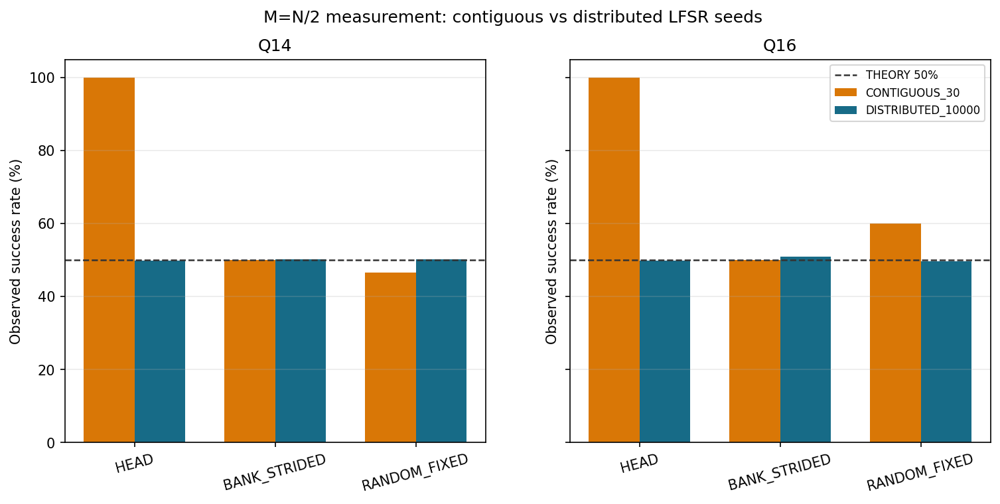

# 실험 03. random number seed coverage

> [← 실험 02 amplitude precision: 14 qubits와 22 fraction bits](02_amplitude_precision.md) · [index](index.md) · [실험 04 enumeration 두 방식 비교 →](04_enumeration_method_comparison.md)

---

| 정한 것 | 근거의 축 |
|---|---|
| regression용 seed와 통계용 seed를 분리 | reference model |

states의 절반이 solution이면 measurement distribution이 균일하므로 solution 배치와 무관하게 success probability가 50%여야 합니다.

| profile | seed 집합 | HEAD | BANK_STRIDED | RANDOM |
|---|---|---:|---:|---:|
| 14 qubits | 연속 30개 | 100.00% | 50.00% | 46.67% |
| 14 qubits | 분산 10,000개 | 49.96% | 50.26% | 50.31% |

연속 seed는 LFSR output space를 고르게 덮지 못합니다. 그래서 seed 집합을 목적별로 나눕니다.

- regression: 같은 seed가 reference model과 RTL에서 같은 number of iterations와 index를 내는지가 중요합니다. 고정된 공식
  seed roster를 씁니다(500 workloads의 100쌍).
- 통계: success probability 같은 통계는 분산 seed로 잽니다. 연속 seed의 결과를 Born-rule success probability의
  unbiased estimate로 인용하지 않습니다.

같은 이유로 solution 배치에 따라 number of shots가 달라진 것은 Grover 이론의 위치 의존성이 아니라
유한한 seed sample의 효과입니다.
