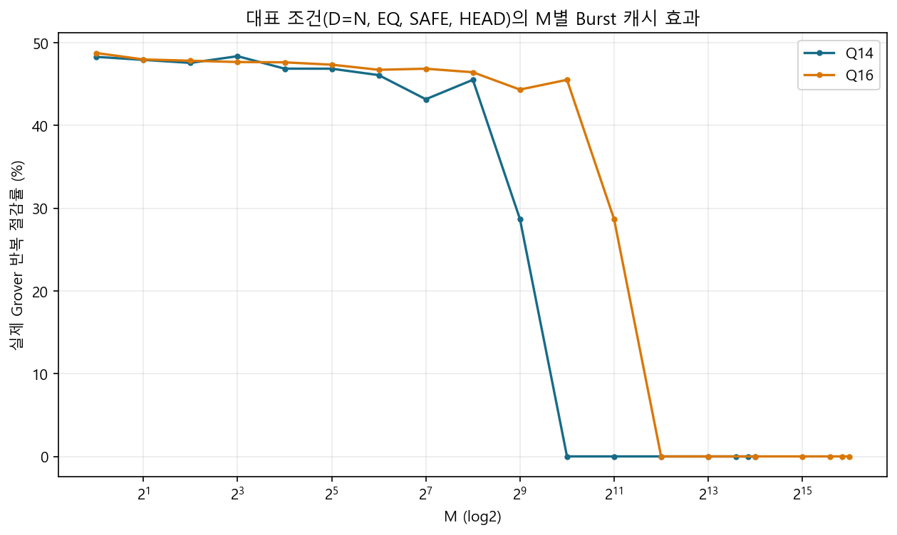

# 실험 05. checkpoint policy algorithm 선정

> [← 실험 04 enumeration 두 방식 비교](04_enumeration_method_comparison.md) · [index](index.md) · [실험 06 checkpoint memory packing →](06_checkpoint_memory_packing.md)

---

| 정한 것 | 근거의 축 |
|---|---|
| checkpoint 도입, Rolling Lookahead Exact DP policy, 동점 규칙 | reference model · software 1,098 seeds |

## 재활용할 가치가 있는가

실패한 shot의 amplitude를 버리지 않고 이어 쓰면 executed iterations가 얼마나 주는지를 먼저 쟀습니다. 1 solution,
30 seeds 기준의 software 추정입니다.

| number of qubits | number of stored states | mean executed iterations | 절감률 |
|---:|---:|---:|---:|
| 14 | 0 | 212.77 | 0.00% |
| 14 | 1 | 112.13 | 47.70% |
| 14 | 2 | 97.43 | 55.22% |
| 14 | 4 | 77.77 | 63.69% |

[실험 01](01_reference_model_campaign.md) campaign에서도 Single-Slot Checkpoint가 requested iterations는 그대로 둔 채 executed iterations를 전체 mean 38.55%
(median 44.44%) 줄였습니다. solution이 드물수록 큰 number of iterations로 점진적으로 다가가므로 이득이 컸습니다.



## 후보 계열

| 후보 | 핵심 | 판단 |
|---|---|---|
| Single-Slot Checkpoint (a Checkpoint-Capacity of 1) | amplitude memory 자체를 checkpoint slot 하나로 | policy 자유도가 거의 없음. 성능 baseline |
| FIFO / LRU | 최근성 기반 | BBHT의 number of iterations 열에는 일반적인 재참조 지역성이 약해 탈락 |
| GE / GE2 | 선행 거리와 간격 비용을 직접 평가 | 강한 online baseline이지만 look-ahead 대비 격차가 큼 |
| Exact Online MDP | online optimum | 상한 기준(reference) 용도 |
| Look-ahead A | 미래 number of iterations를 유한한 Lookahead-Shots만큼 | 경로 중간 state를 안 써서 손실 |
| Look-ahead restricted-B | 출발점에서 목표 number of iterations로 전진하며 지나가는 중간 state를 저장 후보로 | 같은 Checkpoint-Capacity에서 큰 추가 이득 |
| Rolling Lookahead Exact DP | 유한한 Lookahead-Shots 안의 총 executed iterations를 DP로 정확히 풀고 현재 action 하나만 실행 | 최종 계열로 채택 |
| 문헌 대안 (Bern · Hazard-weighted rollout · p-median · DTR · SSP · Checkmate 등) | 같은 문제에 대입 | Rolling 계열을 넘지 못함 |

미래 number of iterations는 결정론적인 Iteration-Count LFSR을 실패 가정으로 이어 돌려 얻습니다. request 순서나 Born-rule sampling의 성공 여부를
미리 아는 것이 아닙니다. hardware에서는 이것이 Iteration-Count Predictor입니다([11장 11.4절](../design_references/11_checkpoint_and_policy_engine.md#114-policy-engine과-3-shot-lookahead)).

## 동점 규칙

초기 Rolling implementation은 동점에서 사실상 마지막으로 나열된 action을 골라, 중간 state를 많이 저장하는
쪽으로 치우쳤습니다. 이것을 lexicographic comparison으로 고쳤습니다.

```
key = (DP의 총 executed iterations, number of segments, 정렬된 checkpoint slot 집합)
```

DP가 계산한 executed iterations가 정확히 같을 때만 number of segments와 정렬된 checkpoint slot 집합을 봅니다. headline executed iterations는 거의
변하지 않았지만 shot당 중간 저장 횟수와 number of segments가 줄었습니다. RTL policy의 minimum 선택도 같은 규칙을
써야 BBHT trajectory가 reference model과 맞습니다([11장](../design_references/11_checkpoint_and_policy_engine.md)).

## Checkpoint-Capacity와 Lookahead-Shots의 첫 선택

BBHT budget 소진형 workload(mean 31.51 shots, 1,098 seeds 전부 BBHT budget 도달)에서 고친 동점 규칙으로 잰
공식 결과입니다. software model의 executed iterations이고 cycle이 아닙니다.

| 설계 | mean executed iterations / run | policy operations / shot |
|---|---:|---:|
| Restart mode | 617.86 | — |
| Single-Slot Checkpoint (a Checkpoint-Capacity of 1) | 396.08 | — |
| a Checkpoint-Capacity of 3 and 8-shot Lookahead | 132.65 | 468.0 |
| a Checkpoint-Capacity of 3 and 10-shot Lookahead | 131.99 | 929.4 |
| a Checkpoint-Capacity of 4 and 8-shot Lookahead | 119.08 | 1,539.6 |
| a Checkpoint-Capacity of 4 and 10-shot Lookahead | 117.80 | 3,691.4 |
| offline optimum 참고 (a Checkpoint-Capacity of 4) | 117.04 | — |

a Checkpoint-Capacity of 4가 a Checkpoint-Capacity of 3보다 executed iterations를 약 10% 줄였고, a Checkpoint-Capacity of 4에서 Lookahead를 10 shots로 넓혀도 1.08%밖에 안
줄었습니다. 반면 policy가 Grover iteration 뒤에 숨으려면 필요한 throughput(operations / cycle)이 a Checkpoint-Capacity of 4 and 8-shot Lookahead에서 0.395,
a Checkpoint-Capacity of 4 and 10-shot Lookahead에서 0.958로 뛰었습니다. 그래서 첫 RTL은 a Checkpoint-Capacity of 4 and 8-shot Lookahead로 갔습니다. 이 판단은 "executed iterations를 줄이면
빨라진다" 는 전제 위에 있었고, [실험 07](07_lookahead_shots_reduction.md)의 board benchmark가 그것을 뒤집습니다.
