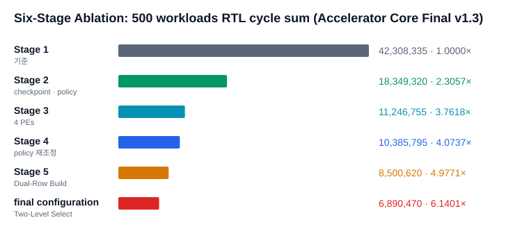
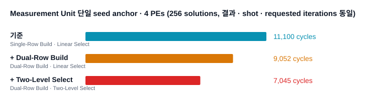

# 실험 13. Accelerator Core 최종 발표 (v1.3)

> [← 실험 12 Board-Verified Build 500 workloads](12_board_verified_build_500_runs.md) · [index](index.md) · [실험 14 Common500 software · FPGA 비교 →](14_common500_software_fpga_comparison.md)

---

| 확인한 것 | 근거의 축 |
|---|---|
| final configuration의 implementation 범위, Six-Stage Ablation cycles, Measurement Unit 개선, standalone build resource, 재현 package 배치 | RTL cycle (500 workloads Six-Stage Ablation · 250쌍 · 단일 seed) · standalone implementation report |

2026-09-10에 Accelerator Core 담당 쪽이 낸 발표 자료 `Main_IP_Final_20260910.pptx`(9장, "Main IP Final v1.3")를 보고서로
옮긴 것입니다. 발표의 근거는 같은 날 받은 재현 package v1.0이고, 저장소 안 위치는
[repro_package_v1.0](../../hardware_bram/configurations/final/results/2026-09-09_repro_package_v1.0/evidence.md)
에 정리돼 있습니다. slide에 그림 file은 없었고, bar chart 두 장(도형으로 그린 것)은 같은 값으로 SVG를 다시
그려 넣었습니다. 다른 문서에 이미 있는 수치는 그쪽으로 링크합니다.

---

## implementation 범위

Accelerator Core 하나를 가운데 두고 실행 경로를 둘로 나눴습니다.

| 묶음 | 내용 |
|---|---|
| Accelerator Core | Shot Controller, checkpoint · Policy Engine, Iteration Datapath, Measurement Unit과 결과 · state |
| standalone board 경로 | UART→APB bridge, deterministic dataset generator, Arty A7-100T top-level, host testbench script |
| RVX SoC 경로 | APB CSR 제어, AHB DMA data 경로, firmware testbench, ORCA software baseline |

standalone 경로는 이 저장소에서 더 유지하지 않습니다. 이유는
[실험 11 「독립 FPGA variant」](11_rejected_extensions.md#독립-fpga-variant)에 있습니다.

기준 구성(14 qubits · 32 lanes · 22 fraction bits를 가진 23-bit amplitude · a Checkpoint-Capacity of 3 · 3-shot Lookahead · 4 PEs · Dual-Row Build · Two-Level Select · Arty A7-100T)은 지금의 확정 스펙과 같습니다.
값은 [1장 1.2절](../design_references/01_project_overview.md#12-확정-spec) 한 곳에 있습니다.

---

## Six-Stage Ablation cycles

공통 500 workloads에서 DUT `CSR_CYCLE_COUNT`를 더한 값입니다.

이 값들은 성능 세 축 중 RTL cycle 축의 source of truth이고, 표와 해석은
[15장 15.4절](../design_references/15_operation_sequence_and_cycle_breakdown.md#154-six-stage-ablation)에 있습니다. 발표의 단계별 해석 표는
머리말에 "250case / 500case" 를 함께 적어 두었지만 값은 모두 500 workloads입니다. 단계별 cycle은 같은 workload
집합끼리만 맞댑니다.

이 campaign은 workload마다 reset해서 Checkpoint-Capacity · Lookahead-Shots 축소의 몫(-7.66%)이 크게 잡힙니다. board와 같은 조건에서는 -3.7% 대입니다
([실험 18 「단계별 손익」](18_six_stage_ablation_comparison.md#단계별-손익)).

---

## 왜 a Checkpoint-Capacity of 3과 3-shot Lookahead인가

발표는 4 PEs 뒤에는 policy · checkpoint 비용을 줄이는 쪽이 유리하다는 근거로 두 비교를 들었습니다. Stage 3 → Stage 4
6 cases 비교(policy actions -69.9%, policy cycles -55.5%, policy stall -72.9%, total cycles 1.0459×)와 Checkpoint-Capacity · Lookahead-Shots를 따로 떼어 본
1 PE 250쌍입니다. 두 표는 [실험 07](07_lookahead_shots_reduction.md)에 있습니다.

---

## Measurement Unit 단일 seed anchor

256 solutions의 단일 seed에서 Dual-Row Build · Two-Level Select switch만 바꿔 잰 RTL cycle입니다. 결과 index · number of shots · requested iterations는 셋이 같습니다.

| 구성 | Dual-Row Build / Two-Level Select switch | cycles |
|---|:-:|--:|
| 4 PEs, Single-Row Build · Linear Select | 0 / 0 | 11,100 |
| 4 PEs, Dual-Row Build · Linear Select | 1 / 0 | 9,052 |
| 4 PEs, Dual-Row Build · Two-Level Select | 1 / 1 | 7,045 |

Two-Level Select는 group prefix sum을 적어 두고 `S_GROUP_SCAN`으로 row 선택을 두 단으로 줄이는 compile-time option입니다.
구조는 [10장](../design_references/10_measurement_unit_and_microarchitecture.md), enumeration 전체 단위의 measurement 실험은
[실험 09](09_measurement_bottleneck_and_microarchitecture.md)에 있습니다. 이 anchor는 workload 하나라 경향을 보이는 값이지 집계값이 아닙니다.

---

## board 결과와 standalone implementation

### 250쌍 RTL cycles

| 구성 | cycles | executed iterations |
|---|--:|--:|
| final configuration | 2,563,403 | 4,457 |

같은 250쌍의 Restart mode · a Checkpoint-Capacity of 4 and 4-shot Lookahead 값은 [실험 07](07_lookahead_shots_reduction.md)의 board 250쌍 표에 있습니다. final configuration 값은
2026-09-10 bench250 RTL에서 다시 냈고, 같은 250쌍의 board benchmark와 논리 네 축이 250/250, cycle sum이 +0.28%입니다
([bench250_final_core](../../hardware_bram/configurations/final/results/2026-09-10_bench250_final_core/evidence.md)).

### standalone build의 timing · resource

| 항목 | 값 |
|---|---|
| WNS / TNS | +0.224 ns / 0 |
| LUT / FF | 34,399 / 28,847 |
| BRAM tiles / DSP | 84.5 / 128 |

RVX 없이 Accelerator Core만 올린 standalone implementation입니다. RVX SoC 전체 implementation(Board-Verified Build)의 값은
[19장](../design_references/19_synthesis_implementation_bitstream.md)에 있고 서로 맞대지 않습니다. 출처는 재현 package의
[`expected_results.md`](../../hardware_bram/configurations/final/results/2026-09-09_repro_package_v1.0/expected_results.md)
입니다.

### system 비교

발표의 wall-clock time 비교(Restart mode · Stage 2 · final configuration · ORCA software)는 2026-09-08에 Board-Verified Build로 잰 값이고
[1장 1.5절](../design_references/01_project_overview.md#15-성능-지표와-인용-기준)과 [실험 12](12_board_verified_build_500_runs.md)에 있습니다.

---

## 재현 package 배치

발표가 "server에서 볼 위치" 로 든 package directory입니다. 저장소 안의 어디로 옮겼는지는
[repro_package_v1.0](../../hardware_bram/configurations/final/results/2026-09-09_repro_package_v1.0/evidence.md)
의 대응표에 있습니다.

| package directory | 내용 |
|---|---|
| `01_RTL` | Accelerator Core · standalone · RVX adapter |
| `02_TB` | standalone testbench, Six-Stage Ablation testbench, Checkpoint-Capacity · Lookahead-Shots 단독 실험 |
| `03_SW_FW` | host testbench, firmware, dataset 기준 |
| `04_BUILD` | standalone · Vivado, RVX, simulation script |
| `05_EXPERIMENTS` | board · resource · Six-Stage Ablation · Checkpoint-Capacity · Lookahead-Shots 원자료와 요약 |
| `06_REFERENCE_OUTPUTS` | expected result CSV, reference model 요약 |
| `07_BOARD` | bitstream, ELF, board 시험 자료 |
| `99_MANIFEST` | SHA, file 목록, 출처 |

---

## 근거

- 재현 package 반입 기록: [repro_package_v1.0](../../hardware_bram/configurations/final/results/2026-09-09_repro_package_v1.0/evidence.md)
- Six-Stage Ablation RTL cycles: [publication_6stage](../../hardware_bram/results/2026-09-08_publication_6stage/evidence.md)
- Checkpoint-Capacity · Lookahead-Shots 단독 실험: [kh_isolated_e1](../../hardware_bram/results/2026-09-09_kh_isolated_e1/evidence.md)
- 250쌍 final Accelerator Core: [bench250_final_core](../../hardware_bram/configurations/final/results/2026-09-10_bench250_final_core/evidence.md)
- 원본 pptx는 이 보고서로 옮긴 뒤 지웠습니다. git 기록(2026-10-12 이전 commit)에 남아 있습니다.
