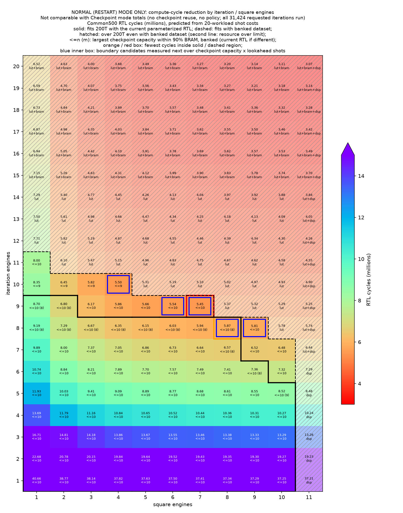

# 실험 38. iteration engines × square engines sweep과 200T resource 판정

> [← 실험 37](37_expanded_iteration_and_measurement_engines.md) · [실험 보고서 index](index.md)

| 확인한 것 | 근거의 축 | 결과 |
|---|---|---|
| 20 workloads 층화 표본이 Common500의 같은 행과 같은가 | RTL simulation, 두 구성 | Normal · Checkpoint 행 모두 byte 동일, Common500 Normal 합계 예측 오차 0.18% 이하 |
| iteration / measurement 한 번의 cycle | Normal mode RTL cycle, 220칸 | 512 ÷ engine 수(올림)에 비례하는 식으로 220칸 모두 설명됨 |
| 200T에 들어가는 iteration engines · square engines | 기존 build 모듈 단가와 RTL memory 구조의 대략 계산 | 지금 RTL 77칸, dataset bank 분할 시 91칸 |
| 일반화 RTL의 200T synthesis | Vivado OOC | amplitude memory가 BRAM으로 추론되지 않아 끝나지 않음 |

기록일: 2026-10-29. [실험 37](37_expanded_iteration_and_measurement_engines.md#다음-resource와-성능-선정-순서)의
선정 순서 1단계입니다. Checkpoint-Capacity · Lookahead-Shots와 policy stall을 빼고, 200T resource 안에서 연산부를
얼마나 키울 수 있고 그때 cycle이 얼마나 줄어드는지 봅니다.

## 측정 방법

**Normal(Restart) mode의 RTL cycle만 씁니다.** Normal mode는 checkpoint와 policy를 쓰지 않아 요청된 iteration 31,424회와
measurement 7,403회를 구성과 무관하게 그대로 수행합니다. 따라서 이 실험의 cycle은 연산부 비교용이며 Checkpoint mode 총 cycle과
맞대지 않습니다. 같은 구성이라도 Checkpoint mode는 iteration이 줄어 총 cycle이 더 작습니다.

testbench `tb_bench500.cpp`에 `BENCH_PER_M`을 더했습니다. target count 다섯 개마다 앞의 N개 seed만 돌리고, 순서와 리셋
없는 연속 실행은 Common500과 같습니다. 기존 `BENCH_LIMIT`은 앞에서부터 잘라 100개 이하이면 target count 1만 남고
measurement 비중이 큰 workload가 빠집니다. runner는 `generalize_main.py --per-m N`이고, sweep 전체는
[`engine_sweep.py`](../../hardware_bram/sim/engine_sweep.py)가 맡습니다.

seed 4개씩 20 workloads로 돌린 결과가 기존 full Common500의 같은 행과 byte 단위로 같았고, 그 20개로 구한 shot당 cycle로
Common500 Normal 합계를 0.18% 안에서 맞혔습니다. 그래서 1~20 × 1~11의 220칸을 모두 20 workloads로 돌렸습니다.

## shot당 cycle

iteration 한 번은 512 행을 iteration engines로 나눈 두 pass와 고정 9 cycle, measurement 한 번은 iteration engines의
한 pass와 square engines의 한 pass와 고정 약 82 cycle입니다. 식과 220칸의 대조는
[evidence bundle](../../hardware_bram/results/2026-10-29_engine_sweep/evidence.md#shot당-cycle)에 있습니다.

iteration engines는 iteration과 measurement 양쪽에 걸리고 square engines는 measurement에만 걸리므로, Normal mode에서는
iteration engines를 늘리는 쪽이 훨씬 큰 효과를 냅니다. 처리 행 수가 올림으로 정해지므로 engine 수가 512의 약수에서
멀수록 한 engine의 몫이 작습니다. 고정 cycle은 engine 수로 줄지 않아 가속에는 상한이 있습니다.

## 200T resource 판정

일반화 RTL은 synthesis로 resource를 잴 수 없었습니다. amplitude memory(`grover_parallel.sv`)와 policy cache
(`grover_policy_parameterized.sv`)가 한 process 안에서 여러 port로 쓰는 구조라 BRAM으로 추론되지 않고 register로
풀렸고, Vivado가 메모리 한도에서 끝나지 않았습니다. 200T 구현 전에 bank당 write port 하나 형태로 고쳐야 합니다.

그래서 기존 RTL의 200T routed build에서 모듈 단가를 읽고, amplitude memory는 bank 수와 Checkpoint-Capacity로 직접
계산했습니다. dataset은 지금 RTL처럼 iteration engine마다 복제하는 경우와, 실험 37이 후속 작업으로 둔 bank 분할의 경우를
따로 판정했습니다. 기준은 LUT · FF 75%, BRAM · DSP 90%이고 timing은 넣지 않았습니다. 단가, 가정, 기존 build와의 대조는
[evidence bundle](../../hardware_bram/results/2026-10-29_engine_sweep/evidence.md#200t-resource-판정)에 있습니다.

경계 근처에서는 LUT가 먼저 걸리고, square engines 11은 DSP 때문에 들어가지 않습니다. 이 범위에서는 BRAM이 남아
대부분의 칸에서 Checkpoint-Capacity를 8~10까지 둘 수 있습니다. 다만 bank 하나의 깊이가 512를 넘는 순간 bank마다
BRAM이 10 tile씩 늘어나므로, 둘 수 있는 최대 Checkpoint-Capacity는 bank 수(iteration engines)에 따라 달라집니다.

## 결과

| 판정 영역 | Normal mode cycle 최소 칸 | iteration engines 4 · square engines 2 대비 |
|---|---|---:|
| 지금 RTL 그대로 | iteration engines 8 · square engines 8 | 2.01배 |
| dataset bank 분할 | iteration engines 9 · square engines 7 | 2.16배 |

수치와 다음 후보는 [evidence bundle](../../hardware_bram/results/2026-10-29_engine_sweep/evidence.md#결과)에 있습니다.
배수는 Normal mode 연산 cycle의 비이고 Checkpoint mode 총 cycle이나 board 시간의 배수가 아닙니다.

## 한계와 다음 단계

- resource는 대략 계산입니다. 가장 불확실한 항은 bank 수의 제곱으로 늘어나는 amplitude 읽기 mux입니다.
  memory를 고쳐 BRAM으로 추론되게 한 뒤 대표 칸의 synthesis로 단가를 보정해야 경계가 확정됩니다.
- Checkpoint-Capacity · Lookahead-Shots에 따른 policy의 LUT · memo table 증가는 넣지 않았습니다.
- Checkpoint mode에서는 iteration이 줄고 measurement는 그대로라 square engines의 비중이 커집니다. 실제 운용 기준의
  순위는 실험 37 선정 순서 2단계(후보별 Checkpoint-Capacity · Lookahead-Shots 탐색)에서 다시 봅니다. 각 칸의
  `bench.csv`에는 Checkpoint-Capacity · Lookahead-Shots 3/3의 Checkpoint 행도 들어 있습니다.
