# 14장. multiple solutions — Born-rule sampling과 enumeration

> [← 13장 oracle과 diffusion operator — multiplier 없는 산술](13_oracle_diffusion_measurement_datapath.md) · [index](index.md) · [15장 논문 지도와 설계 결정표 →](15_paper_map_and_design_decisions.md)
> **이 장을 읽기 위한 준비**: [4장 measurement](04_measurement.md)의 Born rule, [9장 Grover algorithm](09_grover_algorithm.md)의 회전 그림, [13장 oracle과 diffusion operator](13_oracle_diffusion_measurement_datapath.md)의 datapath.

---

13장에서는 oracle과 diffusion operator를 circuit으로 구현했습니다. 한 iteration 안에서 벌어지는 일은 이제 전부 정해졌고, 남은 단계는 하나입니다 — **measurement**. amplitude array에서 답 하나를 꺼내는 circuit을 이 장에서 설계합니다.

그런데 이 단계는 앞의 두 단계와 성격이 다릅니다. 우리가 푸는 문제는 "`value[i] < thr_a` 를 만족하는 index를 찾아라" 같은 **predicate search**이고, predicate를 만족하는 칸이 몇 개인지는 data가 정합니다. 하나일 수도, 300개일 수도, 0개일 수도 있습니다. 즉 우리 문제는 처음부터 **multiple solutions 문제**입니다. 그리고 solution이 여럿이라는 사실은 oracle에서는 추가 비용이 들지 않지만, measurement에서는 설계를 바꿔야 합니다. 이 장은 그 인과 — solution이 여럿이다 → amplitude가 똑같아진다 → 순위로는 못 고른다 → probability로 뽑아야 한다 → 그래야 전부 열거할 수 있다 — 를 따라갑니다.

먼저 혼동하기 쉬운 표기를 정리해야 합니다.

---

## 14.0 기호 충돌 주의

이 장이 인용하는 세 자료가 **같은 글자를 다른 뜻으로** 씁니다. 이걸 정리하지 않으면 수식을 따라가다 반드시 헷갈립니다. 그래서 이 해설서는 **글자 대신 용어를 그대로 쓰고**(아래 표의 둘째 열), 원문을 인용할 때만 환산하겠습니다.

| 개념 | **본 해설서(통일)** | 08번 논문 | 09번 논문 |
|---|:---:|:---:|:---:|
| search space의 크기 | number of states | $D$ | $K = 2^N$ |
| solution의 개수 | number of solutions | $M$ | $S$ (또는 $n_s$) |
| (08의 $N$) | — | diffusion operator가 뒤집는 state의 개수 | — |
| (09의 $N$) | — | — | 사용자 수 |

특히 조심할 것 두 가지입니다. **08번의 $N$ 은 number of qubits도 search space도 아닙니다** — diffusion operator가 phase를 뒤집는 state의 개수라는, 그 논문만의 variable입니다. 08번에서 search space는 $D$ 입니다. 그리고 **09번의 $N$ 은 "사용자 수"이고 search space는 $K=2^N$** 입니다. 그래서 09번의 optimal number of iterations 공식에 $S=1$ 을 넣으면 우리에게 익숙한 $\frac{\pi}{4}\sqrt K = \frac{\pi}{4}\sqrt{2^N}$ 이 나오지, $\frac{\pi}{4}\sqrt N$ 이 아닙니다. 교과서의 "$\frac{\pi}{4}\sqrt N$"은 $N$ 을 search space의 크기(이 해설서의 number of states)로 쓴 표기이니, 09번을 읽을 때는 반드시 $N\to K$ 로 환산하세요.

이 표를 참고하면서, 아래부터는 search space의 크기를 number of states, solution의 개수를 number of solutions로 읽으시면 됩니다.

---

## 14.1 solution이 여럿이면 — oracle에서는 공짜

solution이 여러 개일 때 optimal number of iterations는 [9.5절](09_grover_algorithm.md#95-왜-여러-번--왜-sqrttextnumber-of-states-번--왜-pi)의 회전 그림에서 그대로 나옵니다. 초기 각이 $\sin\theta = \sqrt{\text{number of solutions}/\text{number of states}}$ 가 되어, solution이 많을수록 시작부터 solution 축 쪽으로 더 기울어 있고 그만큼 덜 돌아도 됩니다:

$$\text{optimal number of iterations} = \frac{\pi}{4}\sqrt{\frac{\text{number of states}}{\text{number of solutions}}} - \frac12$$

**oracle에서는 추가 비용이 들지 않습니다.** [13.3절](13_oracle_diffusion_measurement_datapath.md#133-oracle--predicate-4종이-subtractor-하나를-공유한다)의 Predicate Unit은 `value[i] − thr` 의 MSB 한 bit로 각 칸을 독립적으로 판정합니다. predicate를 만족하는 칸이 하나든 300개든 circuit은 같고, 걸리는 cycle도 같습니다 — 어차피 128 lanes가 array 전체를 한 번 훑으니까요. **diffusion operator에서도 추가 비용이 들지 않습니다.** inversion about the mean $a_i \mapsto 2\bar a - a_i$ 는 어느 칸이 solution인지 아예 보지 않는 전역 연산이라, solution이 몇 개로 바뀌어도 circuit은 달라지지 않습니다.

**그러나 iteration 제어에서는 해결할 문제가 있습니다.** 위 식에는 number of solutions가 들어 있는데 우리는 그 값을 모릅니다. 몇 번 돌릴지를 모르는 채로 시작해야 하고, 이 문제를 푸는 것이 [16장](16_iteration_control_and_checkpoints.md)의 BBHT shot loop입니다.

**measurement에서도 설계를 다시 살펴봐야 합니다.** solution이 여럿이면 measurement circuit이 지금까지의 방식으로는 **작동하지 않습니다.** 왜 그런지 보려면 oracle이 무엇을 아는 circuit인지부터 다시 확인해야 합니다.

---

## 14.2 oracle은 solution을 아는 circuit이 아니다

이 해설서는 이 설명을 일관되게 따릅니다. Grover를 처음 배울 때 교과서는 흔히 "solution index $w$ 의 amplitude에 $-1$ 을 곱한다"고 씁니다. 그 표기는 $w$ 를 constant로 못 박은 것처럼 읽히지만, 그렇게 만든 circuit은 **search를 하지 않습니다** — 답을 이미 알고 있으니까요. [7장](07_oracle_and_phase_kickback.md)에서 oracle을 정의할 때 강조한 대로, oracle은 solution이 무엇인지 **모르면서** "이게 predicate를 만족하느냐"는 물음에만 답하는 Predicate Unit입니다.

| | index를 아는 oracle | predicate를 판정하는 oracle |
|---|---|---|
| solution을 | **안다** — constant로 못 박음 | **모른다** — data가 정함 |
| circuit | index comparator | `value − thr` 의 MSB 한 bit |
| number of solutions | 설계 시점에 1로 고정 | 실행 시점에 결정, 0일 수도 모든 state일 수도 |
| 쓸모 | algorithm 골격 확인 | 실제 search |

우리 accelerator는 오른쪽입니다. host가 CSR에 쓰는 것은 **threshold** `THRESHOLD_A`(그리고 범위 predicate면 `THRESHOLD_B`)이지 solution index가 아닙니다. threshold를 아는 것과 solution을 아는 것은 다릅니다 — threshold는 **질문**이고, 어느 칸이 그 질문에 걸리는지는 `data_mem` 안의 값들이 정합니다. circuit은 실행 전에 어느 칸이 뒤집힐지 모르고, 알 필요도 없습니다.

이 명제에서 두 가지가 곧바로 따라 나옵니다. 첫째, **solution이 몇 개인지 미리 셀 수 없습니다.** 그 개수는 predicate·threshold·data 셋 모두에 의존하므로 설계 시점에는 물론이고 실행 시작 시점에도 알 수 없습니다([16.1절](16_iteration_control_and_checkpoints.md#161-왜-solution이-몇-개인지-모르는가)). 둘째, **solution들 사이에는 아무 우열이 없습니다.** oracle이 보기에 모두 똑같이 "predicate를 만족하는 칸"입니다. 이 두 번째 성질 때문에 기존 measurement 방식이 작동하지 않습니다.

---

## 14.3 amplitude 동률 — argmax가 무너지는 지점

solution 두 칸 $i$, $i'$ 를 골라 그 amplitude가 매 순간 어떻게 되는지 따라가 봅시다.

- 시작은 uniform superposition이므로 $a_i = a_{i'} = 1/\sqrt{\text{number of states}}$ 입니다. **같습니다.**
- oracle은 predicate를 만족하는 **모든** 칸에 똑같이 $-1$ 을 곱합니다. 둘 다 solution이니 둘 다 sign이 뒤집힙니다. **여전히 같습니다.**
- diffusion operator $a \mapsto 2\bar a - a$ 는 index를 구별하지 않습니다. 같은 값에 같은 function을 적용했으니 결과도 같습니다. **여전히 같습니다.**

이 관계는 반복해도 유지됩니다. oracle과 diffusion operator가 solution 집합을 **완전히 대칭으로** 다루므로, 모든 solution의 amplitude는 매 iteration 후 정확히 같습니다. 게다가 우리는 fixed-point를 쓰고([12장](12_fixed_point_and_precision.md)) 두 칸이 지나온 연산열이 문자 그대로 동일하므로, rounding error까지 똑같이 생겨 **bit 단위로 같습니다.** 우연히 갈릴 여지가 없습니다.

숫자로 보겠습니다. 8 states 가운데 predicate를 만족하는 칸이 $\{1,3,5\}$ 인 경우(3 solutions, $\theta = 37.761°$, optimal number of iterations $0.692 \to 1$):

| number of iterations | solution amplitude | non-solution amplitude | solution 하나의 probability | solution 전체 probability |
|:-:|--:|--:|--:|--:|
| 0 | $+0.35355$ | $+0.35355$ | 0.1250 (= 4/32) | 0.3750 |
| 1 | $+0.53033$ | $-0.17678$ | **0.2812 (= 9/32)** | 0.8437 |
| 2 | $-0.08839$ | $-0.44194$ | 0.0078 | 0.0234 |
| 3 | $-0.57452$ | $-0.04419$ | 0.3301 | 0.9902 |

한 번 돌리고 나면 1번·3번·5번 칸의 amplitude가 **셋 다 정확히 $0.53033$** 이고, 각각 $9/32 = 28.1\%$ 의 probability를 나눠 가집니다. non-solution 다섯 칸은 $-0.17678$ 로 눌려 있고요. Grover는 의도한 대로 동작했습니다 — solution 쪽에 84.4%의 probability가 모였습니다.

문제는 여기서 답을 꺼내는 circuit입니다. 이 project가 한동안 상정했던 measurement는 **argmax**, 즉 $|a_i|$ 가 가장 큰 index를 고르는 comparator tree였습니다([4.2절](04_measurement.md#42-argmax는-왜-measurement가-아닌가)이 이미 기각해 둔 그 circuit입니다). 그런데 지금 maximum을 갖는 칸이 셋이고 그 값이 bit까지 같습니다. comparator tree는 동률에서 무엇을 내놓을까요? 구조가 정한 우선순위 — 순차 scan이면 먼저 만난 칸, tournament tree면 leaf 배치 순서 — 에 따라 **index 1** 하나입니다. circuit이 결정론적이므로 몇 번을 다시 돌려도 1입니다.

즉 argmax를 쓰면 **3번과 5번은 영원히 나오지 않습니다.** random number seed를 바꿔도, iteration을 늘려도, clock을 아무리 오래 돌려도 나오지 않습니다. 이것은 probability가 낮아서 못 찾는 것이 아니라 **원리적으로 도달할 수 없는** 것입니다. 우리 accelerator의 두 번째 출력 요구 — "predicate를 만족하는 원소를 전부 열거한다" — 를 이 방식으로는 충족할 수 없습니다.

동률을 감지해서 random number로 하나 고르면 되지 않느냐고 물을 수 있습니다. 그러면 $\{1,3,5\}$ 는 균등하게 나오겠지만, 그건 이미 argmax가 아니라 probability sampling의 제한적인 특수 경우입니다. 게다가 "동률"을 정확 일치로 판정해야 하는데 amplitude가 조금이라도 다른 경우가 섞이면 곧바로 무너지고, 무엇보다 **순위만 남기고 probability의 크기 정보를 버린다**는 근본 문제가 그대로입니다. 순위로 뽑는 대신, 처음부터 probability로 뽑아야 합니다.

(solution 두 개짜리 최소 예제는 [9.4절](09_grover_algorithm.md#94-진짜로-한-번-돌려보기--4-states)의 4 states 손계산에 2 solutions 변형으로 붙여 두었습니다. 두 막대의 높이가 **정확히 같아지는 것**을 네 줄짜리 계산으로 확인할 수 있습니다. 다만 4 states에 solution이 둘이면 처음부터 절반이 solution이라 probability가 $\frac12$ 에서 제자리인 퇴화 사례입니다 — 동률인 채로 **자라는** 모습은 이 절 앞의 8 states · 3 solutions 예에서 이미 봤습니다.)

---

## 14.4 Born-rule sampling — probability를 circuit으로

[4.1절](04_measurement.md#41-computational-basis-measurement와-born-rule)의 Born rule을 그대로 적용하면 됩니다. state $|\psi\rangle = \sum_i a_i |i\rangle$ 를 computational basis로 측정하면 결과 $i$ 가 나올 probability는

$$\text{probability}(i) = |a_i|^2$$

입니다. amplitude가 실수뿐인 우리 datapath에서는 그냥 $a_i^2$ 이고요. 우리가 할 일은 이 분포를 따르는 random number를 circuit으로 뽑는 것 — 실기 quantum에서 자연이 공짜로 해 주는 일을, emulator에서는 우리가 만들어야 합니다.

교과서적인 방법은 **inverse transform sampling** 입니다. prefix sum

$$\text{prefix sum}(i) = \sum_{k \le i} a_k^2$$

를 만들어 두고, uniform random number를 하나 뽑아 $\text{prefix sum}(i) > \text{random number}$ 가 되는 **첫 번째** $i$ 를 답으로 씁니다. index $i$ 가 뽑힐 조건은 random number가 $[\text{prefix sum}(i-1),\, \text{prefix sum}(i))$ interval에 떨어지는 것이고, 그 interval의 길이가 정확히 $a_i^2$ 이므로 $\text{probability}(i) = a_i^2$ 가 그대로 성립합니다. 4장의 규칙과 circuit의 동작이 일치합니다.

여기서 세 가지 실용적 결정을 합니다.

**전부 integer로, 자르지 않고 계산합니다.** amplitude가 23-bit integer이므로 square는 46-bit integer이고, 우리는 이 곱을 한 bit도 자르지 않습니다. 잘린 하위 bit가 곧 probability의 왜곡이고, 값이 작은 칸일수록 상대 error가 커져 분포가 체계적으로 기울기 때문입니다. prefix sum과 total weight도 필요한 폭 그대로 담습니다(14.5절). integer라서 좋은 점이 하나 더 있습니다 — prefix sum이 array 끝에서 **정확히** total weight에 닿으므로, random number가 total weight 미만이기만 하면 어디선가 반드시 멈춥니다. floating-point prefix sum이라면 rounding 때문에 끝까지 가도 random number를 못 넘는 경우를 대비한 안전망이 필요했겠지만, integer 설계에서는 그 경로 자체가 없습니다. 남는 예외는 total weight가 0인 경우 하나이고, 이때 circuit은 `zero_weight_error` 를 세우고 끝냅니다.

**나눗셈을 하지 않습니다.** 보통은 probability가 되도록 prefix sum을 전체 sum of squares로 나누지만, 우리는 나누는 대신 random number를 $[0,\ \text{total weight})$ 범위에서 뽑습니다($\text{total weight} = \sum_k a_k^2$). 비교의 양변에 같은 constant를 곱한 것과 같으므로 분포는 동일하고, divider가 통째로 사라집니다. 다만 이 동치는 random number가 $[0,\ \text{total weight})$ 에서 **정확히 균등**할 때만 성립하는데, total weight는 2의 거듭제곱이 아니라서 PRNG 출력을 그대로 잘라 쓰면 균등해지지 않습니다. 그래서 **rejection sampling**을 씁니다 — 64-bit PRNG 출력에서 total weight − 1 의 bit 길이만큼 하위 bit를 후보로 꺼내, 후보가 total weight 이상이면 버리고 다시 뽑습니다. comparator 하나면 되니 divider가 도로 들어오지는 않고, 후보가 받아들여질 probability가 늘 절반을 넘으므로 mean 두 번 안에 끝납니다. 64-bit 출력은 Measurement PRNG(xorshift64)가 한 block씩 내며, 32-bit seed 하나에서 결정적으로 확장됩니다. 초기 state에서 total weight는 정확히 $2^{44}$ 인데(13.2절), iteration을 거친 뒤에는 rounding 때문에 정확히 그 값이 아니어도 이 방식은 그때의 total weight를 그대로 쓰므로 영향을 받지 않습니다.

**squarer는 필요합니다.** argmax 시절에는 $|a|$ 의 최대와 $a^2$ 의 최대가 같아서 square를 건너뛸 수 있었지만, probability로 뽑으려면 크기 자체가 필요하므로 square를 피할 수 없습니다. [13.8절](13_oracle_diffusion_measurement_datapath.md#138-multiplier는-어디에-있고-어디에-없는가)의 "0 multipliers"는 **diffusion operator·oracle·Init 경로에 한정된** 이야기이고, Measurement Unit은 squarer를 씁니다. 이것이 우리 설계에서 DSP가 잡히는 유일한 자리입니다.

남은 문제는 속도입니다. 위 절차를 곧이곧대로 짜면 amplitude를 한 칸씩 훑는 직렬 scan이라 16,384 cycles이 듭니다. Grover iteration 한 번이 약 268 cycles인데([11.8절](11_state_vector_emulator.md#118-cycle-비용-model)) measurement 한 번에 그 60×의 시간이 들고, 128 lanes datapath는 활용되지 않습니다.

---

## 14.5 2단 병렬 measurement

11.7절의 row 구조를 measurement에도 그대로 씁니다. sampling을 **row를 먼저 고르고 그 안에서 lane을 고르는** 두 단으로 쪼개는 것입니다. row가 512개나 되므로, final configuration은 row 고르기를 다시 **group → row**의 두 층으로 나눕니다.

1. **Build — row weight 만들기.** amplitude memory를 한 바퀴 읽으며 row마다 32 lanes의 sum of squares(row weight)를 만들어 작은 memory에 적고, total weight도 함께 모읍니다. 512 rows를 32 rows씩 16개 **group**으로 묶어, group 경계를 지날 때마다 그때까지의 prefix sum을 group prefix sum으로 적어 둡니다 — 추가 square도 추가 cycle도 없이 따라 나오는 값입니다. squarer 한 벌이면 한 cycle에 1 row라 512 cycles인데, final configuration(**Dual-Row Build**)은 checkpoint memory가 한 번에 내주는 4 rows를 받아 **한 cycle에 2 rows씩** 제곱해 256 cycles로 줄입니다. squarer가 두 벌인 이유가 이것입니다(DSP 128개).
2. **random number — rejection sampling.** 14.4절의 규칙대로 total weight 미만인 random number를 얻을 때까지 64-bit block를 뽑습니다.
3. **group 고르기 (Two-Level Select).** 16 groups의 group prefix sum을 앞에서부터 보며 random number를 처음 넘는 group을 고릅니다. 최대 16 cycles입니다.
4. **row 고르기.** 그 group의 32 rows 안에서 row weight의 prefix sum이 random number를 처음 넘는 row를 고릅니다. 최대 32 cycles입니다. (Linear Select라면 512 rows 전체를 앞에서부터 훑어야 합니다.)
5. **lane 고르기.** 고른 row를 다시 읽어 32 lanes를 제곱하고, 그 row 안의 잔여값(random number에서 앞 row들까지의 prefix sum을 뺀 값)을 lane의 prefix sum이 처음 넘는 lane을 고릅니다. 후보 index는 `{row, lane}` 입니다.
6. **verification.** `data_mem` 의 두 번째 port로 후보 칸의 값을 다시 읽어 oracle과 같은 predicate(와 padding·`found_mask`)로 판정합니다(16.4절).

비교는 전부 **엄격한 `>`** 이고, 순서는 늘 group → row → lane입니다. 이 규칙이 하나라도 다르면 같은 random number에서 다른 칸이 나오므로, 18.3절에서 bit-exact 조건으로 명시한 항목입니다.

얼마나 줄었는지는 shot 한 번의 나머지 비용(measurement·verification·policy 등)으로 봅니다. 500 workloads campaign에 직선을 맞춘 값으로, Single-Row Build · Linear Select configuration에서 shot당 약 821 cycles이던 것이 Dual-Row Build에서 약 567, Two-Level Select까지 더해 약 **354 cycles**이 되었습니다. Six-Stage Ablation에서 Dual-Row Build와 Two-Level Select가 각각 총 cycle을 18.15%, 18.94% 줄였고, 둘을 합치면 Stage 4 대비 33.7%입니다 — 눈에 잘 띄지 않는 자리였지만 이득의 큰 몫이 Measurement Unit에 있었습니다.

**이 쪼개기가 분포를 바꾸지 않는다는 것을 반드시 확인해야 합니다.** index $i$ 가 row $b$ 에 속할 때, 이 절차가 $i$ 를 뽑을 probability는 두 단의 곱입니다:

$$\text{probability}(i) = \underbrace{\frac{\text{row weight}_b}{\text{total weight}}}_{\text{row } b \text{ 선택}} \times \underbrace{\frac{a_i^2}{\text{row weight}_b}}_{\text{row } b \text{ 안에서 } i \text{ 선택}} = \frac{a_i^2}{\text{total weight}}$$

row weight가 약분되어 원래의 Born-rule sampling이 그대로 남습니다. group 층을 하나 더 얹어도 같은 약분이 한 번 더 일어날 뿐입니다. 더 근본적으로는 — **inverse transform sampling은 index를 어떤 순서로 훑든, 몇 층으로 나눠 고르든 결과 분포가 같습니다.** probability 질량은 index에 붙어 있지 훑는 순서에 붙어 있지 않으니까요([4.3절](04_measurement.md#43-classical-hardware로-born-rule-흉내내기)). group·row·lane 순의 layer 선택은 순회 방식을 바꾼 것이고, 그래서 순차 prefix sum scan과 통계적으로 구별되지 않습니다. 이 성질은 verification에서도 쓰입니다([18.6절](18_reference_model_verification.md#186-born-sampler를-어떻게-검증하나)).

**accumulator width.** 12장에서 미뤄 둔 논의가 여기서 결론이 납니다. square는 46 bits, 32개를 더한 row weight는 51 bits, 16,384개를 더한 total weight는 60 bits입니다. 실제 값은 norm이라 초기에 정확히 $2^{44}$ 이고 그 근처에 머무르니 상위 bit는 거의 쓰이지 않지만, saturation 없이 bit-exact를 보장하려면 최악 경계로 잡는 것이 맞습니다. diffusion operator 경로의 accumulator width `ACCW = 39` 와는 **별개의 accumulator**라는 점에 주의하세요. 재는 대상이 amplitude의 sum이 아니라 amplitude square의 sum이라 자릿수 계산이 처음부터 다릅니다.

마지막으로, **Build도 lane 고르기도 amplitude memory를 읽기만 합니다.** 제곱해서 prefix sum을 만들 뿐 amplitude를 한 칸도 고쳐 쓰지 않습니다. 이 읽기 전용 성질이 16장 checkpoint의 근거가 됩니다([16.5절](16_iteration_control_and_checkpoints.md#165-checkpoint--measurement가-읽기-전용이라는-사실에서)).

---

## 14.6 기각한 대안들

measurement를 hardware로 만드는 길은 여럿이고, 우리가 고르지 않은 셋을 왜 안 골랐는지 남겨 둡니다. 셋 다 나름의 논리가 있어서, 이유를 알아야 나중에 같은 대안을 다시 검토하는 일을 줄일 수 있습니다.

**argmax.** 가장 싸고 가장 매력적입니다. comparator 하나로 array를 훑으면 끝이고, $|a|$ 의 최대와 $a^2$ 의 최대가 같으니 squarer조차 필요 없으며, absolute value도 sign bit로 조건부 negate 한 번입니다. solution이 하나라고 확신할 수 있다면 지금도 맞는 선택입니다 — optimal number of iterations만큼 돈 뒤에는 그 한 칸이 압도적으로 크니까요. 우리가 버린 이유는 정확히 하나, **14.3절의 동률**입니다. predicate search는 solution이 몇 개인지 모르는 문제이고 solution이 둘 이상이면 argmax가 index 하나에 영원히 고착됩니다. 성능이 아니라 **기능**이 안 되는 것이라 절충의 여지가 없습니다.

**04번의 직렬 prefix sum + linear approximation.** 04번 논문은 squarer와 divider를 피하려고 근사를 3중으로 쌓습니다 — solution probability를 $2|\alpha|-1$ 로 linear approximation하고, 나머지 probability를 geometric series shift로 배분하고, prefix sum을 병렬로 구한 뒤 weighted random number generator로 뽑습니다. 정교하지만 전제가 있습니다: **solution 하나가 probability를 거의 다 차지한다**는 것. multiple solutions에서는 이 전제가 깨집니다. 앞의 8 states · 3 solutions · 1 iteration 예에서 solution amplitude는 $0.53033$ 인데, $2|\alpha|-1 = 0.0607$ 인 반면 참값은 $0.2812$ 입니다 — 4.6× 어긋납니다. non-solution 쪽은 $2(0.17678)-1 = -0.646$ 으로 아예 음수가 나옵니다. probability로 쓸 수 없는 수치입니다. 우리는 근사를 버리고 정확한 integer square를 택했습니다. Artix-7의 DSP에는 여유가 있고(128 / 240), 근사 error와 달리 square는 검증할 수 있습니다.

**von Neumann식 collapse 후 renormalization.** Pilch–Długopolski(2018)의 범용 emulator는 진짜 measurement를 circuit으로 합니다 — qubit별로 0이 나올 probability를 계산하고, LFSR random number와 비교해 state를 collapse시킨 뒤, 살아남은 amplitude를 sum of squares의 square root로 나눠 **renormalization**합니다([4.4절](04_measurement.md#44-measurement는-state를-collapse시킨다)). 범용 simulator에는 필수입니다. measurement 뒤에도 circuit이 이어지니 collapse 후 state가 정확해야 하니까요. 우리는 다릅니다. **measurement는 한 shot의 마지막 단계이고 그 뒤에 gate가 없습니다.** collapse된 state를 쓸 일이 없으므로 square-root unit과 divider를 통째로 생략할 수 있습니다. 게다가 renormalization은 amplitude array를 **덮어씁니다** — 그러면 방금 확인한 "measurement는 읽기 전용"이 깨지고 checkpoint가 성립하지 않습니다. renormalization을 안 하는 것이 circuit을 줄이는 데서 그치지 않고 checkpoint도 사용할 수 있게 합니다.

---

## 14.7 enumeration mode — mask로 중복 없이

이제 두 번째 출력 요구를 채웁니다. predicate를 만족하는 원소를 **전부** 찾는 것입니다.

Born-rule sampling을 그냥 반복하면 안 됩니다. 매번 같은 분포에서 뽑으니 이미 찾은 답이 계속 다시 나옵니다(solution이 셋이면 세 답이 각각 28%씩이니 같은 답이 연달아 나오는 일이 흔합니다). 그래서 **찾은 답을 solution 집합에서 빼야** 합니다. 이를 위해 `found_mask`(16,384 × 1-bit, RAMB36 2개)를 두고, oracle의 predicate에 한 항을 AND합니다:

$$\texttt{mark}(i) = \texttt{predicate}(i) \ \land\ \lnot\,\texttt{found}[i]$$

13.3절의 Predicate Unit 출력에 AND gate 하나가 붙는 것이 전부이고, 후보를 검증할 때도 같은 mask를 봅니다. 새 답 `cand` 가 나오면 Result FIFO에 넣고, `found[cand] ← 1` 을 쓰고, checkpoint를 무효화한 뒤([16.7절](16_iteration_control_and_checkpoints.md#167-무효화는-hardware가-한다)) BBHT를 처음부터 다시 시작합니다. 이 모든 것이 Accelerator Core 안에서 일어나며, firmware가 할 일은 FIFO에서 결과를 뽑는 것뿐입니다.

**이것이 정당한 oracle인 이유**를 짚어야 합니다. 7장은 oracle을 "고정된 블랙박스"로 정의했는데, mask는 enumeration round마다 바뀌지 않느냐는 의문이 자연스럽습니다. 답은 — mask를 걸면 **solution 집합이 하나 줄어든 새 문제를 처음부터 다시 푸는 것**입니다. 한 enumeration round 안에서 oracle은 고정되어 있고, enumeration round가 바뀌면 그것은 같은 문제를 이어 푸는 것이 아니라 **다른 문제**입니다. 그래서 uniform superposition부터 다시 시작하는 것이 당연하고, 7장 전제와도 충돌하지 않습니다.

앞의 8 states · $\{1,3,5\}$ 예를 끝까지 돌리면 이렇습니다:

| enumeration round | 남은 solution | number of solutions | optimal number of iterations | success probability |
|:-:|---|:-:|:-:|--:|
| 1 | $\{1,3,5\}$ | 3 | 1 | 84.4% |
| 2 | $\{3,5\}$ | 2 | 1 | 100.0% |
| 3 | $\{5\}$ | 1 | 2 | 94.5% |
| 4 | $\{\}$ | 0 | — | uniform superposition 유지 → 종료 판정 |

enumeration round가 진행될수록 남은 solution이 줄어 optimal number of iterations $\frac{\pi}{4}\sqrt{\text{number of states}/\text{number of solutions}} - \frac12$ 가 커집니다. **뒤로 갈수록 비싸집니다.** 총비용은 $\sum_{k=1}^{\text{number of solutions}}\sqrt{\text{number of states}/k} \approx 2\sqrt{\text{number of states} \cdot \text{number of solutions}}$ 로, 마지막 몇 enumeration round가 전체 시간을 지배합니다.

**결과는 256칸 FIFO로 나옵니다.** 찾은 index가 FIFO에 쌓이고, FIFO가 가득 차면 hardware가 멈춰 기다립니다(full stall). 그래서 solution이 256개를 넘을 수 있는 enumeration에서는 firmware가 search가 끝나기를 기다리지 말고 **돌고 있는 동안에도** FIFO를 비워야 합니다. 멈춘 cycle은 `FIFO_STALL` 로 남아, firmware가 늦게 뽑았는지를 나중에 확인할 수 있습니다. solution이 너무 많아 enumeration을 포기하는 별도의 signal은 두지 않았습니다 — predicate를 만족하는 원소가 수천 개라면 애초에 Grover로 열거할 문제가 아니라 predicate를 좁혀야 할 문제이고, 그 판단은 firmware 몫입니다.

마지막 enumeration round에는 solution이 하나도 없습니다. 남은 solution이 없으면 oracle이 아무 칸도 뒤집지 않고, diffusion operator는 uniform superposition을 그대로 두므로 amplitude 분포가 변하지 않습니다 — 몇 번을 돌려도 uniform random sampling과 구별되지 않고, 뽑힌 후보는 solution check에서 전부 탈락합니다. 그러면 언제 "다 찾았다"고 선언할까요. hardware의 규칙은 이렇습니다 — 한 번의 BBHT search가 shot cap이나 BBHT budget(16.3절)에 닿도록 새 답을 하나도 못 내면 그것을 **실패 한 번**으로 세고, 실패가 `fail_repeat_limit` 번(기본 3번) **연속**되면 enumeration을 끝냅니다. 새 답이 하나라도 나오면 연속 실패 수는 0으로 돌아갑니다. 즉 enumeration의 끝은 언제나 "solution이 없음을 몇 번 연속 확인하는 비용"을 치르는데, 이것이 solution이 몇 개인지 모르는 채 전부를 열거하는 대가입니다.

새 답이 나와 mask가 바뀔 때는 checkpoint가 무효가 되지만, **실패한 BBHT search 사이에는 mask가 그대로이므로 checkpoint가 유효합니다.** 그래서 enumeration에서도 checkpoint를 활용합니다. software reference model로 `EQ` · 4 solutions · 실패 한계 3 조건을 돌려 보면, 네 답을 다 찾고 끝나기까지 requested iterations는 2,422였는데 실제로 계산한 executed iterations는 635였습니다. 매 shot 처음부터 도는 Restart mode라면 2,422 iterations를 전부 돌았을 것입니다.

---

## 14.8 두 개의 함정

**함정 1 — overshoot.** [9.6절](09_grover_algorithm.md#96-지나치면-안-된다)의 "지나치면 안 된다"가 hardware에서는 더 날카롭게 나타납니다. optimal number of iterations $\frac{\pi}{4}\sqrt{\text{number of states}/\text{number of solutions}} - \frac12$ 는 대개 integer로 떨어지지 않아 반올림해야 하는데, state가 적으면 그 error가 success probability에 그대로 반영됩니다. 위 8 states · 3 solutions 표가 그 자체로 경고입니다 — 최적값 0.692를 1로 올리면 84.4%지만, 한 번 더 돌려 2 iterations로 가면 solution 전체 probability가 **2.3%로 추락**합니다. probability가 단조 증가하다 포화하는 것이 아니라 **진동**하기 때문입니다. FSM의 종료 counter를 한 칸 잘못 세는 것이 success probability를 36× 깎을 수 있다는 뜻이니, qubit가 적을 때는 특히 조심해야 합니다.

**함정 2 — 역주행(reverse amplification).** solution이 **너무 많으면**(전체 state의 절반 초과) 초기 각 $\theta$ 가 이미 45°를 넘어, 첫 iteration부터 solution 축을 지나쳐 non-solution 쪽으로 갑니다. 실기에서는 드문 상황이지만 **predicate search에서는 쉽게 일어납니다.** `value < thr_a` 에서 `thr_a` 를 data에 실린 maximum보다 크게 잡으면 **모든 칸이 predicate를 만족**해 모든 state가 solution이 되고, oracle이 사실상 $-I$ 가 되어 diffusion operator와 합쳐도 global phase만 남습니다 — iteration이 measurement 분포를 전혀 바꾸지 못합니다. 범위 predicate `thr_a < value < thr_b` 를 너무 넓게 잡아도 정도만 다를 뿐 같은 일이 벌어집니다. 다행히 이 극단은 [BBHT](16_iteration_control_and_checkpoints.md#162-bbht--무작위로-뽑는-number-of-iterations와-12-growth-factor)가 자연스럽게 견딥니다 — 초반 shot은 iteration을 거의 돌지 않아 사실상 uniform random sampling인데, solution이 많으면 그 sampling만으로 곧바로 맞으니까요. 대신 이 현상을 이해하지 못한 채 "iteration을 늘리면 정확해지겠지"라고 접근하면 판단을 그르치게 됩니다.

**반대 극단도 짝으로 기억해 두세요.** enumeration mode는 enumeration round가 진행될수록 남은 solution이 하나로 줄어들어 함정 2에서 함정 1 쪽으로 건너갑니다. 14 qubits · 1 solution이면 optimal number of iterations가 100인데, 이 근처에서 probability 곡선의 골짜기가 깊습니다 — 100 iterations에서 100%인 success probability가 두 배쯤 지나친 200 iterations에서는 사실상 0입니다. 우리 hardware는 number of iterations를 $[0, 128)$ 에서만 뽑으므로 그 골짜기까지 가지는 않지만(16.2절), 이 상한 자체가 overshoot를 막으려고 BBHT가 둔 장치입니다. 즉 enumeration의 앞쪽 enumeration round는 "solution이 너무 많아서" 위험하고 뒤쪽 enumeration round는 "optimal number of iterations가 너무 커서" 위험합니다. 양쪽 다 solution이 몇 개인지 모르는 채로 통과해야 하고, 그 통과 방법이 16장입니다.

---

## 14.9 확장 — threshold를 낮추면 minimum search

여기까지 오면 최적화 문제로 가는 길이 한 줄로 보입니다. `value < thr_a` predicate로 solution을 하나 찾을 때마다 `thr_a ← value[cand]` 로 threshold를 낮추고 다시 search하면, 기준이 계단처럼 내려가며 minimum에 수렴합니다 — 이것이 **Dürr–Høyer algorithm**이고, 09번 논문(Habibie 외, IEEE IoT J. 2024)이 무선 IoT의 사용자 탐지에 적용한 것이 이 구조입니다. 우리 accelerator는 이 loop를 hardware에 넣지 않습니다. 넣을 필요가 없기 때문입니다 — `THRESHOLD_A` 는 host가 CSR에 쓰는 값이고 결과는 어차피 host로 돌아가므로, RVX 위의 RISC-V app이 while loop 한 개를 도는 것만으로 같은 algorithm이 됩니다([17.7절](17_rvx_soc_integration.md#177-hardware와-firmware의-경계)). hardware가 제공해야 할 것은 "threshold를 받아 solution 하나를 돌려주는" 원자적 연산 하나뿐이고, 그것은 이미 있습니다. 09번을 인용할 때 주의할 오류 두 가지는 [15.6절](15_paper_map_and_design_decisions.md#156-인용-시-주의--논문의-오류와-모호점)에 정리해 두었습니다.

---

## 14.10 이 장의 요약

- **기호 충돌 주의**: 본 해설서는 글자 대신 number of states(search space의 크기)와 number of solutions라는 용어를 씁니다. 08번의 $N$(diffusion operator가 뒤집는 state의 개수)·$D$(search space), 09번의 $N$(사용자 수)·$K=2^N$(search space)은 뜻이 서로 다르니 원문을 읽을 때 환산합니다.
- **multiple solutions는 oracle과 diffusion operator에서 공짜**입니다 — Predicate Unit도 inversion about the mean도 solution이 몇 개인지 보지 않습니다. **iteration 제어와 measurement에서는 공짜가 아닙니다.**
- **oracle은 solution을 아는 circuit이 아닙니다.** threshold는 질문이고 solution은 data가 정합니다. 귀결 둘 — solution이 몇 개인지 미리 셀 수 없고, solution 사이에 우열이 없습니다.
- **amplitude 동률**: oracle·diffusion operator가 solution 집합을 완전 대칭으로 다루므로 모든 solution의 amplitude가 매 iteration **bit까지 같습니다.** 8 states · $\{1,3,5\}$ · 1 iteration에서 셋 다 $0.53033$, 각 $9/32=28.1\%$, non-solution은 $-0.17678$.
- **그래서 argmax는 무너집니다.** comparator tree 우선순위가 정한 index 하나만 영원히 반환하고, 나머지 solution은 원리적으로 도달 불가 → **enumeration이 불가능합니다.**
- **Born-rule sampling**: prefix sum에 uniform random number를 떨어뜨리는 inverse transform sampling. 전부 integer로 자르지 않고 계산하므로 반드시 어딘가에서 멈추고(예외는 total weight가 0일 때의 `zero_weight_error`), total weight로 나누는 대신 64-bit block의 하위 bit와 **rejection sampling**으로 random number를 $[0, \text{total weight})$ 에 맞춥니다. squarer는 필요합니다.
- **Measurement Unit**: Build(512 row weights · 16 group prefix sums · total weight, **Dual-Row Build**는 cycle당 2 rows) → random number → group(≤16) → row(≤32, **Two-Level Select**) → lane(32) → verification. shot당 나머지 비용이 약 821 → 567 → **354 cycles**. joint probability $\frac{\text{row weight}_b}{\text{total weight}}\cdot\frac{a_i^2}{\text{row weight}_b} = \frac{a_i^2}{\text{total weight}}$ 로 분포가 정확히 보존됩니다.
- **accumulator**: square 46 bits, row weight 51 bits, total weight 60 bits(초기에는 정확히 $2^{44}$). diffusion operator 경로의 `ACCW=39` 와는 별개입니다.
- **measurement는 읽기 전용**입니다 → 16장 checkpoint의 근거.
- **기각한 대안**: argmax(동률로 기능 불능) / 04번 linear approximation $2|\alpha|-1$(multiple solutions에서 $0.0607$ vs 참값 $0.2812$) / von Neumann식 renormalization(measurement 뒤에 gate가 없어 불필요하고, array를 덮어써 checkpoint를 깹니다).
- **enumeration mode**: `found_mask` 로 `predicate(i) ∧ ¬found[i]`. enumeration round마다 **solution 집합이 줄어든 새 문제**를 다시 푸는 것이라 7장 전제와 충돌하지 않습니다. 결과는 **256칸 FIFO**(가득 차면 멈춤 — 도는 동안 비울 것), 종료는 **BBHT 실패가 `fail_repeat_limit`(기본 3)번 연속**될 때. 실패 사이에는 checkpoint가 유효하므로 enumeration에서도 executed iterations가 줄어듭니다.
- **두 함정**: overshoot(8 states · 3 solutions에서 1 iteration 84.4% → 2 iterations 2.3%) / 역주행(solution이 전체 state의 절반 초과, `thr` 을 data 범위 밖으로 잡으면 발생). enumeration 후반에 solution이 하나만 남는 경우가 반대편 극단입니다.
- **확장**: solution을 찾을 때마다 threshold를 낮추면 그대로 Dürr–Høyer minimum search. hardware가 아니라 host software의 loop로 충분합니다.

다음 [15장](15_paper_map_and_design_decisions.md)은 여섯 논문의 지도를 펼치고, 지금까지의 결정을 한 표로 모으며, 논문을 인용할 때 조심해야 할 오류 목록을 정리합니다.

---

> [← 13장 oracle과 diffusion operator](13_oracle_diffusion_measurement_datapath.md) · [index](index.md) · [15장 논문 지도와 설계 결정표 →](15_paper_map_and_design_decisions.md)
