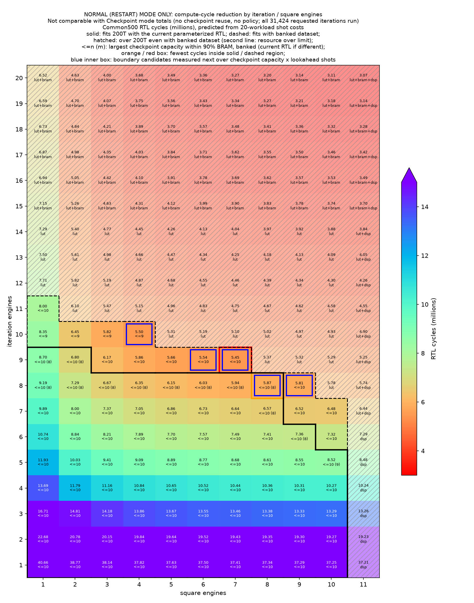

# iteration engines × square engines sweep과 200T resource 판정

기록일: 2026-10-29, Asia/Seoul. 실험 보고서는 [실험 38](../../../documents/reports/38_iteration_square_engine_sweep_200t.md)입니다.

측정 축은 **Normal(Restart) mode의 RTL cycle**입니다. Checkpoint mode의 checkpoint 재사용과 policy stall이 들어가지 않으므로,
Checkpoint mode 총 cycle(예: 실험 26의 Triple-Row Build 4,566,996 cycles)과 비교하는 값이 아닙니다. 200T 판정은
synthesis 결과가 아니라 기존 build의 모듈 단가와 RTL memory 구조로 낸 대략 계산입니다. timing은 판정에 들어가지 않습니다.

## 층화 표본 확인

[`subset_check/`](subset_check/comparison.json)에서 `BENCH_PER_M=4`(target count 1 · 4 · 16 · 64 · 256마다 seed 0~3,
20 workloads)로 iteration engines 4 / square engines 2와 20 / 11 두 구성을 실행했습니다. 정책 설정은 두 구성 모두
[실험 37](../2026-10-29_generalized_e20_m11/evidence.md)의 full Common500 실행과 같습니다.

| 구성 | 같은 20 workloads의 행 일치 | shot당 cycle로 낸 Common500 Normal 합계 | 실측 500 workloads | 차이 |
|---|---|---:|---:|---:|
| iteration 4 · square 2 | Normal 20/20, Checkpoint 20/20 byte 동일 | 11,790,834 | 11,785,382 | +0.046% |
| iteration 20 · square 11 | Normal 20/20, Checkpoint 20/20 byte 동일 | 3,070,602 | 3,065,150 | +0.178% |

workload를 건너뛰어도 남은 workload의 결과와 cycle은 바뀌지 않습니다. 기존 `BENCH_LIMIT` 경로는 수정 뒤에도 iteration
engines 4 / square engines 2의 2 workloads가 500 workloads 실행의 첫 4행과 같았습니다.

Normal mode의 Common500은 iteration 31,424회, measurement 7,403회를 구성과 무관하게 수행합니다. 칸마다 20 workloads의
Normal 행을 iteration 수 · measurement 수 · 상수의 일차식으로 맞추고, 그 계수로 Common500 합계를 냅니다.

## shot당 cycle

220칸 모두에서 계수가 아래 식과 맞았습니다(iteration은 0.5 cycle, measurement는 1.5 cycle 안). 한 workload의 잔차는
최대 89.5 cycle입니다. 512는 amplitude 16,384개를 32 lanes로 나눈 행 수입니다.

| 단위 | cycle |
|---|---|
| iteration 한 번 | 2 × (512 ÷ iteration engines, 올림) + 9 |
| measurement 한 번 | (512 ÷ iteration engines, 올림) + (512 ÷ square engines, 올림) + 약 82 |

iteration engines는 iteration 31,424회의 두 pass와 measurement 7,403회의 한 pass에 걸리고, square engines는 measurement의
한 pass에만 걸립니다. 그래서 같은 행 수를 줄일 때 iteration engines 쪽 효과가 약 9.5배 큽니다. 고정 비용(iteration당 9,
measurement당 약 82)은 engine 수로 줄지 않습니다.

## 200T resource 판정

[resource_model.json](resource_model.json)과 [`sim/engine_sweep.py`](../../sim/engine_sweep.py)의 `estimate()`가 계산식입니다.

- **기준**: xc7a200tfbg484-2에서 LUT · FF 75%, BRAM · DSP 90%. RVX SoC의 accelerator wrapper 밖 사용량(LUT 13,268,
  FF 16,640, BRAM 32 tile, DSP 4)은 2026-10-07 200T build 여섯 벌의 계층별 report에서 top − `i_bbht`의 최댓값입니다.
- **모듈 단가**: 같은 build의 `route_util_hier.rpt`에서 읽었습니다. iteration engine 하나에 datapath · oracle 정렬
  LUT 4,202 · FF 2,985, square engine 하나에 LUT 2,282 · FF 2,601 · BRAM 1 tile · DSP 64입니다.
  고정분은 policy 관련 회로(Checkpoint-Capacity · Lookahead-Shots 3/3)와 제어 회로입니다.
- **amplitude memory BRAM**: bank 수는 iteration engines와 square engines(최소 4) 중 큰 값입니다(`grover_parallel.sv`).
  bank 하나는 736 bit 폭이고 깊이는 Checkpoint-Capacity × (512 ÷ bank 수, 올림)입니다. 깊이 512까지 bank당 11 tile,
  512를 넘는 512마다 bank당 10 tile이 더 붙습니다. 읽기 mux는 읽기 port × 736 bit × (bank 수 ÷ 4, 올림) LUT로 둡니다.
- **dataset 두 가지 가정**:
  - `current`: 지금 일반화 RTL 그대로, iteration engine마다 dataset(16 tile)과 found mask(1 tile)를 복제합니다.
  - `banked`: [실험 37](../../../documents/reports/37_expanded_iteration_and_measurement_engines.md#확장용-memory의-후속-정리)의
    후속 memory 정리를 가정합니다. engine 수로 bank를 나눠 한 벌만 두고, bandwidth상 bank당 8 tile이 최소입니다.
- **확인**: `banked` 식은 기존 RTL의 iteration engines 4 build 두 벌을 LUT 4~8%, FF 1% 안으로 맞추고 BRAM tile은 같게
  냅니다(84 · 83 tile). iteration engines 1 build는 LUT를 20% 크게 냅니다. 일반화 RTL은 bank 수가 최소 4라 BRAM도 11 tile 큽니다.
- **최대 Checkpoint-Capacity**: 연산부가 들어가는 칸에서 BRAM 90% 안에 둘 수 있는 가장 큰 값(1~10)입니다.
  policy의 LUT · memo table BRAM이 Checkpoint-Capacity · Lookahead-Shots에 따라 늘어나는 것은 넣지 않았습니다.

들어가는 칸은 `current` 77칸, `banked` 91칸입니다. 칸별 값은 [feasibility.csv](feasibility.csv)에 있습니다.
square engines 11은 DSP 708개(95.7%)로 두 가정 모두 넘칩니다. 경계 근처에서는 LUT 75%가 먼저 걸립니다.

## 결과



[SVG](normal_mode_heatmap.svg), 칸별 수치는 [summary.csv](summary.csv)에 있습니다. 220칸 모두 실패 없이 끝났습니다
([sim_failures.json](sim_failures.json)). 앞서 2 workers로 끝낸 4칸을 빼고 4 workers로 3,036초가 걸렸습니다.

| 영역 | cycle 최소 칸 | Common500 Normal cycles | iteration 4 · square 2 대비 | LUT | BRAM | 최대 Checkpoint-Capacity |
|---|---|---:|---:|---:|---:|---:|
| `current` 안 | iteration 8 · square 8 | 5,865,991 | 2.01배 | 73.7% | 73.4% | 8 |
| `banked` 안 | iteration 9 · square 7 | 5,448,264 | 2.16배 | 74.1% | 60.0% | 10 |

`banked` 안의 다음 후보는 iteration 10 · square 4(5,504,174 cycles, 최대 Checkpoint-Capacity 9)와 iteration 9 · square 6
(5,537,100)입니다. 대비 기준 iteration 4 · square 2는 같은 식으로 낸 11,790,834 cycles입니다. iteration 4 · square 3은
11,161,579 cycles로, 실험 26의 Triple-Row Build Restart mode 기록 11,156,127과 0.05% 차이입니다.

같은 iteration engines 줄 안에서 square engines를 늘려 얻는 폭은 작습니다. iteration engines 8 줄은 square engines
4 → 8에서 6,347,186 → 5,865,991입니다. iteration engines를 하나 늘리면 줄 전체가 내려갑니다. square engines 8 열은
iteration engines 7 · 8 · 9에서 6,568,501 · 5,865,991 · 5,374,234입니다.

## 일반화 RTL synthesis 시도

iteration engines 20 / square engines 11, Checkpoint-Capacity · Lookahead-Shots 1/1의 `bbht_rvx_wrapper` OOC synthesis를
[`engine_ooc.tcl`](../../synth/engine_ooc.tcl)로 두 번 시도했고 둘 다 끝나지 않았습니다. 첫 시도는 Tcl의
`read_verilog -define`이 이 Vivado 설정에서 거부되어 시작 전에 멈췄고, `synth_design -verilog_define`으로 고쳤습니다.
두 번째 시도는 [vivado_failed.log](synth/k1h1e20m11/vivado_failed.log)에 남아 있습니다.

- `grover_parallel.sv:47`의 `g_bank[*].mem_reg`가 "RAM has multiple writes via different ports in same process"로
  BRAM · LUTRAM 추론에 실패해 register로 풀렸습니다(bank당 19,136 bit). `grover_policy_parameterized.sv:523`의
  `cache_reg`도 같습니다.
- 약 49초 뒤 log가 중간에 끊긴 채 종료되었고 최대 RSS는 9.2 GB였습니다. container 메모리 한도로 강제 종료된 것으로
  보지만 kernel OOM 기록은 확보하지 않았습니다.

따라서 지금 일반화 RTL은 simulation 지원 범위이고, 200T에 구현하려면 amplitude memory와 policy cache를 bank당 한
write port로 쓰는 형태로 고쳐야 합니다. 위 resource 판정이 synthesis 대신 대략 계산인 이유입니다.

## 파일

- `cells/e<iteration engines>m<square engines>/`: 칸마다 `config.json`, `manifest.json`(전체 source SHA-256),
  `source/adapter.v`, `bench.csv`, `integration.json`, `model.json`, `simulation.log`. 정책 설정은 Checkpoint-Capacity ·
  Lookahead-Shots 3/3, policy search mode 6, 4 scan lanes, generic backend입니다.
- `shared/`: 모든 칸이 공유한 source와 workload 한 벌. 칸마다 복사된 사본은 SHA-256 대조 뒤 지웠습니다.
- Verilator 경고 log, Checkpoint 행의 policy trace, workload 생성 log는 다시 돌리면 나오므로 남기지 않았습니다.
  policy replay 검사 결과는 `integration.json`에 있습니다.

## 재실행

```bash
cd hardware_bram/sim
python3 engine_sweep.py model --out ../results/2026-10-29_engine_sweep
BBHT_BUILD_JOBS=2 python3 engine_sweep.py sim --out ../results/2026-10-29_engine_sweep --workers 4
python3 engine_sweep.py plot --out ../results/2026-10-29_engine_sweep
python3 generalize_main.py --config <config.json> --out <dir> --per-m 4 --no-console   # 한 칸만
```

`sim`은 `integration.json`이 있는 칸을 건너뜁니다. 한 칸은 compile을 포함해 20초~3분이 걸립니다.
