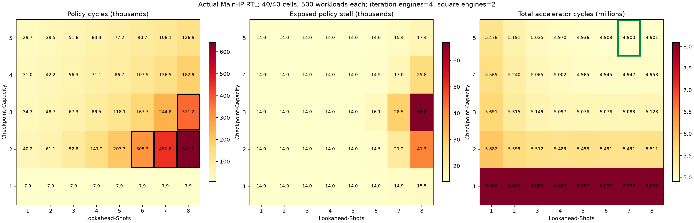

# Generalized Main IP Common500 and fixed-parallelism policy campaign

기록일: 2026-10-29, Asia/Seoul.

## Scope and current state

Checkpoint-Capacity 1~5, Lookahead-Shots 1~8의 40개 조합을 실제 Main IP RTL로 검증합니다.
iteration engines 4 / square engines 2, policy mode 6, 4 scan lanes를 고정했습니다.
한 조합마다 정식 Common500의 전체 500 workloads를 Normal / Checkpoint 순으로 실행합니다.
측정 축은 RTL clocks입니다. 전체 RVX SoC, 합성, timing, board 검증은 이 campaign의 범위가 아닙니다.

**40개 조합이 모두 통과했습니다.** 총 20,000 workload pairs / 40,000 result rows와
316,120개 완료 solver jobs, 296,120개 accepted plans를 검증했습니다.
최종 검증은 [final_checks.json](final_checks.json), 실제 수치는 [summary.csv](kh40_final/summary.csv),
모든 설정과 결과 경로는 [result.json](kh40_final/result.json)에 있습니다.
두 worker의 전체 실행 시간은 3,146.9초(약 52분 27초)이며, 앞서 완료한 baseline 셀 하나는 동일 입력
검증 후 재사용했습니다. 각 model compile은 한 thread로 제한했습니다. 별도 200T background job의 상태는 조회하지 않았습니다.
[campaign_plan.json](campaign_plan.json)이 사용자와 정한 범위입니다.

## Final heatmaps and selection within the fixed parallelism



[SVG](kh40_final/kh_heatmap_detail.svg), [전체 분석](kh40_final/analysis.json).
검은 테두리는 policy 300,000 clocks를 넘은 셀이며, 녹색 테두리는 최소 전체 cycles입니다.
모든 값은 한 configuration의 500 workloads 합계입니다.

| Checkpoint-Capacity | Lookahead-Shots | policy cycles | policy stall | 전체 cycles | 최대 한 solver 결정 |
|---:|---:|---:|---:|---:|---:|
| 5 | 5 | 77,173 | 14,013 | 4,935,925 | 78 |
| 5 | 6 | 90,745 | 14,013 | 4,909,455 | 300 |
| **5** | **7** | **106,099** | **15,373** | **4,900,210** | **713** |
| 5 | 8 | 126,878 | 17,446 | 4,901,029 | 1,239 |

고정 iteration engines 4 / square engines 2에서 최소 전체 cycle은 capacity 5 / lookahead 7입니다.
기존 optimized backend의 capacity 3 / lookahead 3보다 전체 cycles가 4.87% 줄었습니다.
이 결과는 200T 자원이나 timing을 포함한 전체 parameter 최적점이 아닙니다.
큰 iteration / square 병렬도에서는 연산과 policy의 overlap이 줄 수 있으므로 더 짧은 lookahead 후보도
유지합니다. 위 표의 최대 한 결정 clock은 그 후속 검토를 위한 실제 관측치입니다.

Policy 300,000 clocks 목표를 만족한 셀은 **36/40**입니다. 나머지는 아래와 같습니다.

| Checkpoint-Capacity | Lookahead-Shots | policy cycles |
|---:|---:|---:|
| 2 | 6 | 305,318 |
| 2 | 7 | 450,813 |
| 2 | 8 | 642,034 |
| 3 | 8 | 371,158 |

따라서 이 작업으로 모든 parameter에서 300,000 clocks 목표를 달성했다고 선언하지 않습니다.
capacity 5에서는 lookahead 8까지 모두 목표 안에 들어왔습니다.
최악인 capacity 2 / lookahead 8의 모든 완료 job을 상태별로 세면 응답·평가·종료·복귀가 47.8%,
SCAN / cache / replay가 38.1%, BUILD / MAP / PREP가 13.4%, 단일 root 반환이 0.7%였습니다.
이 분해의 분모는 모든 완료 job clocks이며, run 밖 또는 취소된 결과를 제외할 수 있는 CSR 합계와 구분합니다.
[phase_summary.csv](kh40_final/phase_summary.csv), [병목 그림](kh40_final/policy_bottlenecks.png)이 근거입니다.

## Full Common500 baseline

[기존 optimized backend와 일반화 physical kernel](k3h3e4m2_initial/integration.json)은
500 workloads / 1,000 rows 검증을 통과했습니다. 정책의 source / tuple은 7,903개 완료 solver job마다
독립 exact reference와 같았습니다. 모든 Normal / Checkpoint CSV bytes도 직전 고정 source와
일치했습니다([baseline_comparison.json](baseline_comparison.json)).

| 실행 | policy cycles | policy stall | 전체 cycles | physical iterations |
|---|---:|---:|---:|---:|
| 기존 optimized backend | 80,719 | 16,363 | 5,150,965 | 9,582 |
| 개선 generic backend | 67,280 | 14,013 | 5,148,615 | 9,582 |

개선 generic backend의 원자료는 [integration](k3h3e4m2_fast/integration.json),
[console](k3h3e4m2_fast/console.json)입니다. console의 Enumeration 순서는
`8685, 2852, 507, 4724`로 같고 same-Oracle warm restart도 통과했습니다.
위 표는 backend가 다른 두 실제 통합 실행의 비교입니다.
physical work와 결과가 같아도 solver 구현 방식과 telemetry actions는 다를 수 있습니다.

## Added exact shortcuts

`grover_ckpt_policy_generic`에 아래 작업을 반영했습니다. `FAST_PATHS`로 같은 generic RTL의 단축 경로를
분리할 수 있으며 기본값은 1입니다. 기존 production rolling backend의 계산 로직은 바꾸지 않았습니다.

1. Mode 6의 단일 root action을 입력 packet에서 판정합니다. universe BUILD와 MAP 전에 sorted tuple을
   결정하고 한 clock 뒤 반환합니다. request-only policy timing queue는 추가하지 않았습니다.
2. 내부 frame의 child가 하나면 SCAN / lower-bound pipeline을 거치지 않고 정확한 tail 비용을 구합니다.
3. 마지막 두 요청은 non-root에서 최적 predecessor의 합집합으로 비용을 직접 구합니다. root에는 tuple
   동률 순서가 필요하므로 후보 SCAN의 정확한 마지막-request bound를 사용합니다.

단일 root에서 `root_cost`를 immediate cost로 반환하는 기존 mode 6의 lower-bound telemetry 계약은
유지합니다. 여러 후보의 root는 cost / segment count / ascending tuple 동률 규칙을 그대로 지킵니다.
epoch wrap 중 accepted input과 결과도 보존합니다.

독립 exhaustive DP와 비교한 parameterized unit 232건이 통과했습니다
([fast_path_units](fast_path_units/)). 새 reference verifier는 gap별 최대 요구 offset의 합을 admissible
bound로 사용해 정확한 DP를 가속합니다. pruning 전 exhaustive DP와 800개 state/window를 비교했고
source / tuple / cost / segments가 모두 같았습니다([reference_crosscheck.json](reference_crosscheck.json)).
해당 regression은 [`test_generalize_reference.py`](../../sim/test_generalize_reference.py)에 있습니다.
단축 경로를 끈 별도 29건도 통과했습니다([disabled-path unit](fast_paths_disabled_unit/result.json)).
기존 optimized backend에 대한 새 phase observer의 elaboration도 통과했습니다
([lint result](optimized_profile_lint/result.json)).

동일한 7,903개 Main-IP 입력을 이전 generic RTL과 변경 RTL에 각각 넣은 별도 controlled replay도
통과했습니다([controlled result](controlled_k3h3/result.json)). 각 입력의 source / tuple / root cost /
segments를 exact reference와, `policy_cycles_last`를 실제 start-to-done edge 수와 대조했습니다.

| 동일 입력 solver replay | 총 cycles | 최대 한 결정 cycles | memo misses |
|---|---:|---:|---:|
| 변경 전 generic | 145,281 | 43 | 6,540 |
| 변경 후 generic | 67,280 | 33 | 4,360 |

이 53.7% 감소는 **동일 generic backend의 독립 solver clocks 비교**입니다. 이전 전체 시스템이 같은
작업 발행 순서를 따랐다고 가정한 counterfactual system speedup으로 인용하지 않습니다.

빨라진 completion에도 mismatch / flush와 epoch 재사용을 안전하게 처리하는지 실제 driver의
[mismatch injection](fast_mismatch/integration.json), [cancelled epoch reuse](fast_epoch_reuse/integration.json)로
검사했습니다. 각각 요구한 injection 한 건이 관측되었고 잘못된 plan 수락 없이 결과가 일치했습니다.

## Measurement and reproducibility

전 셀은 `force_generic: true`로 같은 generic backend를 사용합니다. 기존 기본 JSON의
`force_generic: false`는 지원 범위에서 기존 optimized backend를 선택하므로 수치를 구분합니다.
iteration / square engines 수는 사용자 지시대로 고정하며 `k` / `h`만 바꿉니다.

각 `integration.json`은 실제 CSR의 Checkpoint-mode cycle 합계와 독립 policy replay 결과를 기록합니다.
개별 `bench.csv`의 `k4`는 공용 testbench의 기존 Checkpoint-mode 문자열입니다. 실제 capacity는
`manifest.json`의 `config.k`를 따릅니다. 개별 benchmark의 `m` 열은 dataset의 solution 수이며,
campaign의 `summary.csv`에 기록한 `m=2`는 square engines 수입니다.
그 안의 `phase_cycles`는 passive observer가 실제 busy edge를 상태별로 센 값이며, 모든 완료 job의
합이 해당 job의 하드웨어 cycle counter와 같은지 검사합니다. 각 cell의 입력·RTL hash와 adapter hash를
별도 manifest로 고정합니다. 실행 중 source가 바뀌면 다음 cell을 거절합니다.

model cache는 source와 adapter hash가 모두 같은 경우에만 재사용합니다. 완료 결과를 재사용할 때도
config / workload 수 / source hash / 검증 결과를 대조합니다. 최초 소규모 runner의 상대 reuse path
처리 오류는 `kh40/`에 보존했고 수정한 최종 campaign은 `kh40_final/`입니다. 이 도구 오류를 RTL
정답 실패로 세지 않습니다.

```bash
python3 hardware_bram/sim/generalize_campaign.py \
  --config hardware_bram/sim/generalize_config.json \
  --plan hardware_bram/results/2026-10-29_generalized_common500/campaign_plan.json \
  --out /tmp/bbht_generalized_common500_kh40
```

[first_parallel_eta.json](kh40_final/first_parallel_eta.json)은 첫 실제 두 셀에서 측정한 경과 시간과 당시
남은 시간 추정입니다. 완료 뒤 생긴 모든 실제 시간을 대신하는 기록이 아닙니다.

## After these heatmaps

사용자와 정한 후속 순서는 [roadmap.json](roadmap.json)입니다. 200T의 LUT / FF / BRAM / DSP와
memory port / bank / replication 비용을 추정한 뒤 대표 구성의 synthesis / timing으로 보정합니다.
그 feasible range에서 실제 total cycles / policy stall을 기준으로 유망 구성을 찾고 heatmap을 확장합니다.
현재 generic amplitude / dataset / found-mask memory와 candidate cache는 simulation 우선 구조이므로
단순 bit 수와 실제 BRAM mapping을 구분해야 합니다. 이 문서의 cycle 결과는 200T fitting을 보증하지 않습니다.
