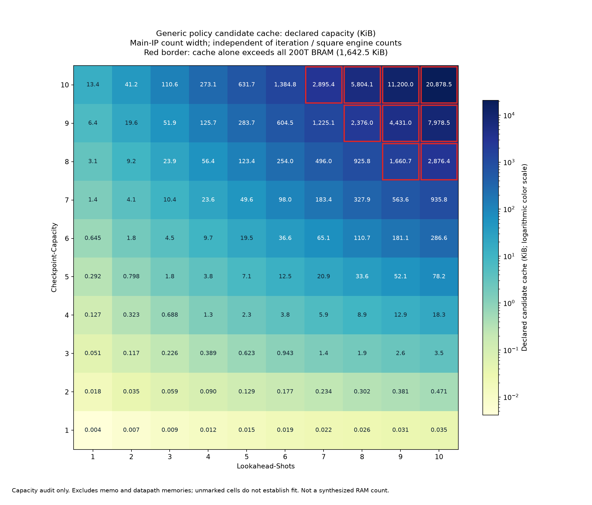

# Generic policy storage capacity audit

기록일: 2026-10-29, Asia/Seoul. simulation이나 synthesis를 새로 실행하지 않고 현재 RTL의
candidate cache와 memo 선언 용량을 계산했습니다. Checkpoint-Capacity와 Lookahead-Shots 각각
1~10의 100개 조합입니다. iteration PE와 square engine 개수는 두 array의 선언식에 들어가지 않습니다.

## 계산 범위

대상은 [`grover_ckpt_policy_generic`](../../src/grover_policy_parameterized.sv)입니다.
Main IP는 `CKPT_COUNT_W`를 전달하므로 Checkpoint-Capacity가 4 이하일 때 count width는 3 bits,
그보다 크면 capacity를 포함하여 표현할 수 있는 bit 수입니다. 독립 solver의 기본 count width로
계산하면 작은 capacity에서 약간 다른 값이 나오므로 실제 Main-IP 연결을 기준으로 합니다.
기존 production rolling backend를 선택한 구성에는 이 표를 그대로 적용하지 않습니다.

- universe 크기는 Checkpoint-Capacity와 Lookahead-Shots의 합에 1을 더한 값입니다.
- frame당 확보하는 후보 수는 두 값의 합에서 0개부터 capacity보다 하나 적은 개수까지 선택하는
  모든 조합 수의 합입니다. 후보 entry는 universe mask, segment count와 11-bit lower bound입니다.
- candidate cache는 그 frame 용량을 현재 request를 포함한 모든 깊이에 확보합니다.
- memo는 기본 4,096 entries입니다. entry마다 16-bit solve epoch, universe mask, 4-bit depth,
  11-bit exact cost를 계산합니다.

이는 **현재 RTL의 최악 경우를 위한 선언 용량**입니다. 실제 workload의 후보 최대 사용량이나
algorithm에 필요한 최소 메모리량이 아닙니다. 단일 후보 경로, 사용하지 않는 depth의 synthesis
제거, 실제 RAM 너비 / 깊이의 padding과 port 구현을 예측하지 않습니다.
`candidate_bram36_capacity_min`은 순수 bit 수를 36 Kibit로 나눈 올림이며 실제 RAMB 수가 아닙니다.
memo 외에 DFS registers, lower-bound pipeline, metadata, Plan Queue와 연산부 memory도 따로 필요합니다.

## 결과

[전체 상세 CSV](capacity.csv), [candidate KiB 행렬 CSV](candidate_kib.csv),
[계산 조건과 source hash](method.json), [재현 script](calculate.py).



빨간 테두리는 candidate cache 선언만으로 200T 전체 BRAM 용량을 넘는 칸입니다.
나머지 칸이 전체 SoC에 들어간다는 뜻은 아닙니다. graph는 candidate cache만 보여주며 memo를 포함하지 않습니다.
KiB는 1,024 bytes이고 graph의 color scale은 logarithmic입니다.

M/E에 해당하는 연산부 개수는 선언 용량에 직접 영향을 주지 않습니다. 다만 연산부와 policy가
같은 FPGA 자원을 사용하므로 연산부 확장으로 남는 memory가 줄면 구현 가능한 policy 설정도 달라집니다.
병렬도에 따른 speculation 완료 시점이나 실제 사용량 변화와 고정 array의 선언 용량을 구분합니다.

기존 normal-mode resource 표의 최대 checkpoint 수는 amplitude memory 기준이며 policy cache 증가를
포함하지 않았습니다. 해당 추정의 한계는
[실험 38](../../../documents/reports/38_iteration_square_engine_sweep_200t.md#한계와-다음-단계)에 있습니다.
generic cache가 BRAM으로 추론되지 않은 기존 OOC 기록도 같은 실험의 evidence에 있습니다.

## 재현

```bash
python3 hardware_bram/results/2026-10-29_policy_cache_capacity/calculate.py
```
