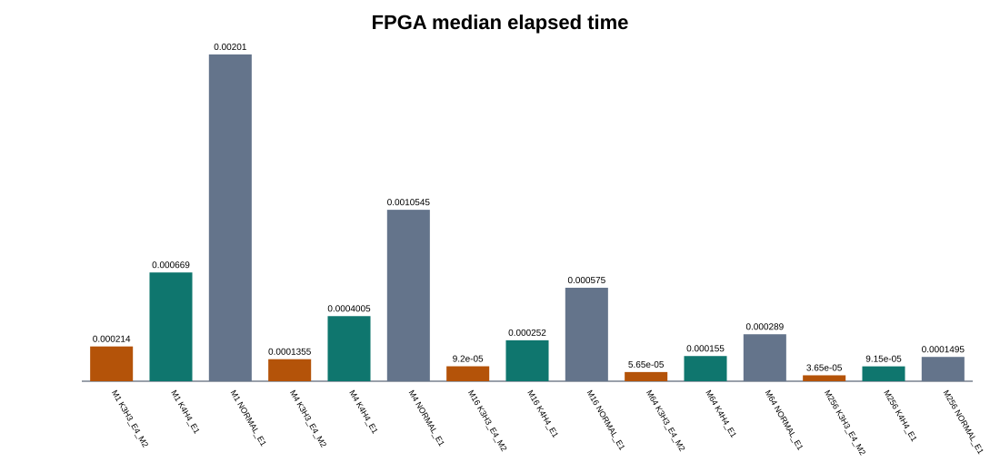
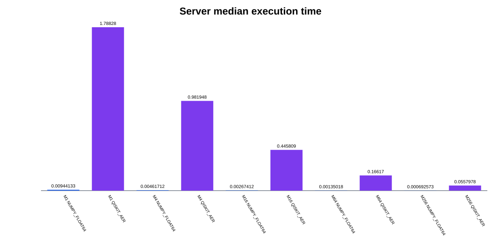

# 14 qubits BBHT 공통 500-workload 비교 결과

## 1. 실험 계약

| 항목 | 값 |
| --- | --- |
| search space | 14 qubits, 16,384 states |
| data | signed 16-bit, 공식 board dataset |
| oracle | EQ, threshold 0xA55A |
| number of solutions | 1, 4, 16, 64, 256 |
| seed | 공식 roster 100쌍 |
| 공통 workload | 500개 |
| BBHT | 초기 sampling range 1, growth factor 6/5, sampling range 상한 128, BBHT budget 576 |
| amplitude reference model | signed Q1.22, AMP_W=23 |

## 2. 비교 대상

| 분류 | Backend | 역할 |
| --- | --- | --- |
| software | `NUMPY_FLOAT64` | 직접 state vector Float64 baseline |
| software | `QISKIT_AER_STATEVECTOR` | 범용 quantum simulator baseline |
| reference model | `RTL_FIXED_NORMAL` | Q1.22 bit-exact Restart mode 기준 |
| reference model | `SOFTWARE_K4H4` | 과거 a Checkpoint-Capacity of 4 · 4-shot Lookahead checkpoint policy 기준 |
| reference model | `SOFTWARE_K3H3` | 최종 a Checkpoint-Capacity of 3 · 3-shot Lookahead checkpoint policy 기준 |
| FPGA | `FPGA_NORMAL_E1` | 팀원 board benchmark Restart mode |
| FPGA | `FPGA_K4H4_E1` | 팀원 board benchmark Stage 2 |
| FPGA | `FPGA_K3H3_E4_M2` | 팀원 board benchmark final configuration |

## 3. 정합성

| 검사 | PASS/실행 | 미실행 |
| --- | ---: | ---: |
| `numpy_qiskit_logical_match` | 500/500 | 0 |
| `fixed_fpga_normal_match` | 500/500 | 0 |
| `software_k4_fpga_k4_logical_match` | 500/500 | 0 |
| `software_k4_fpga_k4_physical_iter_match` | 500/500 | 0 |
| `software_k3_fpga_k3_logical_match` | 500/500 | 0 |
| `software_k3_fpga_k3_physical_iter_match` | 500/500 | 0 |
| `all_fpga_logical_match` | 500/500 | 0 |

`actual_grover_iterations`는 checkpoint policy에서 실제로 수행한 Grover iteration, 곧 executed iterations다.
동일 policy의 reference model과 FPGA 값은 정확히 일치해야 한다. policy solver latency,
Plan Queue stall, 4 PEs · Dual-Row Build · Two-Level Select 최적화는 이 값이 아니라 FPGA `cycle_count`에
반영된다. workload별 executed iterations 차이는 `checkpoint_model_fpga_iteration_delta.csv`에 기록한다.

## 4. FPGA 실행시간

| number of solutions | Restart mode total (µs) | Stage 2 total (µs) | final configuration total (µs) | Restart mode 대비 final configuration speedup | Stage 2 대비 final configuration speedup |
| ---: | ---: | ---: | ---: | ---: | ---: |
| 1 | 209754 | 72598 | 22818 | 9.192× | 3.182× |
| 4 | 106615 | 40806 | 13748 | 7.755× | 2.968× |
| 16 | 61934 | 26272 | 9432 | 6.566× | 2.785× |
| 64 | 30990 | 15620 | 5942 | 5.215× | 2.629× |
| 256 | 16209 | 9601 | 3858 | 4.201× | 2.489× |

## 5. backend별 결과

| number of solutions | backend | runs | success | median shots | median requested iterations | median runtime (s) | scope |
| ---: | --- | ---: | ---: | ---: | ---: | ---: | --- |
| 1 | `FPGA_K3H3_E4_M2` | 100 | 1.000 | 23.0 | 163.5 | 0.000214000 | `BOARD_COMMAND_TO_RESULT_ELAPSED` |
| 1 | `FPGA_K4H4_E1` | 100 | 1.000 | 23.0 | 163.5 | 0.000669000 | `BOARD_COMMAND_TO_RESULT_ELAPSED` |
| 1 | `FPGA_NORMAL_E1` | 100 | 1.000 | 23.0 | 163.5 | 0.002010000 | `BOARD_COMMAND_TO_RESULT_ELAPSED` |
| 1 | `NUMPY_FLOAT64` | 100 | 1.000 | 23.0 | 149.5 | 0.009441335 | `NUMPY_CORE_ONLY` |
| 1 | `QISKIT_AER_STATEVECTOR` | 100 | 1.000 | 23.0 | 149.5 | 1.788283234 | `AER_EXECUTION_ONLY` |
| 1 | `RTL_FIXED_NORMAL` | 100 | 1.000 | 23.0 | 163.5 | 0.024943554 | `PYTHON_FIXED_MODEL_WALL` |
| 1 | `SOFTWARE_K3H3` | 100 | 1.000 | 23.0 | 163.5 | 0.012918605 | `PYTHON_FIXED_MODEL_WALL` |
| 1 | `SOFTWARE_K4H4` | 100 | 1.000 | 23.0 | 163.5 | 0.020287969 | `PYTHON_FIXED_MODEL_WALL` |
| 4 | `FPGA_K3H3_E4_M2` | 100 | 1.000 | 19.0 | 77.0 | 0.000135500 | `BOARD_COMMAND_TO_RESULT_ELAPSED` |
| 4 | `FPGA_K4H4_E1` | 100 | 1.000 | 19.0 | 77.0 | 0.000400500 | `BOARD_COMMAND_TO_RESULT_ELAPSED` |
| 4 | `FPGA_NORMAL_E1` | 100 | 1.000 | 19.0 | 77.0 | 0.001054500 | `BOARD_COMMAND_TO_RESULT_ELAPSED` |
| 4 | `NUMPY_FLOAT64` | 100 | 1.000 | 19.0 | 74.5 | 0.004617119 | `NUMPY_CORE_ONLY` |
| 4 | `QISKIT_AER_STATEVECTOR` | 100 | 1.000 | 19.0 | 74.5 | 0.981947869 | `AER_EXECUTION_ONLY` |
| 4 | `RTL_FIXED_NORMAL` | 100 | 1.000 | 19.0 | 77.0 | 0.012047712 | `PYTHON_FIXED_MODEL_WALL` |
| 4 | `SOFTWARE_K3H3` | 100 | 1.000 | 19.0 | 77.0 | 0.006592981 | `PYTHON_FIXED_MODEL_WALL` |
| 4 | `SOFTWARE_K4H4` | 100 | 1.000 | 19.0 | 77.0 | 0.006687974 | `PYTHON_FIXED_MODEL_WALL` |
| 16 | `FPGA_K3H3_E4_M2` | 100 | 1.000 | 16.0 | 35.0 | 0.000092000 | `BOARD_COMMAND_TO_RESULT_ELAPSED` |
| 16 | `FPGA_K4H4_E1` | 100 | 1.000 | 16.0 | 35.0 | 0.000252000 | `BOARD_COMMAND_TO_RESULT_ELAPSED` |
| 16 | `FPGA_NORMAL_E1` | 100 | 1.000 | 16.0 | 35.0 | 0.000575000 | `BOARD_COMMAND_TO_RESULT_ELAPSED` |
| 16 | `NUMPY_FLOAT64` | 100 | 1.000 | 16.0 | 35.0 | 0.002674120 | `NUMPY_CORE_ONLY` |
| 16 | `QISKIT_AER_STATEVECTOR` | 100 | 1.000 | 16.0 | 35.0 | 0.445809176 | `AER_EXECUTION_ONLY` |
| 16 | `RTL_FIXED_NORMAL` | 100 | 1.000 | 16.0 | 35.0 | 0.007630012 | `PYTHON_FIXED_MODEL_WALL` |
| 16 | `SOFTWARE_K3H3` | 100 | 1.000 | 16.0 | 35.0 | 0.004557010 | `PYTHON_FIXED_MODEL_WALL` |
| 16 | `SOFTWARE_K4H4` | 100 | 1.000 | 16.0 | 35.0 | 0.004674265 | `PYTHON_FIXED_MODEL_WALL` |
| 64 | `FPGA_K3H3_E4_M2` | 100 | 1.000 | 11.0 | 13.0 | 0.000056500 | `BOARD_COMMAND_TO_RESULT_ELAPSED` |
| 64 | `FPGA_K4H4_E1` | 100 | 1.000 | 11.0 | 13.0 | 0.000155000 | `BOARD_COMMAND_TO_RESULT_ELAPSED` |
| 64 | `FPGA_NORMAL_E1` | 100 | 1.000 | 11.0 | 13.0 | 0.000289000 | `BOARD_COMMAND_TO_RESULT_ELAPSED` |
| 64 | `NUMPY_FLOAT64` | 100 | 1.000 | 11.0 | 13.5 | 0.001350182 | `NUMPY_CORE_ONLY` |
| 64 | `QISKIT_AER_STATEVECTOR` | 100 | 1.000 | 11.0 | 13.5 | 0.166170394 | `AER_EXECUTION_ONLY` |
| 64 | `RTL_FIXED_NORMAL` | 100 | 1.000 | 11.0 | 13.0 | 0.004064452 | `PYTHON_FIXED_MODEL_WALL` |
| 64 | `SOFTWARE_K3H3` | 100 | 1.000 | 11.0 | 13.0 | 0.002861535 | `PYTHON_FIXED_MODEL_WALL` |
| 64 | `SOFTWARE_K4H4` | 100 | 1.000 | 11.0 | 13.0 | 0.002968655 | `PYTHON_FIXED_MODEL_WALL` |
| 256 | `FPGA_K3H3_E4_M2` | 100 | 1.000 | 7.0 | 5.0 | 0.000036500 | `BOARD_COMMAND_TO_RESULT_ELAPSED` |
| 256 | `FPGA_K4H4_E1` | 100 | 1.000 | 7.0 | 5.0 | 0.000091500 | `BOARD_COMMAND_TO_RESULT_ELAPSED` |
| 256 | `FPGA_NORMAL_E1` | 100 | 1.000 | 7.0 | 5.0 | 0.000149500 | `BOARD_COMMAND_TO_RESULT_ELAPSED` |
| 256 | `NUMPY_FLOAT64` | 100 | 1.000 | 7.0 | 5.0 | 0.000692573 | `NUMPY_CORE_ONLY` |
| 256 | `QISKIT_AER_STATEVECTOR` | 100 | 1.000 | 7.0 | 5.0 | 0.055797827 | `AER_EXECUTION_ONLY` |
| 256 | `RTL_FIXED_NORMAL` | 100 | 1.000 | 7.0 | 5.0 | 0.002386687 | `PYTHON_FIXED_MODEL_WALL` |
| 256 | `SOFTWARE_K3H3` | 100 | 1.000 | 7.0 | 5.0 | 0.001770503 | `PYTHON_FIXED_MODEL_WALL` |
| 256 | `SOFTWARE_K4H4` | 100 | 1.000 | 7.0 | 5.0 | 0.001820332 | `PYTHON_FIXED_MODEL_WALL` |

## 6. 해석 규칙

- 동일 seed에서 `requested_j`, measurement prefix sum, 결과 index를 비교한다.
- a Checkpoint-Capacity of 4 · 4-shot Lookahead와 a Checkpoint-Capacity of 3 · 3-shot Lookahead의 checkpoint는 논리 결과를 바꾸면 안 되며 reference model과 FPGA의 `actual_grover_iterations`도 같아야 한다.
- 4 PEs · Dual-Row Build · Two-Level Select는 FPGA Iteration Datapath와 Measurement Unit의 cycle 최적화이므로 software a Checkpoint-Capacity of 3 · 3-shot Lookahead의 wall-clock time으로 대체하지 않는다.
- FPGA 시간은 board command-to-result, NumPy는 core 계산, Qiskit은 Aer execution이다. 서로 다른 platform의 절대시간 비율은 참고값이며, FPGA configuration 간 speedup만 직접 성능 주장에 사용한다.
- Qiskit build/transpile 시간은 원시 결과의 별도 열에 남긴다.

## 7. 결과 출처와 범위

| 항목 | 출처 | 범위 |
| --- | --- | --- |
| NumPy·Qiskit 시간과 결과 | 본 software package의 server 실행 | 14 qubits, EQ, Common500 |
| fixed-point·checkpoint 결과 | 본 software RTL reference model | Q1.22, Restart mode / a Checkpoint-Capacity of 4 · 4-shot Lookahead / a Checkpoint-Capacity of 3 · 3-shot Lookahead |
| FPGA 시간·cycle | 팀원 board benchmark CSV | 100 MHz, DMA dataset load 제외 |
| requested iterations test vector | fixed-point state vector reference model | 256 RTL regression cases |
| enumeration test vector | software 재load 및 projected Found Mask model | Common500 성능 비교에는 미포함 |

이 보고서의 FPGA 수치는 software에서 추정한 값이 아니라 팀원이 제공한 board
benchmark 값이다. DRAM Variant 방식(모든 number of iterations의 amplitude 저장)은 reference model에 선택 가능한 policy로만 남아 있으며,
이 Common500 실행과 FPGA 성능표에는 포함되지 않았다.
