# 1장. project 개요

> [← index](index.md) · [2장 개발 환경과 toolchain →](02_development_environment_and_toolchain.md)

---

## 1.1 implementation 대상

host가 dataset과 predicate를 전달하면 FPGA의 accelerator가 Grover search를
emulation하고, predicate를 만족하는 원소의 index를 반환합니다.

predicate는 네 가지입니다.

| predicate | 뜻 | threshold |
|---|---|---|
| `LT` | `x < A` | `A` |
| `GT` | `x > A` | `A` |
| `EQ` | `x == A` | `A` |
| `RANGE` | `A < x < B` (open interval) | `A`, `B` |

전부 16-bit signed 비교이고 경계는 포함하지 않습니다. predicate를 만족하는 칸이 여러 개일 때
하나만 돌려주는 single search와, 전부 차례로 돌려주는 enumeration이 둘 다 있습니다.

solution이 몇 개인지 모르는 채로 search해야 하므로 algorithm은 순수 Grover가 아니라
BBHT(Boyer–Brassard–Høyer–Tapp)입니다. number of iterations를 무작위로 뽑아 한 번 돌려 보고,
measurement로 나온 index를 solution check로 검사해서 틀렸으면 sampling range를 키워 다시 뽑습니다. 자세한 것은
[3장](03_grover_and_bbht_algorithm.md).

### 설계 전제

- oracle은 solution index를 모릅니다. oracle이 보는 것은 data 값과 threshold뿐이고,
  predicate를 만족하는 칸의 amplitude sign을 뒤집습니다. solution index를 알고 그 자리를 뒤집는
  implementation이 아닙니다.
- measurement는 Born rule을 따릅니다. amplitude square에 비례하는 probability로 뽑습니다. amplitude가 가장 큰
  칸을 그냥 고르는 방식은 BBHT의 통계를 무너뜨리므로 쓰지 않았습니다.
- 고전 선형 scan보다 빠르지 않습니다. emulation은 원리상 고전 scan보다 느립니다.
  이 장치의 비교 대상은 같은 일을 software로 emulation했을 때이고, 인용 경계는
  1.5절에 적었습니다.

---

## 1.2 확정 spec

| 항목 | 확정 값 | source of truth |
|---|---|---|
| qubit | 14 qubits (16,384 states) | `grover_param.vh` |
| data word | 16-bit signed | [6장](06_data_representation_and_memory_map.md) |
| amplitude | 23-bit signed, Q1.22 계열 | 같음 |
| uniform amplitude | raw 32768 | `GP_INIT_AMP_RAW` |
| parallelism | 32 lanes × 512 rows | `GP_P` · `GP_ROWS` |
| predicate | `LT` `GT` `EQ` `RANGE` | `GP_MODE_*` |
| execution mode | `MANUAL_SINGLE` `RESTART_SINGLE` `CHECKPOINT_SINGLE` `RESTART_ENUMERATION` `CHECKPOINT_ENUMERATION` | [13장](13_csr_registers_and_execution_modes.md) |
| CSR | APB slave, base `0xE2020000`, 4-byte 간격, 32 bits, 38개 | [`bbht_grover_csr.json`](../../spec/bbht_grover_csr.json) |
| data load | AHB master SINGLE, single outstanding | [7장](07_bus_interface.md) |
| load 원본 | system SRAM `0xE0000000`~`0xE001FFFF` | 같음 |
| Result FIFO | 깊이 256 | `GP_RESULT_FIFO_DEPTH` |
| BBHT budget | `REQUESTED_ITERATIONS` 누적 576 | `GP_BBHT_BUDGET` |
| shot cap | runtime 입력, 기본 100 | `GP_SHOT_CAP_DEFAULT` |
| clock | accelerator 100 MHz / system 50 MHz | [`bbht_grover_final.xml`](../../hardware_bram/configurations/final/rvx/bbht_grover_final.xml) |
| board | Arty A7-100T (`xc7a100tcsg324-1`) | 같음 |
| final configuration | a Checkpoint-Capacity of 3, 3-shot Lookahead, 4 PEs, Dual-Row Build · Two-Level Select | 1.4절 |

---

## 1.3 system layer

system은 다음 네 layer로 구성됩니다.

1. host: [`software/host_fpga_develop/bbht_cli.py`](../../software/host_fpga_develop/bbht_cli.py) 또는 그냥
   serial terminal. ASCII 한 줄을 보내고 한 줄씩 받습니다. 문법은 [14장](14_host_interface_and_uart_protocol.md).
2. RVX SoC (50 MHz): ORCA RV32 core가 명령을 parse하고
   [`bbht_grover_driver.c`](../../hardware_bram/firmware/bbht_grover_driver.c)를 통해 CSR을
   씁니다. dataset은 core가 system SRAM에 올려 두고, accelerator가 AHB master로 직접
   끌어갑니다.
3. Bus Interface: `bbht_grover_mmio`(APB slave·CSR 38개), `bbht_ahb_loader`(AHB
   master·SINGLE 전송), 그리고 계약 이름과 실물 module 이름을 잇는 얇은 adapter. [7장](07_bus_interface.md).
4. Accelerator Core (100 MHz): state vector amplitude와 dataset을 BRAM에 들고 Grover iteration · Born-rule
   sampling · solution check · BBHT 제어를 전부 수행합니다. [8장](08_accelerator_core_top_and_bbht_control.md)~[11장](11_checkpoint_and_policy_engine.md).

clock domain은 둘이고 그 사이를 건너는 경로는 없습니다. CDC는 RVX의 `*_ASYNCH` NI
module이 담당하고, 2026-09-16 implementation report의 Inter Clock Table이 비어 있는 것으로
확인됩니다. 소유권 표는 [5장](05_hardware_architecture_overview.md).

---

## 1.4 final configuration

final configuration은 아래 네 축의 값으로 정합니다. 전부 RTL build에 compile되는 값이고 CSR로
고르는 것이 아닙니다. 그래서 CSR execution mode 이름에는 값이 들어 있지 않습니다
(`CHECKPOINT_SINGLE`이지 `K3H3_SINGLE`이 아닙니다: build가 바뀌면 이름이 틀려지고, 실제로
a Checkpoint-Capacity of 4 and 8-shot Lookahead → a Checkpoint-Capacity of 4 and 4-shot Lookahead → a Checkpoint-Capacity of 3 and 3-shot Lookahead로 두 번 바뀌었습니다).

| 축 | 뜻 | 확정 값 | 효과 |
|---|---|:-:|---|
| Checkpoint-Capacity | 한 번에 남겨 둘 수 있는 checkpoint의 최대 개수 | 3 | 실패한 shot의 iteration을 버리지 않고 이어 돌림 |
| Lookahead-Shots | policy가 지금 shot 뒤로 미리 내다보는 shot의 개수 | 3 | 어느 checkpoint를 남길지 계획 |
| number of PEs | Grover iteration 한 번에 협력하는 PE의 개수 | 4 | 512 rows를 4 rows씩 처리 |
| Measurement Microarchitecture | Measurement Unit 최적화 단계 | Dual-Row Build · Two-Level Select | Build에서 cycle당 2 rows + 두 단계 row 선택 |

Checkpoint-Capacity와 Lookahead-Shots를 크게 설정한다고 항상 성능이 좋아지는 것은 아닙니다. a Checkpoint-Capacity of 4 and 4-shot Lookahead에서 a Checkpoint-Capacity of 3 and 3-shot Lookahead로
줄였을 때 cycle이 7.66% 감소했습니다. 두 값을 분리해 benchmark한 실험
([2026-09-09_kh_isolated_e1](../../hardware_bram/results/2026-09-09_kh_isolated_e1/evidence.md))
에서 Checkpoint-Capacity 감소의 기여도는 0.21%, Lookahead-Shots 감소의 기여도는 2.58%로 나타났습니다. 다만 이 두 실험은 workload마다 reset한 RTL이라 Checkpoint-Capacity · Lookahead-Shots 축소의 몫이 크게 잡힙니다. board와 같은 조건에서는 4 PEs에서 -3.7% 입니다([실험 18 「단계별 손익」](../reports/18_six_stage_ablation_comparison.md#단계별-손익)). 주된 비용은
checkpoint 저장 공간이 아니라 유지할 checkpoint를 결정하는 과정에서 발생합니다. 자세한
내용은
[11장](11_checkpoint_and_policy_engine.md).

---

## 1.5 성능 지표와 인용 기준

같은 500 workloads(1 · 4 · 16 · 64 · 256 solutions × seed 100, `EQ`(12345), data 16,384개,
shot cap 100)를 세 가지 기준으로 benchmark했습니다. benchmark 대상과 경계가 다르므로 각 수치는 해당
기준 안에서만 비교해야 합니다.

| 축 | Restart mode | final configuration | speedup | 근거 |
|---|---:|---:|---:|---|
| board wall-clock time | 425,502 µs | 55,798 µs | 7.626× | [board_500run](../../hardware_bram/configurations/final/vivado/vivado_bbht_grover_fpga/2026-09-08_k3h3_e4_m2_board_500run/evidence.md) |
| RTL cycle (Six-Stage Ablation) | 42,308,335 | 6,890,470 | 6.1401× | [publication_6stage](../../hardware_bram/results/2026-09-08_publication_6stage/evidence.md) |
| 같은 board ORCA 1 core 대비 | 6,496,338,005 µs | 55,798 µs | 116,426× | [orca_1core_baseline](../../hardware_bram/configurations/final/vivado/vivado_bbht_grover_fpga/2026-09-08_orca_1core_baseline/evidence.md) |

benchmark 조건과 evidence bundle은 [실험 12](../reports/12_board_verified_build_500_runs.md)에 있습니다.

BBHT trajectory는 세 축에서 같고 cycle은 다릅니다. `result_index` · `shot_count` · `requested_iterations`는
board와 RTL이 500/500 일치하지만 `cycle_count` 값 자체는 다릅니다: final configuration은
473/500이 정확히 3,279 cycles 차이입니다. 원인은 Policy Engine의 memo table 청소이고
[11장](11_checkpoint_and_policy_engine.md)에 있습니다. 따라서 board cycle과 RTL cycle을
섞어 speedup을 계산하지 않습니다.

ORCA speedup을 인용할 때는 benchmark 조건을 함께 밝혀야 합니다. speedup이 십만을 넘는 것은 16,384 states의 state vector를
32-bit core 하나로 훑는 것과 32 lanes로 훑는 것의 차이에 clock 2×가 곱해진
결과이지, algorithm 우위가 아닙니다.

2026-10-11에는 새 software baseline(checkpoint 유무 두 revision과 naive)을 200T board의 ORCA와 server의 x86 core 하나에서
네 predicate 2,000개로 다시 재어 같은 board의 FPGA와 같은 mode끼리 맞댔습니다. board · workload · baseline code가
달라 위 표와 섞지 않습니다. server 한 core가 FPGA와 비슷한 시간에 끝난다는 결과가 있으니, 가속 효과를 말할
때는 그 비교를 같이 밝힙니다([실험 19](../reports/19_orca_server_software_baseline.md)).

단계별 분해와 cycle이 어디로 가는지는 [15장](15_operation_sequence_and_cycle_breakdown.md),
resource는 [19장](19_synthesis_implementation_bitstream.md)입니다.

---

## 1.6 board verification 이력

실제 board까지 verification 범위를 확장한 과정을 시간순으로 정리했습니다. 마지막 row가 이
reference의 기준 시점입니다.

| 날짜 | 무엇 | 근거 |
|---|---|---|
| 2026-09-07 | board bitstream build.이 17개 RTL이 Board-Verified Build | [repro_package_v1.0](../../hardware_bram/configurations/final/results/2026-09-09_repro_package_v1.0/evidence.md) |
| 2026-09-08 | board 500 runs benchmark 세 configuration (Restart mode · a Checkpoint-Capacity of 4 and 4-shot Lookahead · final configuration) | [board_500run](../../hardware_bram/configurations/final/vivado/vivado_bbht_grover_fpga/2026-09-08_k3h3_e4_m2_board_500run/evidence.md) |
| 2026-09-08 | 같은 board ORCA 1 core baseline | [orca_1core_baseline](../../hardware_bram/configurations/final/vivado/vivado_bbht_grover_fpga/2026-09-08_orca_1core_baseline/evidence.md) |
| 2026-09-10 | 현재 Bus Interface version으로 bench500 BBHT trajectory·cycle 대조 | [bench500_final_core](../../hardware_bram/configurations/final/results/2026-09-10_bench500_final_core/evidence.md) |
| 2026-09-16 | SoC 전체 RTL simulation에서 실제 CPU가 구동, 261쌍 cycle 일치 | [soc_rtl_paper_bench](../../hardware_bram/configurations/final/results/2026-09-16_soc_rtl_paper_bench/evidence.md) |
| 2026-09-16 | console 명령 21줄 왕복과 host CLI 재생 대조 | [soc_rtl_console](../../hardware_bram/configurations/final/results/2026-09-16_soc_rtl_console/evidence.md) |
| 2026-09-16 | Bus Interface 교체 version synthesis·implementation, WNS +0.196 ns | [comm_layer_rebuild](../../hardware_bram/configurations/final/vivado/vivado_bbht_grover_fpga/2026-09-16_comm_layer_rebuild/evidence.md) |
| 2026-09-17 | 해당 bitstream을 board에 기록하고 host에서 UART로 제어. selftest 7/7, 응답 26줄이 simulation과 일치 | [board_console](../../hardware_bram/configurations/final/vivado/vivado_bbht_grover_fpga/2026-09-17_board_console/evidence.md) |
| 2026-10-08 | 원격 200T board에서 Six-Stage Ablation 여섯 build 500 workloads × 두 mode. 6,000 runs가 RTL bench500과 cycle까지 일치. 네 predicate 24,000 runs는 reference model과 전부 일치 (revision 사이 비교용) | [board500_6models](../../hardware_bram/results/2026-10-08_board500_6models/evidence.md) |
| 2026-10-11 | 새 software baseline을 200T board ORCA와 server에서 네 predicate 2,000개. 세 model 모두 FPGA와 BBHT trajectory 2,000/2,000 일치 | [sw_baseline_predicate500](../../software/orca_grover_result/2026-10-11_predicate500/2026-10-11_predicate500.md) |

층별 설명은 [16장](16_verification_framework.md), board session 자체는 [실험 보고서 index 「board benchmark 묶음」](../reports/index.md#board-benchmark-묶음).

---

## 1.7 미확정 항목

amplitude 재활용 방식은 두 variant가 살아 있습니다. 확정된 것은 BRAM Variant
(`hardware_bram/`)이고 board 실물도 이쪽입니다. checkpoint · PE configuration마다 configuration directory를 두며, 그 목록은 [5장 5.2절](05_hardware_architecture_overview.md#hardware-directory-tree와-bram-configuration)에 있습니다.
DRAM Variant(`hardware_dram/`)는 iteration마다 amplitude를 DRAM에 전량 저장해서 checkpoint와 policy를 아예
없애는 구성입니다. 2026-09-25에 32-bit AXI4 bridge로 RVX `slow_dram`에 이어 bitstream까지
냈고, 2026-10-04에 board에서 네 predicate × 500이 reference model과 2,000/2,000 맞았습니다. 같은 board에서
checkpoint revision보다 wall-clock time으로 약 15.6× 느립니다([실험 16](../reports/16_three_revisions_board_predicate500.md)).
나중에 하나를 고릅니다. [21장](21_dram_variant.md).

여기에 재활용을 아예 하지 않는 No-Checkpoint Baseline(`no_checkpoint_baseline` configuration, 4 PEs만 켠
구성)이 있습니다. variant 후보가 아니라 최적화 유무의 속도를 같은 board에서 맞대기 위한
것입니다([20장](20_no_checkpoint_baseline.md)).

Bus Interface 교체 version은 2026-10-04에 네 predicate × 500 workloads를 board에서 돌려 reference model과
4,000/4,000 맞았습니다. 그중 EQ 500은 Board-Verified Build와 dataset · seed가 같고, Checkpoint mode의
wall-clock time sum이 Board-Verified Build의 final configuration과 0.3% 안입니다([실험 16](../reports/16_three_revisions_board_predicate500.md)). 그래도 성능 세 축은
그대로 2026-09-07 Board-Verified Build의 결과를 사용합니다.

폐기된 값들은 현행 설계의 근거로 사용하지 않습니다. 목록은
[22장](22_appendix_glossary_and_retired_specs.md)에 모아 두었습니다.
