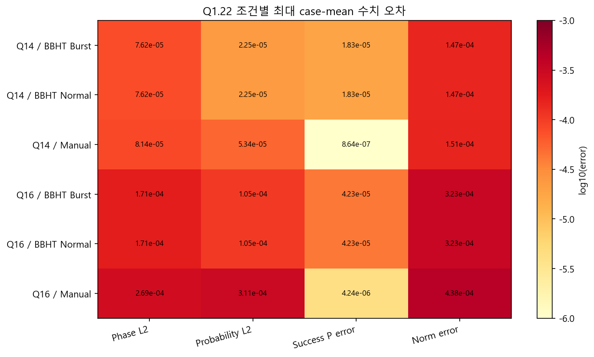
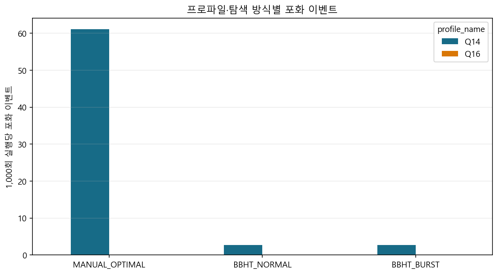

# 실험 02. 진폭 정밀도: Q14 와 소수부 22비트

> [← 실험 01 골든 모델 캠페인: 기능 정합성](01_골든모델_캠페인.md) · [index](index.md) · [실험 03 난수 시드 커버리지 →](03_난수_시드_커버리지.md)

---

| 정한 것 | 근거의 축 |
|---|---|
| Q14 · 소수부 22비트 · 대칭 포화 | 골든 모델 정밀도 분석 |

float64 기준과 같은 마스크 · 같은 `j` 로 소수부 폭만 바꿔 돌린 정밀도 분석입니다(M = 1 · 4 · 64 ·
N/2). 확률분포 L2 오차가 기준을 넘지 않는 가장 작은 소수부 폭입니다.

| Q | 확률 L2 ≤ 10⁻³ | 확률 L2 ≤ 10⁻⁵ |
|---:|---:|---:|
| 14 | F20 | F22 |
| 15 | F20 | F24 까지 미충족 |
| 16 | F20 | F24 까지 미충족 |

Q14 는 소수부 22비트에서 두 기준을 모두 만족했고, 큰 Q 는 24비트까지 늘려도 10⁻⁵ 에 닿지
못했습니다. Q14 · F22 로 굳힌 근거 중 하나가 이것입니다.

[실험 01](01_골든모델_캠페인.md) 캠페인의 Q1.22 실행 전체에서 잰 오차의 최댓값도 모두 10⁻³ 아래였습니다.

| 지표 | 전체 최댓값 | 최악 조건 |
|---|---:|---|
| 위상 정렬 진폭 L2 | 2.951e-4 | Q16, D=49,152, M=2, BBHT Normal |
| 확률분포 L2 | 3.515e-4 | Q16, D=32,768, M=2, BBHT Normal |
| 성공확률 오차 | 1.688e-4 | Q16, D=16,384, M=8, BBHT Normal |
| 정규화 오차 | 5.351e-4 | Q16, D=16,384, M=1, BBHT Normal |

위상 정렬 L2 는 `min(‖A_f − A_q‖, ‖A_f + A_q‖)` 로 전역 부호를 뺀 진폭 벡터 오차입니다. 측정
인덱스는 난수에 따라 달라지므로 정확도는 측정 결과 하나가 아니라 측정 전 전체 진폭과
확률분포로 봅니다.

포화는 이렇게 걸렸습니다.

| 프로파일 | 탐색 | 실행 | 포화 이벤트 | 1,000회당 |
|---|---|---:|---:|---:|
| Q14 | Manual | 41,280 | 2,520 | 61.05 |
| Q14 | Normal | 137,600 | 368 | 2.67 |
| Q14 | Burst | 137,600 | 368 | 2.67 |
| Q16 | 모든 탐색 | 355,120 | 0 | 0 |

전체 3,256회였고 기능 불일치는 0이었습니다. Q1.22 에서 `+1.0` 을 정확히 표현할 수 없는 경계가
있으므로 포화 자체를 실패로 보지 않고, `amp_overflow` 는 진단용 sticky 비트로 두었습니다
([6장 6.3절](../design_references/06_데이터_표현과_메모리_맵.md#63-진폭-형식)). Normal 과 Burst 의 포화 수가 같다는
것도 두 모드의 최종 논리 상태가 같다는 추가 증거입니다. 이 결론은 지금의 연산 순서와 반올림 ·
포화 규칙에 대한 것이고, 다른 Q 포맷이나 연산 순서에 자동으로 옮겨지지 않습니다.
