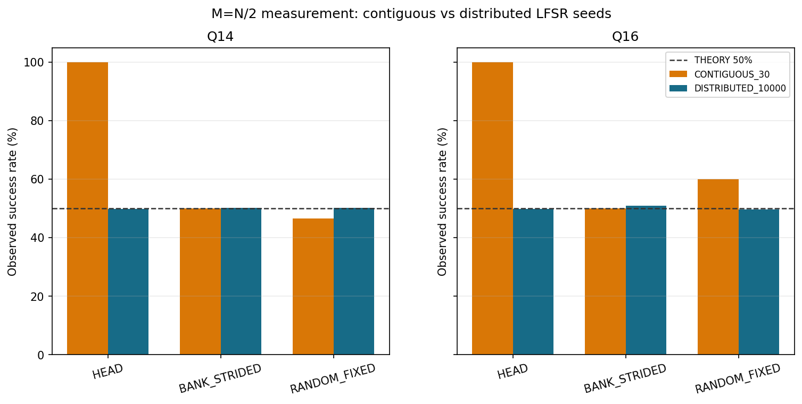

# 실험 03. 난수 시드 커버리지

> [← 실험 02 진폭 정밀도: Q14 와 소수부 22비트](02_진폭_정밀도.md) · [index](index.md) · [실험 04 열거 두 방식 비교 →](04_열거_방식_비교.md)

---

| 정한 것 | 근거의 축 |
|---|---|
| 회귀용 시드와 통계용 시드를 분리 | 골든 모델 |

M = N/2 에서는 측정분포가 균일하므로 배치와 무관하게 성공확률이 50% 여야 합니다.

| 프로파일 | 시드 집합 | HEAD | BANK_STRIDED | RANDOM |
|---|---|---:|---:|---:|
| Q14 | 연속 30개 | 100.00% | 50.00% | 46.67% |
| Q14 | 분산 10,000개 | 49.96% | 50.26% | 50.31% |

연속 시드는 LFSR 출력공간을 고르게 덮지 못합니다. 그래서 시드 집합을 목적별로 나눕니다.

- 회귀: 같은 시드가 골든 모델과 RTL 에서 같은 `j` 와 인덱스를 내는지가 중요합니다. 고정된 공식
  시드 로스터를 씁니다(500 워크로드의 100쌍).
- 통계: 성공확률 같은 통계는 분산 시드로 잽니다. 연속 시드의 결과를 Born 성공확률의 불편향
  추정으로 인용하지 않습니다.

같은 이유로 타겟 배치에 따라 attempt 수가 달라진 것은 Grover 이론의 위치 의존성이 아니라
유한 시드 표본의 효과입니다.
