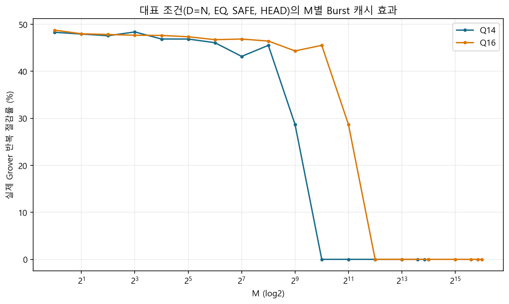

# 실험 05. 체크포인트 정책 알고리즘 선정

> [← 실험 04 열거 두 방식 비교](04_열거_방식_비교.md) · [index](index.md) · [실험 06 체크포인트 메모리 패킹 →](06_체크포인트_메모리_패킹.md)

---

| 정한 것 | 근거의 축 |
|---|---|
| 체크포인트 도입, Rolling H-step 정확 DP 정책, 동점 규칙 | 골든 모델 · SW 1,098 시드 |

## 재활용할 가치가 있는가

실패한 샷의 진폭을 버리지 않고 이어 쓰면 물리 반복이 얼마나 주는지를 먼저 쟀습니다. M = 1,
시드 30개 기준의 소프트웨어 추정입니다.

| Q | 저장 상태 수 | 평균 실제 반복 | 절감률 |
|---:|---:|---:|---:|
| 14 | 0 | 212.77 | 0.00% |
| 14 | 1 | 112.13 | 47.70% |
| 14 | 2 | 97.43 | 55.22% |
| 14 | 4 | 77.77 | 63.69% |

[실험 01](01_골든모델_캠페인.md) 캠페인에서도 슬롯 하나짜리 Burst 가 논리 반복은 그대로 둔 채 물리 반복을 전체 평균 38.55%
(중앙값 44.44%) 줄였습니다. 희소한 M 일수록 큰 `j` 로 점진적으로 다가가므로 이득이 컸습니다.



## 후보 계열

| 후보 | 핵심 | 판단 |
|---|---|---|
| K1 Burst | 진폭 메모리 자체를 1칸 체크포인트로 | 정책 자유도가 거의 없음. 성능 기준선 |
| FIFO / LRU | 최근성 기반 | BBHT 의 `j` 열에는 일반적인 재참조 지역성이 약해 탈락 |
| GE / GE2 | 선행 거리와 간격 비용을 직접 평가 | 강한 온라인 기준선이지만 look-ahead 대비 격차가 큼 |
| Exact Online MDP | 온라인 최적 | 상한 기준(reference) 용도 |
| Look-ahead A | 미래 `j` 를 유한 지평으로 | 경로 중간 상태를 안 써서 손실 |
| Look-ahead restricted-B | 출발점 → `j` 로 전진하며 지나가는 중간 상태를 저장 후보로 | 같은 K 에서 큰 추가 이득 |
| Rolling H-step Exact DP | 유한 지평의 총 물리 비용을 정확한 DP 로 풀고 현재 행동 하나만 실행 | 최종 계열로 채택 |
| 문헌 대안 (Bern · Hazard-weighted rollout · p-median · DTR · SSP · Checkmate 등) | 같은 문제에 대입 | Rolling 계열을 넘지 못함 |

미래 `j` 는 결정론적인 J-LFSR 을 실패 가정으로 이어 돌려 얻습니다. 요청 순서나 Born 성공 여부를
미리 아는 것이 아닙니다. 하드웨어에서는 이것이 Shadow-J 입니다([11장 11.4절](../design_references/11_체크포인트와_정책_엔진.md#114-정책-엔진-h3)).

## 동점 규칙

초기 Rolling 구현은 동점에서 사실상 마지막으로 열거된 행동을 골라, 중간 상태를 많이 저장하는
쪽으로 치우쳤습니다. 이것을 사전식 비교로 고쳤습니다.

```
key = (총 DP 물리 비용, 구간 수, 정렬된 S')
```

DP 물리 비용이 정확히 같을 때만 구간 수와 정렬된 슬롯 집합을 봅니다. 헤드라인 물리 반복은 거의
변하지 않았지만 샷당 중간 저장과 구간 수가 줄었습니다. RTL 정책의 최소값 선택도 같은 규칙을
써야 궤적이 기준모델과 맞습니다([11장](../design_references/11_체크포인트와_정책_엔진.md)).

## K 와 H 의 첫 선택

예산 소진형 워크로드(샷 평균 31.51, 1,098 시드 전부 예산 도달)에서 고친 동점 규칙으로 잰
공식 결과입니다. 소프트웨어 모델의 물리 반복이고 사이클이 아닙니다.

| 설계 | 평균 물리 반복 / 실행 | 정책 연산 / 샷 |
|---|---:|---:|
| Normal | 617.86 | — |
| K1 Burst | 396.08 | — |
| K3/H8 | 132.65 | 468.0 |
| K3/H10 | 131.99 | 929.4 |
| K4/H8 | 119.08 | 1,539.6 |
| K4/H10 | 117.80 | 3,691.4 |
| 오프라인 최적 참고 (K4) | 117.04 | — |

K4 가 K3 보다 물리 반복을 약 10% 줄였고, K4 안에서 지평을 H10 으로 넓혀도 1.08% 밖에 안
줄었습니다. 반면 정책이 Grover 연산 뒤에 숨으려면 필요한 처리율(연산 / 사이클)이 K4/H8 0.395,
K4/H10 0.958 로 뛰었습니다. 그래서 첫 RTL 은 K4/H8 로 갔습니다. 이 판단은 "물리 반복을 줄이면
빨라진다" 는 전제 위에 있었고, [실험 07](07_정책_지평_축소.md)의 보드 실측이 그것을 뒤집습니다.
