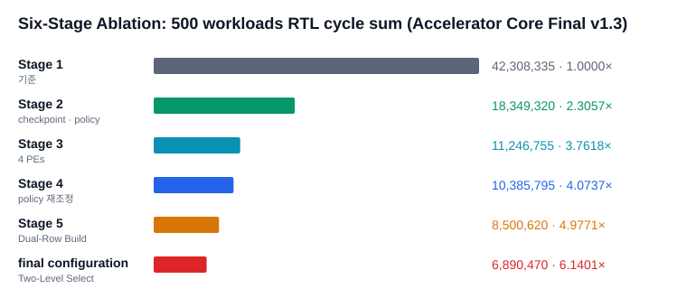
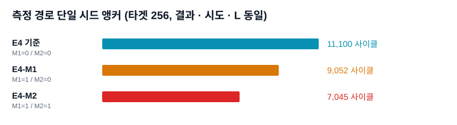

# 실험 13. Main IP 최종 발표 (v1.3)

> [← 실험 12 보드 정본 500 워크로드](12_보드_정본_500런.md) · [index](index.md) · [실험 14 Common500 소프트웨어 · FPGA 비교 →](14_Common500_SW_FPGA_비교.md)

---

| 확인한 것 | 근거의 축 |
|---|---|
| 최종 구성 K3/H3-E4-M2 의 구현 범위, 6단계 사이클, 측정 경로 개선, standalone 빌드 자원, 재현 패키지 배치 | RTL 사이클 (500 워크로드 6단계 · 250쌍 · 단일 시드) · standalone 구현 리포트 |

2026-09-10 에 Main IP 담당 쪽이 낸 발표 자료 `Main_IP_Final_20260910.pptx`(9장, "Main IP Final v1.3")를 보고서로
옮긴 것입니다. 발표의 근거는 같은 날 받은 재현 패키지 v1.0 이고, 저장소 안 위치는
[repro_package_v1.0](../../hardware_bram/models/hardware_bram_K3H3_E4_M2/results/2026-09-09_repro_package_v1.0/evidence.md)
에 정리돼 있습니다. 슬라이드에 그림 파일은 없었고, 막대그래프 두 장(도형으로 그린 것)은 같은 값으로 SVG 를 다시
그려 넣었습니다. 다른 문서에 이미 있는 수치는 그쪽으로 링크합니다.

---

## 구현 범위

Main IP 하나를 가운데 두고 실행 경로를 둘로 나눴습니다.

| 묶음 | 내용 |
|---|---|
| 가속기 코어 | BBHT 샷 FSM, 체크포인트 · 정책, Grover 반복 데이터패스, 측정과 결과 · 상태 |
| standalone 보드 경로 | UART→APB 브리지, 결정적 데이터셋 생성기, Arty A7-100T 최상단, 호스트 벤치 스크립트 |
| RVX SoC 경로 | APB CSR 제어, AHB DMA 데이터 경로, 펌웨어 벤치, ORCA SW 기준선 |

standalone 경로는 이 저장소에서 더 유지하지 않습니다. 이유는
[실험 11 「독립 FPGA 갈래」](11_채택하지_않은_확장.md#독립-fpga-갈래)에 있습니다.

기준 구성(Q14 · P32 · 진폭 23비트 / 소수부 22 · K3 · H3 · E4 · M2 · Arty A7-100T)은 지금의 확정 스펙과 같습니다.
값은 [1장 1.2절](../design_references/01_프로젝트_개요.md#12-확정-스펙) 한 곳에 있습니다.

---

## 6단계 사이클

500 공통 워크로드에서 DUT `CSR_CYCLE_COUNT` 를 더한 값입니다.

이 값들은 성능 세 축 중 RTL 사이클 축의 정본이고, 표와 해석은
[15장 15.4절](../design_references/15_동작_과정과_사이클_구성.md#154-6단계-분해)에 있습니다. 발표의 단계별 해석 표는
머리말에 "250case / 500case" 를 함께 적어 두었지만 값은 모두 500 워크로드입니다. 단계별 사이클은 같은 워크로드
집합끼리만 맞댑니다.

이 캠페인은 워크로드마다 리셋해서 K/H 축소의 몫(-7.66%)이 크게 잡힙니다. 보드와 같은 조건에서는 -3.7% 대입니다
([실험 18 「단계별 손익」](18_6단계_모델_비교.md#단계별-손익)).

---

## 왜 K3/H3 인가

발표는 E4 뒤에는 정책 · 체크포인트 비용을 줄이는 쪽이 유리하다는 근거로 두 비교를 들었습니다. K4/H4-E4 → K3/H3-E4
6케이스 비교(정책 행동 -69.9%, 정책 사이클 -55.5%, 정책 정지 -72.9%, 합계 사이클 1.0459배)와 K/H 를 따로 떼어 본
E1 250쌍입니다. 두 표는 [실험 07](07_정책_지평_축소.md)에 있습니다.

---

## 측정 경로 단일 시드 앵커

타겟 256 의 단일 시드에서 M1 · M2 스위치만 바꿔 잰 RTL 사이클입니다. 결과 인덱스 · 시도 수 · L 은 셋이 같습니다.

| 구성 | M1 / M2 | 사이클 |
|---|:-:|--:|
| E4 기준 | 0 / 0 | 11,100 |
| E4-M1 | 1 / 0 | 9,052 |
| E4-M2 | 1 / 1 | 7,045 |

M2 는 그룹 누계(group-CDF)를 적어 두고 `S_GROUP_SCAN` 으로 행 선택을 두 단으로 줄이는 컴파일 시점 옵션입니다.
구조는 [10장](../design_references/10_측정_경로와_M1_M2.md), 열거 전체 단위의 측정 실험은
[실험 09](09_측정_병목과_M1_M2.md)에 있습니다. 이 앵커는 워크로드 하나라 경향을 보이는 값이지 집계값이 아닙니다.

---

## 보드 결과와 standalone 구현

### 250쌍 RTL 사이클

| 구성 | 사이클 | 물리 반복 |
|---|--:|--:|
| K3/H3-E4-M2 | 2,563,403 | 4,457 |

같은 250쌍의 Normal · K4/H4 값은 [실험 07](07_정책_지평_축소.md)의 보드 250쌍 표에 있습니다. K3/H3-E4-M2 값은
2026-09-10 bench250 RTL 에서 다시 냈고, 같은 250쌍의 보드 실측과 논리 네 축이 250/250, 사이클 합이 +0.28% 입니다
([bench250_final_core](../../hardware_bram/models/hardware_bram_K3H3_E4_M2/results/2026-09-10_bench250_final_core/evidence.md)).

### standalone 빌드의 타이밍 · 자원

| 항목 | 값 |
|---|---|
| WNS / TNS | +0.224 ns / 0 |
| LUT / FF | 34,399 / 28,847 |
| BRAM 타일 / DSP | 84.5 / 128 |

RVX 없이 Main IP 만 올린 standalone 구현입니다. RVX SoC 전체 구현(보드 정본 빌드)의 값은
[19장](../design_references/19_합성_구현_비트스트림.md)에 있고 서로 맞대지 않습니다. 출처는 재현 패키지의
[`expected_results.md`](../../hardware_bram/models/hardware_bram_K3H3_E4_M2/results/2026-09-09_repro_package_v1.0/expected_results.md)
입니다.

### 시스템 비교

발표의 실경과 시간 비교(Normal · K4/H4-E1 · 최종 M2 · ORCA SW)는 2026-09-08 보드 정본 값이고
[1장 1.5절](../design_references/01_프로젝트_개요.md#15-성능-지표와-인용-기준)과 [실험 12](12_보드_정본_500런.md)에 있습니다.

---

## 재현 패키지 배치

발표가 "서버에서 볼 위치" 로 든 패키지 폴더입니다. 저장소 안의 어디로 옮겼는지는
[repro_package_v1.0](../../hardware_bram/models/hardware_bram_K3H3_E4_M2/results/2026-09-09_repro_package_v1.0/evidence.md)
의 대응표에 있습니다.

| 패키지 폴더 | 내용 |
|---|---|
| `01_RTL` | 코어 · standalone · RVX 어댑터 |
| `02_TB` | standalone TB, 6단계 TB, K/H 단독 실험 |
| `03_SW_FW` | 호스트 벤치, 펌웨어, 데이터셋 기준 |
| `04_BUILD` | standalone · Vivado, RVX, 시뮬 스크립트 |
| `05_EXPERIMENTS` | 보드 · 자원 · 6단계 · K/H 원자료와 요약 |
| `06_REFERENCE_OUTPUTS` | 기대 CSV, 골든 요약 |
| `07_BOARD` | 비트스트림, ELF, 보드 시험 자료 |
| `99_MANIFEST` | SHA, 파일 목록, 출처 |

---

## 근거

- 재현 패키지 반입 기록: [repro_package_v1.0](../../hardware_bram/models/hardware_bram_K3H3_E4_M2/results/2026-09-09_repro_package_v1.0/evidence.md)
- 6단계 RTL 사이클: [publication_6stage](../../hardware_bram/results/2026-09-08_publication_6stage/evidence.md)
- K/H 단독 실험: [kh_isolated_e1](../../hardware_bram/results/2026-09-09_kh_isolated_e1/evidence.md)
- 250쌍 최종 코어: [bench250_final_core](../../hardware_bram/models/hardware_bram_K3H3_E4_M2/results/2026-09-10_bench250_final_core/evidence.md)
- 원본 pptx 는 이 보고서로 옮긴 뒤 지웠습니다. git 기록(2026-10-12 이전 커밋)에 남아 있습니다.
