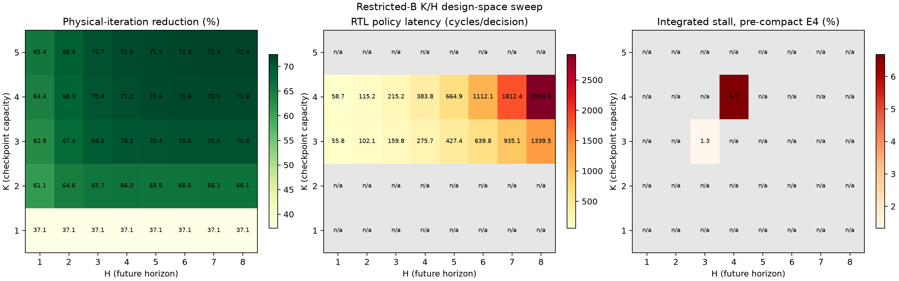

# 실험 22. Checkpoint-Capacity · Lookahead-Shots policy design space와 결정 latency

> [← 실험 21](21_policy_memo_table_compaction.md) · [실험 보고서 index](index.md)

## 질문

Checkpoint-Capacity와 Lookahead-Shots를 키웠을 때 executed iterations 감소가 실제 implementation 비용을 정당화하는지 확인하기
위해 다음 세 축을 같은 Checkpoint-Capacity × Lookahead-Shots grid에서 분리했습니다.

1. exact restricted-B policy의 executed iterations 감소율
2. policy 한 번의 실제 RTL `start`→`done` cycles
3. Iteration-Count Predictor와 실행에 가려지고 남은 integrated policy stall

policy의 품질은 결과 정확도가 아니라 executed iterations 감소로 표현합니다. 모든 cell은 같은
Common500 request BBHT trajectory 500개, policy 결정 7,403회를 사용했습니다.

## 결과

| Checkpoint-Capacity | Lookahead-Shots | executed iterations 감소 | actions/decision | RTL cycles/decision | integrated stall |
|:-:|:-:|---:|---:|---:|---:|
| 3 | 3 | 69.51% | 22.7 | 159.8 | 1.32% |
| 3 | 4 | 70.17% | 42.3 | 275.7 | 미측정 |
| 3 | 8 | 70.56% | 318.8 | 1,339.5 | 미측정 |
| 4 | 4 | 71.17% | 78.2 | 383.8 | 6.68% |
| 4 | 5 | 71.63% | 157.3 | 664.9 | 미측정 |
| 4 | 8 | 71.95% | 985.1 | 2,916.9 | 미측정 |
| 5 | 5 | 71.94% | 294.6 | RTL 미구현 | RTL 미구현 |

a Checkpoint-Capacity of 3에서 3-shot → 4-shot Lookahead는 executed iterations 감소율을 0.66%p 더 얻지만 결정 latency가 159.8→275.7 cycles로 72.5% 늘었습니다. a Checkpoint-Capacity of 4에서 4-shot → 5-shot Lookahead도 이득은 0.46%p인데 latency는
383.8→664.9 cycles로 73.2% 늘었습니다. 현재 DFS/memo table 구조에서는 Lookahead-Shots 증가의
체감 효과보다 search 비용 증가가 훨씬 빠릅니다.

a Checkpoint-Capacity of 5 and 5-shot Lookahead는 algorithmic sweep에서는 a Checkpoint-Capacity of 4 and 4-shot Lookahead보다 0.77%p 더 줄이지만 action 수가 3.77×라,
다섯 번째 amplitude checkpoint slot의 **저장 용량 lower bound** 11 RAMB36을 추가하기 전에 search logic 자체를 개선해야 합니다.
단, 4 PEs의 4 rows/cycle read+write bandwidth까지 유지하는 hot slot은 11개만으로 만들 수 없으며
repacking 기준 약 40~44 RAMB36이 더 필요합니다. 자세한 교정 계산은
[실험 25](25_triple_row_build_capacity_5_resource_review.md)에 있습니다.
a Checkpoint-Capacity of 5의 RTL latency와 stall은 구현하지 않았으므로 heatmap에서 `n/a`로 남겼습니다.

## stall panel을 아직 두 cell만 채운 이유

`cycles/decision`은 policy 단독 RTL로 정확히 측정할 수 있지만 stall은 policy latency에서
단순 계산할 수 없습니다. 실행 segment, Iteration-Count Predictor, Plan Queue와 겹친 뒤 실제 demand가 빈
cycle만 세어야 합니다. 따라서 동일한 4 PEs · Single-Row Build · Linear Select integrated bench500이 있는
a Checkpoint-Capacity of 3 and 3-shot Lookahead와 a Checkpoint-Capacity of 4 and 4-shot Lookahead만 채웠고 나머지는 추정하거나 보간하지 않았습니다. 표의 1.32%와
6.68%는 2026-10-07 memo table 압축 전 Checkpoint-Capacity · Lookahead-Shots 단독 비교값입니다. 현재 RTL의 새 stall
확정값이 아니며 final configuration 수치와도 섞지 않습니다.

다음 실험은 같은 4 PEs 조건에서 a Checkpoint-Capacity of 3 · 4와 1-shot ~ 8-shot Lookahead의 integrated sweep을 돌려 오른쪽 panel을
채우는 것입니다. 그 전에는 큰 Lookahead-Shots의 memo table rank stride도 각 Checkpoint-Capacity · Lookahead-Shots 조합의 도달 범위로 압축해야
initialization 비용과 search 비용을 공정하게 분리할 수 있습니다.

## verification 중 발견한 8-shot Lookahead 결함

8-shot Lookahead 전체 sweep이 최초에는 reference model과 어긋났고 두 원인을 수정했습니다.

- 마지막 future request `j_window[8]` 대신 `[7]`을 중복해서 읽음
- 8,744-entry memo table에 5개가 필요한데 2,048-word bank가 4개뿐이었음

수정 뒤 a Checkpoint-Capacity of 3 · 4 × 1-shot ~ 8-shot Lookahead의 16개 RTL cell 모두 7,403회 결정에서 exact software policy와
source, next set, action count가 일치했습니다.

원본 CSV, RTL 요약, 재현 명령은
[결과 근거](../../hardware_bram/results/2026-10-26_kh_sweep/evidence.md)에 있습니다.
