# 17장. RVX SoC에 붙이기 — APB CSR · AHB DMA · UART

> [← 16장 몇 번 돌릴지 모를 때 — BBHT shot loop와 checkpoint](16_iteration_control_and_checkpoints.md) · [index](index.md) · [18장 무엇을 어떻게 증명하나 — 3단 reference model과 bit-exact →](18_reference_model_verification.md)
> **이 장을 읽기 위한 준비**: [13장 oracle과 diffusion operator](13_oracle_diffusion_measurement_datapath.md), [16장 BBHT shot loop와 checkpoint](16_iteration_control_and_checkpoints.md).

---

13·14·16장에서 IP 안쪽은 다 만들었습니다. amplitude array가 있고, predicate를 판정하는 oracle이 있고, mean으로 되비추는 diffusion operator가 있고, Born sampler가 있고, 그 위에 shot loop와 checkpoint가 얹혀 있습니다. 그런데 이 circuit에는 아직 시작을 눌러 줄 사람도, data를 넣어 줄 사람도, 답을 받아 갈 사람도 없습니다.

이 장은 그 바깥을 붙입니다. host가 UART로 명령을 보내고, RISC-V core가 APB로 설정 register를 쓰고, IP가 AHB master로 data를 끌어오는 경로입니다. FPGA를 다뤄 본 독자에게는 이 장이 가장 손에 잡히는 장일 것입니다.

---

## 17.1 accelerator는 혼자 서지 않는다

우리 IP가 실제로 잘하는 일은 하나뿐입니다 — **모든 state의 amplitude를 한꺼번에 훑어 갱신하는 것**. 128 lanes가 매 cycle 128칸씩 sign을 뒤집고 mean으로 되비추는 일은 규칙적이고, 분기가 없고, data에 따라 흐름이 바뀌지 않습니다. hardware가 압도적으로 유리한 종류의 계산입니다.

반대로 이 IP를 실제로 **쓰는** 과정은 정반대의 성격을 가집니다. 어떤 predicate를 쓸지 정하고, threshold를 넘기고, data를 준비하고, enumeration mode라면 결과를 제때 빼 가고, 결과를 사람이 읽을 형태로 찍어 내는 일 — 전부 분기와 loop와 예외 처리입니다. 이런 것을 state machine으로 굳혀 넣으면 조건 하나 바뀔 때마다 재합성해야 하고, synthesis에 걸리는 시간이 실험 한 번의 시간을 압도하게 됩니다.

그래서 경계를 이렇게 긋습니다. **amplitude 갱신과 shot loop는 hardware가, 설정과 결과 처리와 표시는 software가.** 정확히 말하면 software가 하는 일은 "설정을 쓰고 시작을 누르고 status를 polling하고 결과를 읽는" 몇 줄이며, 그 몇 줄이 유연해야 하는 부분 전부를 흡수합니다.

이 구도가 임의로 고른 편의가 아니라는 점을 짚어 둘 필요가 있습니다. **실제 quantum computer도 똑같이 생겼습니다.** quantum processor는 circuit 하나를 실행하고 measurement 결과를 뱉을 뿐이고, "몇 번 더 돌릴지, 다음에 어떤 parameter를 넣을지"는 옆에 붙은 classical control computer가 정합니다. superconducting qubit든 trapped ion이든, 사용자가 실제로 이야기를 나누는 상대는 언제나 그 classical computer입니다. 우리가 RISC-V core를 옆에 두는 것은 emulator를 편하게 만들려는 타협이 아니라 **실기의 구조를 그대로 흉내 내는 것**입니다. 16.1절에서 "충실도가 속도를 이긴다"고 한 원칙이 system 층에서도 똑같이 적용됩니다.

---

## 17.2 RVX가 무엇인가

**RVX**(RISC-V eXpress)는 ETRI(한국전자통신연구원)에서 만든 MCU급 저전력 SoC 개발 키트입니다. 우리가 하려는 일 — "직접 만든 accelerator IP를 RISC-V SoC에 붙여 FPGA에 올린다" — 이 정확히 RVX가 상정한 사용 시나리오입니다.

RVX의 핵심은 **platform XML 하나에서 SoC 전체가 생성된다**는 점입니다. 우리 platform `bbht_grover_final` 의 XML은 짧습니다. accelerator 전용 clock `clk_accel` 을 100 MHz로 정의하고, system SRAM 크기를 128 KB로 잡고, IP instance를 셋 선언합니다 — RV32 core `rvc_orca` 를 `i_main_core` 로, 우리 IP의 제어 register 쪽을 APB slave shim `user_slaveif_apb_clkout`(memory map `0x1000`, address·data 32 bits)으로, data load 쪽을 AHB master shim `user_masterif_ahb_clkout`(32 bits)으로. core와 peripheral과 우리 IP 사이를 잇는 interconnect는 **munoc** 입니다.

이 XML로부터 생성되는 것이 SoC RTL만이 아니라는 점이 중요합니다. `make syn` 을 돌리면 다음이 전부 자동으로 나옵니다.

- **memory map header** `memorymap_info.h` — 우리 CSR의 base address `I_GROVER_CSR_SLAVE_BASEADDR`(이 환경에서 `0xE2020000`), system SRAM 범위 `0xE0000000` ~ `0xE001FFFF`(128 KB).
- **hardware 정보 header** `hw_info.h` — `SRAM_SIZE`, `SYSTEM_CLK_HZ`(50 MHz), 포함된 option macro들.
- 같은 내용의 Verilog version(`platform_info.vh`), Vivado용 TCL, boot ROM, SoC simulation 환경.

즉 "register address를 RTL과 C header에 두 번 적고 나중에 어긋나는" 고전적인 사고를 구조적으로 막아 줍니다. 이 점 하나만으로도 손으로 SoC를 조립하는 것보다 낫습니다. firmware는 base address를 숫자로 박지 않고 이 macro를 씁니다 — platform XML이 바뀌면 address가 옮겨 가기 때문입니다.

board 정의는 `imp_class_info/` 아래에 따로 있고, 우리가 쓰는 `arty-100t` 항목에는 `part` 가 `xc7a100tcsg324-1`, 외부 clock 100 MHz, configuration flash `s25fl128s`(SPI x4), USB-UART bridge `0403:6010:01` 로 적혀 있습니다. board를 바꾸는 것은 `TARGET_IMP_CLASS` 를 바꾸는 일이 됩니다.

이 project 환경에는 RVX가 `/opt/rvx` 에 **전체 설치**되어 있어, platform 생성부터 synthesis·implementation·bitstream·SoC 전체 RTL simulation까지 전부 local에서 돕니다. Vivado도 local에 있고 화면이 없는 batch mode로 씁니다. accelerator를 붙이는 방법은 RVX 예제 platform `tip_quantized_cnn`(accelerator + `user/rtl` · `user/api`)의 틀을 따랐습니다.



---

## 17.3 왜 APB와 AHB를 같이 쓰나

bus를 두 개 쓰는 것이 낭비처럼 보일 수 있으니, 우리 IP가 bus로 하는 일이 성격이 완전히 다른 두 가지라는 점부터 짚겠습니다.

첫째는 **설정과 status**입니다. predicate 두 bit, threshold 16 bits, 시작 한 bit, status 몇 bit, counter 몇 개. 한 번 실행에 몇백 byte가 오갈 뿐이고, 그나마 실행 전후에만 오갑니다. 여기에 필요한 것은 bandwidth가 아니라 **address로 register를 콕 집는 능력**과 **적은 gate**입니다.

둘째는 **array load**입니다. 14 qubits면 `data_mem` 에 32 KB를 채워야 하고, 이것은 system SRAM의 연속된 address를 죽 읽어 오는 일입니다. 여기에 필요한 것은 IP가 스스로 bus에 나가 읽어 오는 **master 능력**입니다. core가 한 data word씩 읽어 CSR로 넘겨 주는 방식은 core를 붙잡아 두고 bus를 두 번씩 건넙니다.

AMBA 계열의 세 bus는 정확히 이 spectrum 위에 놓여 있습니다. **APB**는 가장 단순합니다 — setup/access 두 phase에 burst도 pipeline도 없고, 한 번에 data word 하나입니다. 대신 slave implementation이 combinational logic 몇 줄이면 끝납니다. **AHB**는 pipelined address/data phase와 burst를 지원하고, master를 직접 쓸 만한 복잡도입니다. **AXI**는 읽기와 쓰기 channel이 따로 있고 out-of-order completion과 multiple outstanding transaction을 지원합니다. 강력하지만 우리처럼 순차 load만 하는 IP에게는 쓰지 않을 기능에 대한 logic 비용입니다.

그래서 결론은 **CSR은 APB slave, data load는 AHB master**입니다. RVX가 두 shim을 모두 제공하니, 우리는 검증된 routing을 그대로 따라가면 됩니다.

load를 어떤 방식으로 하느냐는 따로 정했습니다. 초판은 AHB burst(`INCR16`)를 상정했지만, 최종 DMA Engine은 **32-bit SINGLE 읽기를 한 번에 하나씩(single outstanding)** 합니다. burst는 FIFO와 `BUSY` 처리가 붙어 복잡하고, 17.5절에서 보듯 SINGLE로도 load가 search 한 번과 비슷한 시간에 끝나기 때문입니다. burst는 benchmark에서 load가 실제 병목으로 드러난 뒤에 볼 일로 미뤄 두었습니다.

여기서 초기 설계안 하나가 폐기되었음을 명시해 둡니다. 처음에는 data를 **AXI-Stream** 으로 흘려 넣는 DMA Engine을 상정했습니다. 이 안은 못 씁니다 — **RVX library에 AXI-Stream shim이 아예 없기 때문입니다.** RVX에 등록된 사용자 interface shim을 전부 열거하면 master 쪽이 `moi`·`ahb`·`axi`·`axi4`·`axi4l`, slave 쪽이 `apb`·`ahb`·`axi`·`axi4`·`axi4l` 이고(각각 `_clkin`/`_clkout` 두 벌), stream 계열은 한 줄도 없습니다. shim이 없으면 interconnect에 붙일 방법이 없고, 그러면 그 IP는 SoC 바깥의 섬이 됩니다. 도구가 제공하는 것과 설계가 요구하는 것이 어긋날 때는 대개 설계를 고치는 쪽이 싸며, 이 경우는 특히 그렇습니다.

shim 이름 끝의 `_clkin` / `_clkout` 도 짚고 갈 값어치가 있습니다. `_clkin` 은 IP가 SoC의 clock을 **받아** core와 같은 도메인에서 도는 형태이고, `_clkout` 은 IP가 자기 clock을 **내보내** 별도 도메인에서 도는 형태입니다. 우리는 **`_clkout`** 을 씁니다. core와 bus는 50 MHz로 두고 accelerator만 100 MHz 전용 clock으로 돌리기 위해서입니다. 두 도메인 사이의 clock 경계 처리(CDC)는 RVX가 APB·AHB 쪽에 각각 생성해 주는 비동기 bridge가 맡습니다. 그러니 **우리 쪽에 CDC를 또 넣으면 안 됩니다** — RVX가 만들어 주는 것이 실제 board에서 검증된 구조이고, 중복 삽입은 그 verification을 무효로 만듭니다.

---

## 17.4 CSR map

RVX에는 CSR block를 생성기로 뽑는 길과 손으로 짜는 길이 둘 다 있습니다. RVX 예제의 생성기는 register 간격을 **8 bytes**로 잡고, 설정 register의 쓰기 signal을 module 안에 가둬 둡니다. 우리는 **손으로 짠 APB slave**(`bbht_grover_mmio`)를 쓰고 간격을 **4 bytes**로 잡았습니다. register가 38개라 8-byte 간격이면 address 공간이 두 배로 비고, 무엇보다 읽기 부작용(FIFO pop)이나 완료 표시 같은 동작을 우리가 직접 쥐어야 했기 때문입니다. `pready` 는 constant 1이라 wait state가 없고, 정렬되지 않은 접근과 미할당 address는 `pslverr` 로 떨어집니다.

register는 32-bit 38개이고, 접근 성격이 넷입니다.

| 표기 | 뜻 |
|---|---|
| `RW` | 설정. 여기 저장되고 값이 IP로 상시 나감 |
| `W1P` | 명령. 저장 공간이 없고 쓰면 1 cycle pulse만 나감. 읽으면 0. 쓰는 행위 자체가 명령 |
| `RO` | status. IP가 내보내는 signal을 읽기 응답에 실어 보냄 |
| `RPOP` | 읽기가 곧 Result FIFO에서 한 칸 꺼내기. 부작용이 있는 유일한 읽기 |

주요 register를 역할별로 모으면 이렇습니다. 전체 38개의 bit 정의는 [CSR register 규격](../design_references/13_csr_registers_and_execution_modes.md)에 있습니다.

| offset | 이름 | 접근 | 뜻 |
|---|---|:-:|---|
| `0x000` | `COMMAND` | W1P | search 시작 |
| `0x004` | `CONTROL` | RW | autonomous mode(`auto_shot`) · checkpoint(`burst_enable`) · predicate 선택 2-bit |
| `0x008` | `J_TARGET` | RW | Manual mode의 number of iterations (7 bits, 0~127). autonomous mode에서는 무시 |
| `0x00C` · `0x010` | `THRESHOLD_A` · `THRESHOLD_B` | RW | threshold (signed 16 bits). range predicate는 열린 interval |
| `0x014` | `DATA_COUNT` | RW | 유효 data 개수 1~16384. 그 뒤 index는 non-solution |
| `0x018` | `SHOT_CAP` | RW | shot cap (기본 100) |
| `0x01C` · `0x020` | `SEED_J` · `SEED_MEAS` | RW | Iteration-Count LFSR과 Measurement PRNG의 seed. 서로 독립 |
| `0x024` | `STATUS` | RO | 실행 status 12-bit (아래) |
| `0x028` | `RESULT_INDEX` | RO | single search 결과 (14 bits) |
| `0x02C` ~ `0x038` | `SHOT_COUNT` · `REQUESTED_ITERATIONS` · `EXECUTED_ITERATIONS` · `CYCLE_COUNT` | RO | shot count · requested iterations(요청된 iteration의 sum) · executed iterations · 100 MHz cycle count |
| `0x03C` | `ENUM_CFG` | RW | enumeration 켜기 · 연속 실패 한계 `fail_repeat_limit` (1~15) |
| `0x040` | `FIFO_DATA` | RPOP | Result FIFO 머리 |
| `0x044` ~ `0x054` | `FIFO_COUNT` · `FOUND_COUNT` · `CONSEC_FAIL` · `MAX_FIFO_OCC` · `FIFO_STALL` | RO | enumeration status와 FIFO 통계 |
| `0x058` · `0x05C` · `0x060` | `DATA_ADDR` · `DMA_COMMAND` · `DMA_STATUS` | RW · W1P · RO | data load (17.5절) |
| `0x064` ~ `0x094` | policy telemetry 13개 | RO | policy cycle · stall cycle · Plan Queue hit·miss 등 (16.5절) |

`STATUS` 의 12 bits는 실행 중(`busy`), load 중(`load_busy`), 완료 표시(`done_sticky`), 결과 유효(`result_valid`), 그리고 sticky 오류·한도 bit들 — 설정 오류, shot cap 도달, requested iterations budget 도달, amplitude saturation(`amp_overflow`, [12.5절](12_fixed_point_and_precision.md#125-overflow-policy--saturationwraparound-금지renormalization-없음)), measurement total weight 0, load 오류 — 과 enumeration 종료, FIFO 비었음입니다. saturation bit는 진단용이고 결과 무효 표시가 아닙니다.

초판의 CSR 초안과 달라진 점이 셋 있습니다. 첫째, **checkpoint 무효화용 register가 없습니다.** 16.7절대로 Accelerator Core가 설정값이 바뀐 것을 스스로 보고 checkpoint slot을 비우므로, 무효화 명령도, register마다 무효화 strobe를 모으는 routing도 필요 없어졌습니다. 둘째, **지금 몇 번의 iteration을 거친 state인지를 알려 주는 register가 없습니다.** checkpoint slot의 state는 전부 hardware 안에 있고, firmware는 알 필요가 없습니다. 셋째, 두 지표를 갈라 읽는 counter는 그대로 남았습니다 — `REQUESTED_ITERATIONS` 가 algorithm 지표(요청된 iteration의 sum), `EXECUTED_ITERATIONS` 와 `CYCLE_COUNT` 가 emulation 비용입니다(16.6절).

시작 명령에는 수락 조건이 있습니다. 실행 중이 아니고, load 중이 아니고, 직전 enumeration 결과가 FIFO에 남아 있지 않고, 직전 완료 표시가 아직 안 읽힌 채가 아니어야 합니다. **시작 queue는 두지 않았습니다.** 조건이 안 맞으면 pulse가 조용히 버려지므로, firmware가 `COMMAND` 를 쓰기 전에 `STATUS` 를 확인하는 것이 규약입니다. queue를 두면 "언제 시작했는지"가 software에서 보이지 않게 되고, 그런 때에 counter를 읽으면 서로 다른 시점의 값이 섞입니다.

---

## 17.5 data load — AHB master

14 qubits면 `data_mem` 은 16,384개 × 16-bit = **32 KB**, 32-bit data word로 8,192개입니다. 이것을 SoC의 system SRAM에서 IP 안으로 옮기는 것이 AHB master(`bbht_ahb_loader`)가 하는 유일한 일입니다.

DMA Engine은 data word 하나를 **SINGLE 읽기로 하나씩**(single outstanding) 읽고, 받은 32 bits를 16-bit 두 칸으로 나눠 `data_mem` 에 씁니다 — 하위 16 bits가 짝수 index, 상위 16 bits가 다음 index입니다. data word 하나에 address 1 + data 1 + 쓰기 1로 3 cycles이 들어 전체가 24,576 cycles, 100 MHz에서 **약 246 µs** 입니다. 같은 board에서 final configuration이 solution 하나를 찾는 search가 mean 약 0.23 ms(wall-clock time)이니, load 한 번이 search 한 번과 비슷한 시간입니다. data를 한 번 올려 두고 threshold만 바꿔 가며 여러 번 탐색하는 usage pattern이라면 load 비용은 더 희석됩니다.

load를 시작하기 전에 DMA Engine이 스스로 검사하는 것이 넷 있고, 어긋나면 `DMA_STATUS` 의 해당 오류 bit를 세우고 거절합니다.

| 검사 | 조건 |
|---|---|
| 정렬 | `DATA_ADDR` 가 4-byte 정렬 |
| 개수 | `DATA_COUNT` 가 1~16384 |
| 범위 | 읽을 interval이 system SRAM(`0xE0000000` ~ `0xE001FFFF`) 안 |
| status | Accelerator Core가 실행 중이 아님 |

최소한의 규약 셋을 못 박아 둡니다.

**load 중에는 시작을 받지 않습니다.** load가 도는 동안은 `STATUS.load_busy` 가 서고, 17.4절의 수락 조건에 걸려 시작 pulse가 무시됩니다. 이유는 자명합니다 — 절반만 채워진 `data_mem` 위에서 oracle을 돌리면 아무 경고 없이 틀린 답이 나옵니다.

**`DATA_COUNT` 가 홀수면 마지막 data word의 상위 16 bits는 쓰지 않습니다.** 설령 쓰더라도 그 index는 `DATA_COUNT` 밖이라 oracle이 non-solution으로 봅니다(13.3절). 다만 Accelerator Core 쪽 load port는 같은 address를 두 번 써도 개수를 올리므로, 바깥의 DMA Engine이 각 address를 정확히 한 번씩 쓰도록 짜여 있습니다.

**load는 checkpoint를 무효화합니다.** data가 바뀌면 predicate가 같아도 solution 집합이 달라지므로, 남아 있던 amplitude는 의미가 없습니다(16.7절).

system SRAM 크기도 이 경로와 묶여 있습니다. 32 KB array에 firmware code와 stack까지 들어가야 하므로 SRAM을 128 KB로 잡았고, 그 몫이 SoC가 쓰는 32 BRAM tiles의 대부분입니다(15.5절).

data를 어디서 만드느냐는 firmware의 몫으로 정했습니다. benchmark용 data는 console app의 `GEN` 명령이 RISC-V core에서 **seed 둘로부터 결정적으로** 만들어 SRAM에 씁니다 — 배경값은 xorshift random number로, solution을 심을 위치는 또 다른 seed로 정하고, 배경값이 우연히 목표값과 같아지는 자리는 한 bit를 뒤집어 피해서 심은 개수가 곧 number of solutions가 되게 합니다. seed가 같으면 array가 같으므로 재현성도 확보됩니다. 초판은 IP 안에 PRNG를 두는 안을 적었지만, firmware에서 만들어도 load가 search와 비슷한 시간에 끝나므로 IP를 가볍게 두는 쪽을 택했습니다. (재현 package에는 RVX 없이 IP 안의 생성기로 data를 만드는 독립 FPGA revision도 있었지만, 임의 data를 올릴 수 없어 final revision에는 쓰지 않았습니다.)

---

## 17.6 host UART protocol

host와 SoC 사이의 물리 경로는 UART 하나입니다. Arty board의 micro USB 하나가 JTAG과 UART를 겸하고, 꽂으면 host에 serial port가 둘 잡히는데 뒤 번호가 UART입니다. 설정은 **115200 8N1, 흐름 제어 없음**이고, baud rate는 50 MHz system clock에서 분주됩니다. 표준 pin map에서 RX pin까지 물려 있어 **양방향**입니다.

board 쪽에는 **console app**(`bbht_console`)이 돌며, protocol은 **ASCII line 기반**입니다. binary frame보다 느리지만, 이 경로로 오가는 것이 원래 몇십 byte뿐이라 속도가 문제가 되지 않고, 대신 얻는 것이 큽니다 — terminal을 열어 손으로 명령을 쳐 볼 수 있고, log가 그대로 사람이 읽는 문서가 되며, parsing이 어긋났는지 값이 틀렸는지 눈으로 구분됩니다. bring-up 단계에서 이 차이는 며칠을 좌우합니다.

명령은 `SET`(predicate·threshold·seed·mode·data 개수), `GEN`(board 위 data 생성), `LOAD`(DMA load), `RUN`(single search), `ENUM`(enumeration), `STAT`(counter), `REG`(CSR dump) 등이고, 응답 한 덩어리는 반드시 `OK` 나 `ERR` 로 끝납니다. 한 번 돌리면 이런 모양입니다.

```
> GEN COUNT=16384 TARGETS=1 VAL=12345
OK count=16384 targets=1 val=12345
> LOAD
OK loaded=16384 addr=0xe0000abc
> SET MODE=EQ A=12345 AUTO=1 BURST=0 SEEDJ=0x7b1dcdaf SEEDM=0x24370df2
OK
> RUN
HIT idx=507 val=12345 trials=25 l=308 iters=308 cyc=351394 us=3513
OK
> SET BURST=1
OK
> RUN
HIT idx=507 val=12345 trials=25 l=308 iters=70 cyc=30913 us=309
OK
```

두 `HIT` 줄의 수치는 같은 조건으로 2026-09-08 board benchmark app이 낸 값(Restart mode와 final configuration)을 옮긴 것입니다. 마지막 두 `RUN` 이 이 project의 주장을 그대로 보여 줍니다. **`idx` 와 `trials` 와 `l` 은 같고 `iters` 와 `cyc` 만 줄었습니다.** 답이 같고 algorithm이 oracle에 던진 질의 수도 같은데 emulation 비용만 줄어든 것입니다(16.6절). 명령과 응답의 전체 문법은 [UART 명령 protocol](../design_references/14_host_interface_and_uart_protocol.md)에 있습니다.

enumeration mode의 흐름은 stream입니다. `ENUM` 을 치면 console app이 search를 시작하고, hardware가 답을 Result FIFO에 쌓는 동안 firmware가 계속 FIFO를 비우며 답마다 `FOUND` 줄을 내보내다가, enumeration이 끝나면 `END` 로 닫습니다. solution이 256개를 넘으면 firmware가 늦게 뽑는 동안 hardware가 멈추고, 그 cycle이 `FIFO_STALL` 에 남습니다.

**이 경로로 data array를 보내지는 않습니다.** 계산해 보면 이유가 분명합니다. 32 KB를 115200 bps · 8N1(byte당 10 bits)로 보내면 약 **2.8초**입니다. search 자체가 수백 µs인데 data를 넣는 데 그 만 배를 쓰는 것은 — 그것도 ASCII hex로 보내면 두 배 — 실험 회전율을 완전히 망칩니다. 그래서 array는 board 위 `GEN` 으로 만들거나 SRAM에 미리 두고 DMA로 올립니다. UART로 오가는 것은 **명령과 결과뿐**이라는 원칙을 세워 두면 이 함정을 피할 수 있습니다.

host 쪽 도구는 serial terminal이면 충분합니다. 여러 명령을 한 번에 돌리고 싶다면, 한 줄 보내고 `OK`/`ERR` 을 받을 때까지 기다리는 loop를 짜면 됩니다 — 흐름 제어가 없으므로 **응답을 받은 뒤에 다음 명령**을 보내는 것이 규약입니다.

---

## 17.7 hardware와 firmware의 경계

지금까지 나온 역할 분담을 한 표로 모읍니다. 각 항목의 근거는 "왜 그쪽인가" 열에 있습니다.

| 하는 일 | 어디서 | 왜 |
|---|:-:|---|
| amplitude 갱신 (oracle · diffusion operator · Init) | hardware | 128 lanes 병렬, 분기 없음 |
| Born-rule sampling · solution check | hardware | amplitude array 전체를 읽어야 하고 `data_mem` 이 IP 안에 있음 (14.5절) |
| number of iterations sampling · sampling range 갱신 | hardware | shot마다 필요, 왕복 latency가 아까움 (Manual mode에서는 firmware가 `J_TARGET` 을 씀) |
| checkpoint policy · 무효화 | hardware | state를 software에 맡기면 샙니다 (16.7절) |
| enumeration round · 종료 판정 | hardware | 새 답마다 Found Mask·checkpoint slot·BBHT를 되돌리는 일이 전부 IP 안 state |
| enumeration 종료 한계값 | firmware | `fail_repeat_limit` 을 CSR로. 응용마다 다른 policy |
| Result FIFO 비우기 | firmware | 도는 동안에도 계속 (FIFO 256 entries) |
| predicate · threshold 결정 | firmware | 응용에 따라 바뀜 |
| minimum search loop (threshold 낮추기) | firmware | `while` 한 줄로 충분 (14.9절) |
| UART parsing · 결과 출력 | firmware | 분기 덩어리 |
| data 준비 (`GEN` · SRAM · load 시작) | firmware | policy 결정 |

**shot loop는 hardware가 돕니다.** 이 결정이 이 표에서 가장 논쟁적인 지점이라 근거를 적어 둡니다. 16.3절의 수치대로 14 qubits·1 solution에서 search 한 번에 mean 22.7 shots가 듭니다. shot마다 core를 깨워 status를 읽고 다음 shot이 돌 iteration을 계산해 CSR에 쓰면 왕복이 20번 넘게 생기는데, core가 50 MHz로 APB를 건너는 동안 100 MHz accelerator는 놀고, 무엇보다 **checkpoint state가 hardware와 software 양쪽에 존재하게 됩니다.** 16.7절이 경계한 바로 그 구조입니다. 그래서 최종 형태는 시작 한 번에 "답을 찾거나 한도에 닿을 때까지" 돌고 완료 표시로 끝나는 **BBHT autonomous mode**이고, firmware가 보는 것은 "설정 → 시작 → polling → 결과 읽기" 네 줄입니다.

그렇다고 firmware가 shot을 직접 모는 길을 없애지는 않았습니다. **Manual mode**(`MANUAL_SINGLE`)에서는 app이 `J_TARGET` 에 원하는 값을 써서 한 shot씩 돌릴 수 있습니다. 이 mode는 solution이 몇 개인지 알고 iteration을 정해진 횟수로 고정해 도는 비교 실험과, software reference model과의 한 shot 단위 대조(18장)에 쓰입니다.

초판과 달리 **enumeration round의 종료 판단도 hardware로 들어갔습니다.** 초판은 "몇 번 더 시도할지는 응용마다 다른 policy이니 firmware에 남긴다"고 적었는데, 새 답이 나올 때마다 Found Mask에 bit를 세우고 checkpoint slot을 비우고 BBHT를 처음부터 돌리는 일이 전부 IP 안 state라 경계를 IP 안에 두는 편이 깔끔했습니다. policy의 손잡이 — 연속 실패 몇 번에 끝낼지 — 는 `ENUM_CFG` 로 firmware가 쥡니다. 재합성 없이 바뀌어야 할 것은 여전히 firmware 쪽에 있는 셈입니다.

직접 CSR을 두드리는 firmware가 지켜야 할 규약도 여기 모아 둡니다. 시작 전에 `STATUS` 를 확인하고, 완료는 `done_sticky` 로 판정하며(이 bit는 `COMMAND` 쓰기로만 지워집니다), 결과와 counter는 `busy` 가 내려간 뒤에 읽고, load 중에는 시작하지 않고, `FIFO_DATA` 는 읽는 것 자체가 꺼내기이며 index 0도 정상 결과일 수 있으니 비었는지는 `STATUS` 나 `FIFO_COUNT` 로 봅니다. driver(`bbht_grover_driver`)가 이 규약을 이미 따릅니다.

---

## 17.8 초판의 미정 다섯은 이렇게 정해졌다

초판은 system 층에서 다섯 가지를 미정으로 남겨 두었습니다. 지금은 board에서 돈 build가 답을 줍니다.

**1. CSR map.** 32-bit register 38개, **4-byte 간격**, base `0xE2020000`(크기 `0x1000`)으로 확정했습니다. RVX 생성기 대신 손으로 짠 APB slave를 써서, 읽기 부작용과 완료 표시를 우리가 쥐었습니다(17.4절).

**2. enumeration 결과를 어떻게 돌려줄 것인가.** IP 안에 **256-entry Result FIFO**를 두고, firmware가 도는 동안에도 비웁니다. enumeration round마다 완료를 세워 firmware가 한 번씩 읽어 가는 안보다 왕복이 적고, FIFO 깊이는 BRAM이 아니라 LUT memory로 잡혀 싸게 끝났습니다.

**3. `M_max` 값.** solution이 너무 많을 때 enumeration을 포기하는 별도의 상한은 두지 않았습니다. FIFO가 가득 차면 hardware가 멈추고 firmware가 비우는 만큼 진행합니다(14.7절).

**4. RVX SoC가 실제로 얼마를 먹는가.** implementation report로 쟀습니다. SoC 몫(core·interconnect·UART·SRAM 128 KB 등)이 32 BRAM tiles · 4 DSPs이고, board 전체가 BRAM 116 / 135 · DSP 132 / 240 · LUT 45,284 / 63,400입니다(15.5절).

**5. clock이 정말 100 MHz인가.** accelerator에 **전용 100 MHz clock**(`clk_accel`)을 주고, RISC-V core와 bus는 RVX 기본값인 50 MHz로 두었습니다. IP는 `_clkout` shim으로 자기 도메인에서 돌고, 경계는 RVX 생성 비동기 bridge가 맡습니다(17.3절). 100 MHz에서 timing이 닫혔습니다(WNS +0.126 ns). cycle counter `CYCLE_COUNT` 가 이 100 MHz 기준이라 **시간 = cycle ÷ 100 µs** 이고, 50으로 나누면 두 배 틀립니다.

---

## 17.9 이 장의 요약

- **경계**: amplitude 갱신과 shot loop처럼 규칙적이고 IP 안 state에 묶인 일은 hardware가, 설정·결과 처리·표시처럼 응용마다 바뀌는 일은 software가. 실제 quantum computer도 classical control computer가 circuit을 돌리는 구조라, 이 배치는 편의가 아니라 실기의 구조를 따르는 것입니다.
- **RVX**: ETRI의 RISC-V eXpress. **platform XML 하나**에서 SoC RTL·memory map C header·Verilog header·boot ROM·Vivado script가 전부 생성됩니다. 우리 platform은 core `rvc_orca`, APB slave shim, AHB master shim 셋에 accelerator 전용 100 MHz clock과 SRAM 128 KB. `/opt/rvx` 에 전체 설치되어 생성부터 bitstream까지 local에서 돕니다.
- **bus 두 개**: 설정·status는 **APB slave**, 32 KB array load는 **AHB master**. load는 SINGLE 읽기 하나씩으로 충분했고, **AXI-Stream은 RVX에 shim이 없어** 초기 원안을 폐기했습니다. IP는 `_clkout` shim으로 자기 clock domain에서 돌고, CDC는 RVX 생성 bridge가 맡습니다.
- **CSR map**: 손으로 짠 APB slave, 32-bit **38개 · 4-byte 간격**, 접근 성격은 `RW` · `W1P` · `RO` · `RPOP`. 무효화 register가 없고(Accelerator Core가 스스로), algorithm 지표 `REQUESTED_ITERATIONS` 와 비용 지표 `EXECUTED_ITERATIONS` · `CYCLE_COUNT` 를 따로 둡니다. 시작 queue는 없고 firmware가 `STATUS` 를 먼저 봅니다.
- **load**: 32-bit SINGLE, data word당 3 cycles → 8,192 data words **약 246 µs**(100 MHz). 정렬·개수·범위·실행 중 여부를 DMA Engine이 검사하고, load 중 시작 금지 · 홀수 개수의 마지막 상위 16-bit 생략 · load는 checkpoint 무효화. benchmark data는 firmware `GEN` 이 seed로부터 결정적으로 만듭니다.
- **UART**: console app과 ASCII line protocol, 115200 8N1, 흐름 제어 없음. 명령과 결과만 오갑니다 — 32 KB를 UART로 보내면 **약 2.8초**로 search 시간의 만 배라 data 직송은 비현실적입니다.
- **shot loop는 hardware**(BBHT autonomous mode)가 돌고, firmware가 number of iterations를 정하는 **Manual mode**도 비교 실험과 reference model 대조를 위해 남아 있습니다. **enumeration 종료 판정도 hardware**가 하고, 한계값만 firmware가 쥡니다.
- **초판의 미정 다섯**은 전부 정해졌습니다: CSR 38개 · 4-byte · 256-entry Result FIFO · 별도 `M_max` 없음 · SoC 32 BRAM tiles · accelerator 100 MHz / core 50 MHz.

system 경계까지 그렸으니 설계는 이제 종이 위가 아니라 board 위에서 돕니다. 남은 질문은 하나입니다 — 이것이 맞다는 것을 어떻게 증명하나요? 다음 18장이 그 답입니다.

---

> [← 16장 몇 번 돌릴지 모를 때](16_iteration_control_and_checkpoints.md) · [index](index.md) · [18장 무엇을 어떻게 증명하나 →](18_reference_model_verification.md)
